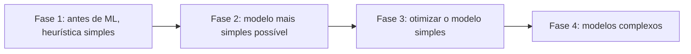

# 6. Desenvolvimento e avaliação offline

> [!NOTE] Em uma frase
> Comece com o modelo mais simples que funciona, registre cada experimento e avalie contra baselines e testes de sanidade antes de confiar em qualquer número.

## Por que isso importa

Uma equipe lê sobre um modelo novo que bateu todos os recordes em um benchmark acadêmico e decide usá-lo para classificar tickets de suporte. Três semanas depois, o modelo está pronto: lento, caro de servir e apenas 1 ponto percentual melhor que uma regressão logística (um modelo linear simples) que um estagiário treinou em uma tarde. Pior, ninguém sabe exatamente com quais dados e hiperparâmetros o modelo de três semanas foi treinado, porque não foi registrado.

Este capítulo é a parte "divertida" de ML, a de treinar modelos, mas com o olhar de produção: como escolher, como não se perder entre dezenas de experimentos, e como saber se um número de avaliação significa alguma coisa antes de colocar o modelo na frente de usuários.

## O que você precisa saber antes

- [Capítulo 5](05-engenharia-de-features.md): features e vazamento de dados.
- [Overfitting](../../glossario.md#overfitting) e [divisão treino / validação / teste](../../glossario.md#dataset-e-divisão-treino--validação--teste).
- [Gradiente e descida do gradiente](../../glossario.md#gradiente-e-descida-do-gradiente): o algoritmo que ajusta os parâmetros do modelo durante o treino.

## As ideias centrais

### Escolher um modelo: seis dicas

Em vez de comparar arquiteturas uma a uma (tarefa sem fim, porque surgem novas toda semana), o livro oferece critérios:

1. **Evite a armadilha do estado da arte.** Um modelo que é o melhor em um benchmark acadêmico não é necessariamente o melhor para os seus dados, sua latência e seu orçamento.
2. **Comece pelo modelo mais simples.** Ele é mais fácil de colocar no ar, o que valida o pipeline inteiro cedo; é mais fácil de depurar; e serve de base de comparação para os complexos.
3. **Evite vieses humanos na comparação.** Quem está animado com uma arquitetura tende a testar mais configurações dela. Compare com o mesmo esforço de ajuste.
4. **Avalie o desempenho agora e depois.** Curvas de aprendizado (desempenho em função da quantidade de dados) mostram se um modelo vai melhorar com mais dados. Um modelo simples pode ganhar hoje e perder quando houver dez vezes mais dados.
5. **Avalie trade-offs.** Falsos positivos versus falsos negativos, precisão versus custo de computação, acurácia versus interpretabilidade.
6. **Entenda as premissas do modelo.** Todo modelo assume algo sobre os dados (por exemplo, que os exemplos são independentes entre si, ou que a relação é linear). Se a premissa não vale, o modelo sofre.

### As quatro fases do desenvolvimento

A autora sugere que a adoção de ML em um problema passa por fases, e pular fases costuma sair caro:

Na fase 1, uma regra como "recomende os itens mais populares" já dá um resultado e um número para bater. Na fase 2, o objetivo é ter um modelo de ponta a ponta no ar, não o melhor modelo. Na fase 3, ajusta-se features, objetivos e hiperparâmetros. Só na fase 4, quando o simples se esgotou, faz sentido partir para modelos grandes.

### Ensembles

Um ensemble combina vários modelos para obter uma previsão melhor que a de qualquer um sozinho, desde que os erros deles não sejam todos iguais. Três técnicas:

- **Bagging**: treina vários modelos em amostras diferentes do dataset (sorteadas com reposição) e faz votação ou média. Reduz variância. A floresta aleatória (random forest) é o exemplo clássico.
- **Boosting**: treina modelos em sequência, cada um dando mais atenção aos exemplos que os anteriores erraram. XGBoost e LightGBM são implementações populares, muito usadas em dados tabulares.
- **Stacking**: treina modelos diferentes e depois um modelo final que aprende a combinar as saídas deles.

Ensembles dominam competições, mas em produção são menos comuns: mais modelos significam mais latência, mais custo e mais coisas para manter.

### Acompanhar e versionar experimentos

Durante o desenvolvimento, você roda dezenas ou centenas de experimentos. Sem registro, é impossível reproduzir o melhor ou entender por que algo piorou. O que vale acompanhar: curvas de loss no treino e na validação, métricas de avaliação, os hiperparâmetros, o uso de memória e CPU/GPU, e, principalmente, a versão exata do código e dos dados. Versionar dados é mais difícil que versionar código, porque são grandes e porque ainda não há consenso sobre o que é um "diff" de dataset.

Depurar modelos também é difícil: eles falham em silêncio, e um bug pode só deixar o modelo um pouco pior. Algumas dicas do livro: comece simples e vá adicionando componentes; tente fazer o modelo decorar um conjunto bem pequeno de dados (se nem isso ele consegue, há bug); e fixe as sementes aleatórias para que resultados sejam reproduzíveis.

### Treinamento distribuído

Quando os dados ou o modelo não cabem em uma máquina, o treino é dividido entre várias. Três estratégias:

- **Paralelismo de dados**: cada máquina tem uma cópia inteira do modelo e treina em uma fatia diferente dos dados; depois, os gradientes são combinados. É a mais comum.
- **Paralelismo de modelo**: o modelo é grande demais para uma máquina, então partes diferentes dele ficam em máquinas diferentes.
- **Paralelismo de pipeline**: uma variação do de modelo que divide o lote de dados em pedaços menores para que as máquinas trabalhem ao mesmo tempo em etapas diferentes, em vez de esperar umas pelas outras.

O capítulo também menciona **AutoML**, a automação de partes do desenvolvimento. A forma mais comum é o ajuste automático de hiperparâmetros (as configurações escolhidas antes do treino, como taxa de aprendizado). Formas mais ambiciosas, como buscar a própria arquitetura da rede, custam muito computação e são usadas principalmente por grandes empresas.

### Avaliação offline

Avaliar offline é medir o modelo antes do deploy, com dados guardados. O primeiro ponto: **uma métrica sozinha não significa nada**. F1 de 0,7 é bom ou ruim? Depende de com o que se compara. Por isso existem os **baselines**:

| Baseline | O que é |
|---|---|
| Aleatório | Prever ao acaso, seguindo a distribuição dos labels |
| Heurística simples | Uma regra, como "ordenar por data" ou "o mais popular" |
| Regra zero | Prever sempre a classe mais comum |
| Humano | Quão bem uma pessoa faz a tarefa |
| Solução existente | O sistema que a empresa já usa hoje |

Além de comparar com baselines, o livro propõe testes que verificam se o modelo se comporta de forma sensata:

- **Perturbação**: adicionar pequeno ruído às entradas e ver se a saída muda muito. Um modelo de voz que funciona com áudio limpo e falha com ruído de fundo vai falhar em produção.
- **Invariância**: mudar algo que não deveria importar e conferir que a saída não muda. Se trocar só a raça ou o gênero de um candidato muda a previsão de contratação, há um problema sério.
- **Expectativa de direção**: mudar algo que deveria mover a saída em um sentido conhecido. Aumentar a área de uma casa não deveria baixar o preço previsto.
- **Calibração**: se o modelo diz "70% de chance", o evento deveria acontecer em cerca de 70% desses casos. Importa quando a probabilidade é usada para decisões, como em anúncios.
- **Medida de confiança**: definir a partir de qual confiança uma previsão é mostrada ao usuário.
- **Avaliação por fatias**: medir o desempenho separadamente por grupos (país, tipo de dispositivo, faixa etária). O desempenho geral pode subir enquanto um grupo importante piora. Isso tem nome em estatística, **paradoxo de Simpson**: uma tendência que aparece em cada grupo pode se inverter quando os grupos são somados.

## Onde isso aparece no mundo real

- **Dados tabulares em empresas** continuam sendo dominados por modelos de boosting de árvores, mesmo com toda a atenção dada a deep learning, o que reforça a dica de começar simples.
- **Competições como Kaggle** são vencidas com frequência por ensembles grandes que nunca iriam para produção como estão, por causa de latência e custo.
- **Avaliação por fatias** é prática corrente em sistemas de reconhecimento de voz e de imagem, depois de casos públicos em que modelos funcionavam bem na média e mal para certos sotaques ou tons de pele.

## Erros comuns de quem está aprendendo

- **Começar pelo modelo mais complexo.** Sem um baseline simples, não há como saber se a complexidade compensou.
- **Relatar uma métrica sem comparação.** Diga sempre contra qual baseline.
- **Confiar na média.** Olhe as fatias que importam para o negócio.
- **Não registrar experimentos.** O melhor modelo da semana passada vira impossível de reproduzir.

## Verifique se entendeu

1. Por que começar pelo modelo mais simples ajuda mesmo quando você sabe que vai precisar de um complexo? (Escolher um modelo)
2. Qual a diferença entre bagging e boosting? (Ensembles)
3. Em que situação o paralelismo de dados não basta? (Treinamento distribuído)
4. Dê um exemplo de teste de invariância e um de expectativa de direção para um modelo de preço de imóveis. (Avaliação offline)
5. Como o desempenho geral pode melhorar enquanto um grupo de usuários piora? (Avaliação por fatias)

## Para ir além

- [Resumo de Cedric Chee](https://cedricchee.com/blog/ml-sys-design-book-summary/): o resumo deste capítulo é um dos mais detalhados do texto, com as técnicas de avaliação listadas.
- [Booklet Machine Learning Systems Design](https://huyenchip.com/machine-learning-systems-design/design-a-machine-learning-system.html): a etapa de modeling traz baselines, depuração e ajuste de hiperparâmetros na versão inicial da autora.
- [resources.md oficial](https://github.com/chiphuyen/dmls-book/blob/main/resources.md): tem uma subseção de leituras sobre treino, depuração e avaliação.

---
Anterior: [5. Engenharia de features](05-engenharia-de-features.md) · Próximo: [7. Deploy e serviço de predição](07-deploy-e-predicao.md) · Voltar ao livro: [Guia de leitura](index.md)
