# 7. Deploy e serviço de predição

> [!NOTE] Em uma frase
> Colocar um modelo no ar é um desafio de engenharia, não de ML: é preciso escolher quando as previsões são calculadas, onde o modelo roda e como deixá-lo rápido o bastante.

## Por que isso importa

Um cientista de dados treina, no notebook, um modelo que recomenda produtos. Funciona. Agora alguém pergunta: quando o usuário abrir o app, de onde vem a recomendação? O modelo roda a cada abertura? Roda uma vez por noite e guarda o resultado? Roda no servidor ou no celular? Se o modelo leva 2 segundos por previsão, o app vai travar? Nenhuma dessas perguntas tem resposta no notebook.

Deploy, aqui, significa tornar o modelo acessível a quem precisa dele: usuários, outros serviços, outros sistemas. O livro reconhece que um deploy "de brinquedo" é fácil (embrulhar o modelo em uma API web e subir em um servidor). O difícil é fazê-lo funcionar para milhões de usuários, com latência de milissegundos, com monitoramento e com atualizações frequentes.

## O que você precisa saber antes

- [Capítulo 3](03-fundamentos-de-engenharia-de-dados.md): batch versus streaming e features estáticas versus dinâmicas.
- [Latência e throughput](../../glossario.md#latência-e-throughput) e [p50, p99](../../glossario.md#p50-p99-percentis-de-latência).
- **Inferência**: o ato de o modelo produzir uma previsão para uma entrada nova, já depois de treinado.

## As ideias centrais

### Quatro mitos sobre deploy

1. **"Você só coloca um ou dois modelos no ar."** Empresas acumulam centenas ou milhares, porque cada país, tarefa ou produto ganha o seu. Um app de transporte pode ter modelos separados de demanda, preço, tempo de chegada, fraude e suporte em cada cidade.
2. **"Se não mexermos no modelo, o desempenho fica igual."** Ele piora com o tempo, porque o mundo muda. Isso é o [capítulo 8](08-mudancas-de-distribuicao-e-monitoramento.md).
3. **"Não vai precisar atualizar muito."** Pelo motivo anterior, atualizar com frequência é uma necessidade. Empresas maduras colocam versões novas no ar várias vezes por dia.
4. **"A maioria dos engenheiros de ML não precisa se preocupar com escala."** Boa parte deles trabalha em empresas médias ou grandes, em que escala é o problema central.

### Predição em batch versus predição online

A decisão central do capítulo é **quando** as previsões são calculadas.

- **Predição em batch** (assíncrona): previsões são calculadas periodicamente para um conjunto de entradas, guardadas, e servidas quando alguém pede. A Netflix pode calcular à noite as recomendações de todos os usuários e só ler da tabela quando você abre o app. Vantagem: latência de leitura baixíssima e aproveitamento eficiente de hardware. Desvantagem: as previsões ficam desatualizadas e são calculadas para gente que nem vai aparecer. E não serve quando as entradas não podem ser conhecidas de antemão, como traduzir um texto que o usuário acabou de digitar.
- **Predição online** (síncrona, sob demanda): a previsão é calculada no momento do pedido. Responde ao contexto atual (o que o usuário acabou de procurar), mas exige que o modelo e as features sejam rápidos.

A predição online tem duas variações. Na primeira, o modelo usa só **features em batch**, pré-calculadas, como o histórico de compras. Na segunda, usa também **features de streaming**, calculadas sobre eventos recentes, como os itens vistos nos últimos minutos. A segunda é a mais poderosa e a mais exigente em infraestrutura.

```mermaid
flowchart TB
    subgraph B["Predição em batch"]
        B1["Dados históricos"] --> B2["Job periódico roda o modelo para todos"]
        B2 --> B3["Tabela de previsões"]
        B3 --> B4["App lê a previsão pronta"]
    end
    subgraph O1["Online com features em batch"]
        O1a["Pedido do usuário"] --> O1b["Busca features pré-calculadas"]
        O1b --> O1c["Modelo prevê na hora"]
    end
    subgraph O2["Online com features de streaming"]
        O2a["Pedido do usuário"] --> O2b["Features pré-calculadas mais eventos recentes"]
        O2b --> O2c["Modelo prevê na hora"]
    end
```

A autora vê a predição em batch como um contorno para quando o modelo é lento demais para responder na hora. Conforme o hardware e as técnicas de otimização evoluem, ela espera que mais sistemas migrem para predição online.

**Unificar pipelines.** Um problema prático: o treino quase sempre usa dados históricos processados em batch, enquanto a predição online precisa calcular features em streaming. Se cada lado tem seu código, as features divergem, o famoso [train-serving skew](../../glossario.md#train-serving-skew). A solução é usar a mesma lógica de cálculo de features nos dois lados, e é um dos motivos de existirem as feature stores.

### Comprimir o modelo

Se o modelo é lento demais, há três caminhos: deixá-lo menor, fazer a inferência rodar mais rápido, ou usar hardware mais rápido. Para deixá-lo menor, o livro descreve quatro técnicas:

- **Fatoração de baixo posto**: substituir matrizes grandes de parâmetros por produtos de matrizes menores que se aproximam do original. Reduz cálculos e parâmetros.
- **Destilação de conhecimento**: treinar um modelo pequeno (aluno) para imitar as saídas de um modelo grande (professor). O DistilBERT é um exemplo conhecido: bem menor e mais rápido que o BERT, com boa parte do desempenho mantida.
- **Poda (pruning)**: remover parâmetros que pouco contribuem, zerando-os ou eliminando partes da rede.
- **Quantização**: guardar os números com menos bits, por exemplo inteiros de 8 bits em vez de números de ponto flutuante de 32. O modelo fica até quatro vezes menor e mais rápido, com alguma perda de precisão. É a técnica mais usada.

### Nuvem versus borda

A outra decisão é **onde** o modelo roda.

- **Na nuvem**: o modelo fica em servidores; o dispositivo manda a entrada pela rede e recebe a resposta. É o mais fácil de montar e atualizar. Custos: rede (latência e dependência de conexão), cobrança de nuvem que cresce com o uso, e dados do usuário saindo do dispositivo.
- **Na borda (edge)**: o modelo roda no próprio dispositivo (celular, carro, câmera, navegador). Funciona sem internet, tem latência menor, não paga servidor por previsão e mantém os dados no aparelho, o que ajuda na privacidade. Exige, porém, que o dispositivo tenha processamento, memória e bateria suficientes, e que o modelo seja compilado para um hardware muito variado.

Para rodar na borda, os frameworks de ML convertem o modelo para uma **representação intermediária** que depois é otimizada para cada tipo de chip. Também é possível rodar modelos no navegador, com tecnologias como WebAssembly, ao custo de desempenho menor.

A aposta da autora para o futuro é a predição **online e no dispositivo**, conforme o hardware de celulares e computadores ganha chips dedicados a ML.

### Do notebook ao serviço

Embora o capítulo não seja um manual de infraestrutura, ele reforça que o modelo em produção é um serviço como outro qualquer: precisa de uma API, de controle de versões, de [SLO](../../glossario.md#slo) de latência e de capacidade de escalar. Por isso a autora diz que deploy é um desafio de engenharia: as habilidades exigidas são as de quem constrói sistemas, não as de quem ajusta modelos.

## Onde isso aparece no mundo real

- **Recomendações noturnas** em serviços de streaming e e-commerce são um exemplo clássico de predição em batch, combinada com ajustes online para reagir ao que o usuário faz durante a sessão.
- **Teclados de celular** que sugerem a próxima palavra rodam modelos na borda, porque a resposta precisa ser instantânea e o texto digitado é privado.
- **Modelos destilados e quantizados** são o padrão para colocar modelos de linguagem em dispositivos pequenos; versões de 8 ou 4 bits de modelos grandes se tornaram comuns.

## Erros comuns de quem está aprendendo

- **Achar que deploy é subir uma API e pronto.** Em escala, envolve versionamento, monitoramento, latência e atualizações frequentes.
- **Escolher predição online sem precisar.** Se as entradas são conhecidas e a previsão pode ficar algumas horas desatualizada, batch é mais simples.
- **Escrever o cálculo de features duas vezes.** Uma para o treino e outra para produção é receita de skew.
- **Avaliar só a métrica do modelo comprimido.** Meça também latência e memória no hardware real de destino.

## Verifique se entendeu

1. Por que predição em batch não serve para tradução de texto digitado pelo usuário? (Predição em batch versus online)
2. Qual a diferença entre predição online com features em batch e com features de streaming? (Predição em batch versus online, diagrama)
3. Explique destilação de conhecimento com as palavras professor e aluno. (Comprimir o modelo)
4. Liste duas vantagens e duas dificuldades de rodar o modelo na borda. (Nuvem versus borda)
5. Por que manter o mesmo código de features no treino e na predição evita problemas? (Unificar pipelines)

## Para ir além

- [summary.md oficial](https://github.com/chiphuyen/dmls-book/blob/main/summary.md): o resumo da autora deste capítulo registra a aposta dela em predição online no dispositivo.
- [Resumo de Cedric Chee](https://cedricchee.com/blog/ml-sys-design-book-summary/): lista os mitos de deploy e as técnicas de compressão em bullets.
- [Booklet Machine Learning Systems Design](https://huyenchip.com/machine-learning-systems-design/design-a-machine-learning-system.html): a etapa de serving apresenta as questões de colocar modelos no ar na versão inicial da autora.

---
Anterior: [6. Desenvolvimento e avaliação offline](06-desenvolvimento-e-avaliacao-offline.md) · Próximo: [8. Mudanças de distribuição e monitoramento](08-mudancas-de-distribuicao-e-monitoramento.md) · Voltar ao livro: [Guia de leitura](index.md)
