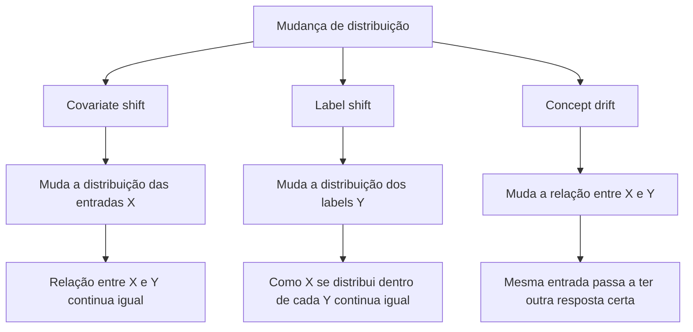

# 8. Mudanças de distribuição e monitoramento

> [!NOTE] Em uma frase
> Modelos não quebram com estrondo: eles pioram em silêncio quando o mundo muda, e só quem monitora as métricas certas percebe a tempo.

## Por que isso importa

Em março de 2020, modelos de previsão de demanda de supermercados no mundo inteiro começaram a errar feio. Papel higiênico, álcool em gel e farinha esgotaram, enquanto produtos de escritório encalharam. Nada no código mudou. O que mudou foi o comportamento das pessoas, e os modelos, treinados em anos de dados "normais", continuaram prevendo um mundo que já não existia.

Esse é um caso extremo do assunto do capítulo: a diferença entre os dados de treino e os dados de produção. Em casos menos dramáticos, a mudança é lenta (gírias novas em um classificador de texto, um concorrente que muda preços) e passa despercebida por meses. A autora considera este um dos capítulos mais difíceis de escrever, porque aqui a pesquisa acadêmica ainda corre atrás do que acontece na indústria.

## O que você precisa saber antes

- [Capítulo 7](07-deploy-e-predicao.md): como o modelo é servido em produção.
- [Data drift](../../glossario.md#data-drift): mudança na distribuição dos dados que o modelo recebe.
- [Train-serving skew](../../glossario.md#train-serving-skew): features calculadas de forma diferente no treino e em produção.
- [Observabilidade](../../glossario.md#observabilidade): entender o sistema a partir do que ele emite.
- **Distribuição**: a descrição de quais valores um dado assume e com que frequência. "Idade dos usuários" tem uma distribuição; se de repente entram muitos adolescentes, ela mudou.

## As ideias centrais

### Dois tipos de falha

O livro separa as falhas em dois grupos:

- **Falhas de sistema de software**, que acontecem em qualquer sistema: dependência que quebrou, deploy errado (subiu a versão antiga do modelo), hardware com defeito, servidor fora do ar. Um estudo citado pela autora sobre falhas de ML no Google indica que a maioria dos problemas era desse tipo, não específica de ML.
- **Falhas específicas de ML**: o sistema está "no ar" e respondendo, mas as respostas estão erradas.

As falhas específicas de ML têm três causas principais.

**1. Dados de produção diferentes dos de treino.** O modelo aprendeu com uma foto do passado. A suposição de que o futuro se parece com essa foto quase nunca vale por muito tempo. Às vezes a diferença existe desde o primeiro dia (dados de treino coletados de um jeito, dados de produção de outro); às vezes surge aos poucos.

**2. Casos extremos (edge cases).** Entradas raras em que o modelo erra de forma catastrófica. Um carro autônomo pode acertar 99,99% das situações e o erro restante ser fatal. Um caso extremo não é o mesmo que um outlier (valor muito diferente dos demais): um outlier pode ser tratado tranquilamente; um caso extremo é aquele em que o modelo vai muito mal.

**3. Ciclos de feedback degenerados.** Acontecem quando as previsões do sistema influenciam os dados com que ele próprio é retreinado. Exemplo: um sistema recomenda músicas; as mais recomendadas são as mais ouvidas; as mais ouvidas viram labels positivos; o modelo passa a recomendá-las ainda mais. Músicas novas nunca têm chance. Isso cria **viés de exposição** e **viés de popularidade**, e torna o sistema homogêneo. Para detectar, meça a diversidade das recomendações e quanto itens pouco populares aparecem. Para corrigir, o livro sugere **aleatorização** (mostrar às vezes itens ao acaso para coletar dados sem viés) e **features de posição** (registrar em que posição o item foi mostrado, porque o primeiro da lista é clicado mais só por estar em primeiro).

### Os tipos de mudança de distribuição

Chame de X as entradas (features) e de Y a saída (label). Treinar um modelo é aprender a relação "dado X, qual o Y", que em estatística se escreve P(Y|X). A autora usa uma decomposição para separar três tipos de mudança:

- **Covariate shift**: a distribuição das entradas muda, mas a relação entre entrada e resposta não. Um modelo de detecção de câncer de mama treinado com dados de um hospital que atende mais pessoas acima de 40 anos e usado em um hospital com público mais jovem. A relação "estas características indicam câncer" continua valendo; só mudou quem chega.
- **Label shift**: a distribuição das respostas muda. Se a doença fica mais comum na população (por um surto, por exemplo), a proporção de positivos muda, mesmo que a aparência dos casos positivos continue igual. Covariate e label shift frequentemente acontecem juntos.
- **Concept drift**: a mesma entrada passa a ter outra resposta certa. Um apartamento de 80 m² em uma certa rua valia R$ 500 mil; um ano depois, por mudança no mercado, as mesmas características valem R$ 400 mil. O "conceito" que o modelo aprendeu ficou velho. Muitos concept drifts são sazonais ou cíclicos, como preços de passagens em feriados.

Há também mudanças mais gerais e mundanas: uma feature passa a vir em outra unidade (idade em meses em vez de anos), um label ganha uma classe nova, ou um bug no pipeline faz uma coluna chegar vazia. Na prática, boa parte do "drift" que aparece nos gráficos é, na verdade, erro humano no pipeline.

A autora avisa que a literatura sobre o tema ainda não tem nomes padronizados; artigos diferentes chamam o mesmo fenômeno de coisas diferentes.

### Detectar mudanças

Se houvesse labels em tempo real, bastaria medir a acurácia. Mas labels costumam demorar (lembre do ciclo de feedback do [capítulo 4](04-dados-de-treino.md)). Por isso, monitora-se a distribuição das entradas e das previsões como sinal antecipado.

- **Estatísticas simples**: comparar média, mediana, mínimo, máximo e variância entre treino e produção. Barato, mas uma mudança pode passar despercebida se essas estatísticas não se moverem.
- **Testes de duas amostras**: testes estatísticos que verificam se duas amostras parecem vir da mesma distribuição. O teste de Kolmogorov-Smirnov (KS) é um exemplo comum para uma variável numérica. Atenção: com dados suficientes, quase toda diferença é "estatisticamente significativa", mesmo quando é pequena demais para importar.
- **Escala de tempo**: a mesma métrica olhada por hora, por dia ou por semana conta histórias diferentes. Uma queda às segundas de manhã pode ser só sazonalidade semanal. Janelas curtas detectam mudanças mais cedo; janelas longas evitam alarme falso.

Para corrigir, a resposta mais comum é **retreinar** com dados recentes, seja do zero, seja ajustando o modelo existente. Isso é o [capítulo 9](09-aprendizado-continuo-e-testes-em-producao.md).

### O que monitorar

Monitoramento é sobre métricas. O livro separa:

- **Métricas operacionais**, comuns a todo software: [latência](../../glossario.md#latência-e-throughput), throughput, uso de CPU e memória, [disponibilidade](../../glossario.md#disponibilidade).
- **Métricas específicas de ML**, em quatro camadas, da mais próxima do negócio à mais próxima do dado bruto:
  1. **Acurácia**: quando há feedback do usuário (clicou, comprou, corrigiu), é o sinal mais direto.
  2. **Previsões**: a distribuição das saídas. Se o modelo de fraude passou de 1% de alertas para 15%, algo mudou.
  3. **Features**: validar se cada feature está dentro do esperado (faixa de valores, formato, taxa de ausentes). Ferramentas como Great Expectations automatizam essas checagens.
  4. **Entradas brutas**: os dados antes de qualquer processamento, mais difíceis de monitorar e muitas vezes fora do controle da equipe de ML.

As ferramentas são **logs**, **dashboards** e **alertas**. Alerta demais causa **fadiga de alerta**: as pessoas deixam de prestar atenção. Cada alerta precisa de uma condição clara, de quem será avisado e do que fazer.

**Monitoramento versus observabilidade**: monitorar é acompanhar métricas definidas de antemão; observabilidade é instrumentar o sistema de forma que, quando algo der errado, seja possível descobrir o quê, inclusive com perguntas que ninguém previu. Em ML, isso inclui conseguir rastrear quais features causaram uma previsão ruim.

## Onde isso aparece no mundo real

- **Pandemia de 2020**: modelos de demanda, de fraude e de crédito precisaram ser revistos em massa, porque o comportamento de consumo mudou de uma semana para outra.
- **Feeds e recomendação** convivem permanentemente com ciclos de feedback; por isso, plataformas reservam parte do tráfego para exploração aleatória.
- **Pipelines de dados quebrados** são a causa mais comum de alertas de drift: mudança de esquema em uma tabela de origem, campo que passou a vir nulo, unidade trocada.

## Erros comuns de quem está aprendendo

- **Achar que toda queda é drift.** Verifique primeiro o pipeline e o deploy; a maioria das falhas é de software comum.
- **Monitorar só métricas operacionais.** O servidor pode estar saudável enquanto o modelo erra.
- **Confiar só em testes estatísticos.** Diferença estatisticamente significativa não é o mesmo que diferença que importa.
- **Criar alertas para tudo.** A fadiga de alerta faz o alerta importante ser ignorado.

## Verifique se entendeu

1. Dê um exemplo de falha de software comum e um de falha específica de ML em um sistema de recomendação. (Dois tipos de falha)
2. Como um ciclo de feedback degenerado prejudica artistas novos em um app de música, e o que pode ser feito? (Dois tipos de falha)
3. Qual a diferença entre covariate shift e concept drift? Dê um exemplo de cada. (Os tipos de mudança)
4. Por que monitorar a distribuição das previsões é útil quando os labels demoram a chegar? (Detectar mudanças; O que monitorar)
5. O que diferencia monitoramento de observabilidade? (O que monitorar)

## Para ir além

- [Nota de aula Data Distribution Shifts and Monitoring](https://huyenchip.com/2022/02/07/data-distribution-shifts-and-monitoring.html): a versão longa e gratuita deste capítulo, escrita pela autora para o curso de Stanford, com os tipos de shift, testes de detecção e monitoramento.
- [summary.md oficial](https://github.com/chiphuyen/dmls-book/blob/main/summary.md): resumo da autora com as três causas de falha específica de ML.
- [resources.md oficial](https://github.com/chiphuyen/dmls-book/blob/main/resources.md): leituras sobre distribution shift e monitoramento indicadas para este capítulo.

---
Anterior: [7. Deploy e serviço de predição](07-deploy-e-predicao.md) · Próximo: [9. Aprendizado contínuo e testes em produção](09-aprendizado-continuo-e-testes-em-producao.md) · Voltar ao livro: [Guia de leitura](index.md)
