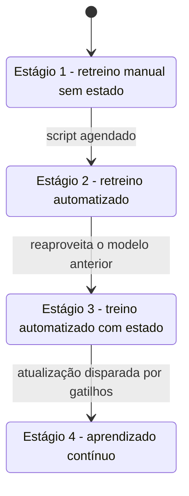

# 9. Aprendizado contínuo e testes em produção

> [!NOTE] Em uma frase
> Se o mundo muda, o modelo precisa mudar junto; aprendizado contínuo é a infraestrutura para atualizá-lo com frequência, e testar em produção é como saber, com segurança, se a atualização ficou melhor.

## Por que isso importa

Em uma Black Friday, uma loja online vê o comportamento dos clientes mudar a cada hora: promoções relâmpago, produtos esgotando, tendências que surgem e somem. O modelo de recomendação foi treinado na semana anterior e continua sugerindo itens que já acabaram e ignorando o que está em alta. Se a loja só consegue retreinar uma vez por mês, perde a data mais importante do ano.

O [capítulo 8](08-mudancas-de-distribuicao-e-monitoramento.md) mostrou como detectar que o modelo piorou. Este capítulo trata da reação: atualizar o modelo de forma rotineira e confiável. E, como uma atualização pode piorar as coisas, trata também de como testar modelos novos com usuários reais sem causar estrago.

## O que você precisa saber antes

- [Capítulo 8](08-mudancas-de-distribuicao-e-monitoramento.md): mudanças de distribuição e monitoramento.
- [Batch vs streaming](../../glossario.md#batch-vs-streaming): processar dados em lotes fechados ou conforme chegam.
- [Stateless e stateful](../../glossario.md#stateless-e-stateful): componentes que não guardam estado e componentes que guardam.

## As ideias centrais

### O que é aprendizado contínuo (e o que não é)

Quando se ouve "aprendizado contínuo", pensa-se em um modelo que se atualiza a cada exemplo que chega. Quase ninguém faz isso: atualizar com um único exemplo deixa o modelo instável e sujeito a esquecer o que sabia (esquecimento catastrófico). Na prática, atualiza-se em **micro-lotes**: a cada 512 ou mil exemplos novos, por exemplo, ou a cada poucas horas.

O ponto central do livro é outro: aprendizado contínuo é sobre ter **infraestrutura** para atualizar modelos com a frequência que for necessária, de forma automatizada e segura. A atualização gera um modelo candidato (o "desafiante"), que só substitui o modelo em produção (o "campeão") se for avaliado como melhor.

Há dois jeitos de atualizar:

- **Retreino sem estado (stateless)**: o modelo é treinado do zero a cada vez, com uma janela de dados, digamos os últimos três meses.
- **Treino com estado (stateful)**: o modelo continua a partir de onde parou, ajustado apenas com os dados novos (fine-tuning, ou ajuste fino). Usa muito menos dados e computação. O livro cita relatos de empresas que reduziram drasticamente o custo de treino com essa abordagem. A contrapartida é que mudanças grandes, como adicionar uma feature nova, ainda pedem um retreino do zero de vez em quando.

### Por que vale a pena

Dois motivos principais. Primeiro, **reagir a mudanças**: o caso da Black Friday, ou de um evento que muda o comportamento de uma região. Segundo, o **problema do início frio** (cold start): quando um usuário novo chega, ou um usuário antigo muda de comportamento, o modelo não tem histórico dele. Um app de vídeos curtos que se adapta em minutos ao que a pessoa está assistindo na primeira sessão retém muito mais usuários do que um que espera o retreino da semana.

### Os desafios

- **Acesso a dados frescos**: se os dados precisam passar por um data warehouse que atualiza uma vez por dia, não há como retreinar de hora em hora. O ideal é ler direto de um transporte em tempo real, como Kafka. E os labels também precisam chegar rápido, o que favorece tarefas com labels naturais e ciclo de feedback curto.
- **Avaliação**: quanto mais vezes se atualiza, mais chances de um modelo ruim ir para produção. E há o risco de ataques coordenados: usuários mal-intencionados podem alimentar o sistema com dados manipulados para envenenar o próximo modelo. Cada atualização precisa ser avaliada antes de ser promovida.
- **Algoritmo**: alguns modelos, como redes neurais, aceitam bem atualizações parciais. Outros, como modelos baseados em matrizes ou árvores, foram pensados para ver o dataset inteiro de uma vez, e atualizá-los aos poucos é mais complicado.

### Os quatro estágios

A autora descreve a evolução típica de uma empresa:

1. **Retreino manual sem estado**: alguém percebe que o modelo piorou e, quando tem tempo, retreina do zero à mão. Comum em equipes que acabaram de colocar o primeiro modelo no ar.
2. **Retreino automatizado**: um script agendado (por exemplo, diário) puxa os dados, treina, avalia e faz o deploy. A dificuldade aqui é saber de quais dados e de quais outros modelos o modelo depende.
3. **Treino automatizado com estado**: o script passa a continuar o modelo anterior em vez de começar do zero. Exige guardar a linhagem dos modelos (de qual versão cada um derivou).
4. **Aprendizado contínuo**: em vez de um horário fixo, a atualização é disparada por gatilhos: tempo, desempenho caindo, volume de dados novos, ou detecção de drift. É o estágio mais maduro e o que exige streaming de verdade.

### Com que frequência atualizar

A resposta honesta é: depende de quanto o modelo ganha com dados frescos. Para descobrir, o livro sugere um experimento: treine o mesmo modelo com dados de janelas diferentes do passado (janeiro a março, fevereiro a abril, e assim por diante) e avalie todos no mês seguinte. Se o modelo treinado com dados de um mês atrás é muito melhor que o treinado com dados de seis meses atrás, frescor importa e vale atualizar mais vezes.

Também há o dilema **iterar no modelo versus iterar nos dados**: com recursos limitados, é melhor gastar tempo tentando uma arquitetura nova ou alimentando o modelo atual com dados mais recentes? Não há resposta universal; o importante é testar as duas hipóteses em vez de assumir.

### Testar em produção

Avaliação offline (capítulo 6) não garante comportamento online. A única forma de saber é testar com tráfego real, de forma controlada. O livro descreve cinco técnicas:

- **Deploy sombra (shadow)**: o modelo novo roda em paralelo, recebe as mesmas requisições, mas suas previsões só são registradas, nunca mostradas ao usuário. Seguro, mas dobra o custo de inferência e não serve para medir como o usuário reage.
- **Teste A/B**: uma parte do tráfego vai para o modelo A, outra para o B, e compara-se uma métrica. A divisão precisa ser realmente aleatória e o teste precisa de amostras suficientes para ter confiança estatística.
- **Canary release**: o modelo novo começa recebendo uma fatia pequena do tráfego (1%, por exemplo); se tudo vai bem, a fatia cresce até 100%. Se algo der errado, o estrago fica contido.
- **Experimentos de intercalação (interleaving)**: em vez de mostrar a cada usuário as recomendações de um só modelo, mostra-se uma lista que mistura itens dos dois e vê-se de qual modelo vêm os itens clicados. A Netflix relatou que essa técnica identifica o melhor modelo com muito menos amostras que um A/B.
- **Bandits**: algoritmos que distribuem o tráfego de forma dinâmica, mandando mais requisições para o modelo que está indo melhor, enquanto ainda exploram os outros. Pense em um cassino com várias máquinas: você joga mais nas que pagam mais, mas de vez em quando testa as outras. Bandits precisam de muito menos dados que A/B para escolher o vencedor, mas exigem predição online, feedback rápido e um mecanismo para lembrar o desempenho de cada modelo. Os **bandits contextuais** aplicam a mesma ideia à escolha de itens para cada usuário, equilibrando mostrar o que ele já gosta com explorar o que ainda não se sabe.

O ponto final do capítulo: testar em produção não é uma ferramenta isolada, é um processo. Cada atualização precisa ter dono, critério de sucesso definido antes, e plano de volta caso dê errado.

## Onde isso aparece no mundo real

- **Apps de vídeo curto** são o exemplo mais citado de adaptação rápida: o feed muda perceptivelmente em uma mesma sessão.
- **Interleaving** foi descrito publicamente pela Netflix como forma de acelerar a comparação entre algoritmos de ranking.
- **Canary releases** são prática comum em engenharia de software em geral, e ML herda a ideia: subir aos poucos e observar.

## Erros comuns de quem está aprendendo

- **Achar que aprendizado contínuo é atualizar a cada exemplo.** Na prática são micro-lotes, e o foco é a infraestrutura.
- **Promover o modelo novo sem avaliar.** Mais frequência sem avaliação é mais chance de piorar a produção.
- **Escolher a frequência de retreino por intuição.** Meça o valor do frescor com o experimento das janelas.
- **Encerrar um A/B cedo porque "já parece melhor".** Sem amostras suficientes, o resultado pode ser ruído.

## Verifique se entendeu

1. Qual a diferença entre retreino sem estado e treino com estado, e por que o segundo é mais barato? (O que é aprendizado contínuo)
2. Por que a infraestrutura de dados limita a frequência de atualização? (Os desafios)
3. O que muda do estágio 3 para o estágio 4? (Os quatro estágios)
4. Descreva o experimento para medir o valor do frescor dos dados. (Com que frequência atualizar)
5. Em que situação um deploy sombra é melhor que um teste A/B, e em qual é pior? (Testar em produção)

## Para ir além

- [summary.md oficial](https://github.com/chiphuyen/dmls-book/blob/main/summary.md): resumo da autora com os quatro estágios e a lista de soluções de streaming que ela cita.
- [resources.md oficial](https://github.com/chiphuyen/dmls-book/blob/main/resources.md): tem uma subseção sobre contextual bandits para aprofundar a parte de testes em produção.
- [Booklet Machine Learning Systems Design](https://huyenchip.com/machine-learning-systems-design/design-a-machine-learning-system.html): a etapa de serving aborda experimentos em produção e treino online na versão inicial da autora.

---
Anterior: [8. Mudanças de distribuição e monitoramento](08-mudancas-de-distribuicao-e-monitoramento.md) · Próximo: [10. Infraestrutura e ferramentas](10-infraestrutura-e-ferramentas.md) · Voltar ao livro: [Guia de leitura](index.md)
