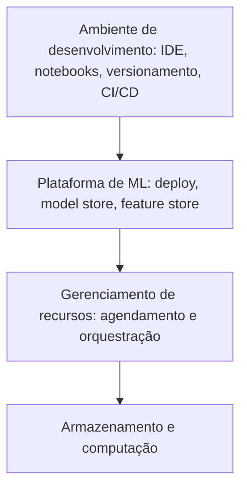

# 10. Infraestrutura e ferramentas para MLOps

> [!NOTE] Em uma frase
> Colocar e manter modelos em produção é, no fundo, um problema de infraestrutura: com as ferramentas certas, um cientista de dados entrega sozinho o que sem elas exigiria uma equipe inteira.

## Por que isso importa

Em uma empresa sem infraestrutura de ML, colocar um modelo no ar funciona assim: o cientista de dados treina no próprio notebook, manda o arquivo do modelo por chat para um engenheiro, que reescreve o pré-processamento em outra linguagem, sobe um servidor à mão e esquece de configurar o monitoramento. Três meses depois, ninguém sabe qual versão está rodando nem como reproduzi-la. Em uma empresa com boa infraestrutura, o mesmo cientista roda um comando, o modelo vai para um registro com versão, sobe em um ambiente padronizado e aparece em um painel de monitoramento.

MLOps é o nome do conjunto de práticas e ferramentas para colocar e manter modelos em produção de forma confiável. Este capítulo descreve as camadas de infraestrutura que tornam isso possível. A autora reconhece que a quantidade certa de infraestrutura depende do tamanho da empresa: quem tem um modelo simples não precisa de uma plataforma; quem tem centenas, precisa.

## O que você precisa saber antes

- [Capítulo 9](09-aprendizado-continuo-e-testes-em-producao.md): aprendizado contínuo, que depende muito de infraestrutura.
- [Pipeline](../../glossario.md#pipeline): etapas encadeadas, que aqui viram fluxos de trabalho agendados.
- [Train-serving skew](../../glossario.md#train-serving-skew): o problema que a feature store ataca.
- **Container**: um pacote que leva o programa junto com tudo de que ele depende (bibliotecas, versões, configurações), para rodar igual em qualquer máquina. Docker é a ferramenta mais conhecida.

## As ideias centrais

### As quatro camadas

O livro organiza a infraestrutura de ML em camadas, da mais básica à mais específica:

### Armazenamento e computação

É a base: onde os dados ficam e onde os cálculos rodam. Armazenamento pode ser um disco, um banco ou armazenamento de objetos na nuvem como S3. Computação são as CPUs, GPUs e memória.

Essa camada virou commodity (produto padronizado e intercambiável): a maioria das empresas aluga da nuvem, pagando pelo que usa, em vez de montar data centers. A nuvem facilita começar e permite escalar para cima e para baixo de forma elástica. Mas o livro lembra que, conforme a empresa cresce, a conta da nuvem pode se tornar proibitiva, e algumas grandes empresas passaram a considerar a **repatriação**: voltar parte da infraestrutura para data centers próprios.

Ao avaliar computação para ML, duas medidas aparecem: quanta memória há (o modelo e os dados precisam caber) e quantas operações por segundo o hardware faz (FLOPS, operações de ponto flutuante por segundo). O número anunciado de FLOPS raramente é atingido na prática; o que importa é a utilização real.

### Ambiente de desenvolvimento

É onde cientistas de dados e engenheiros de ML passam a maior parte do tempo: o editor de código (IDE), notebooks, versionamento, e a integração e entrega contínuas (CI/CD, a automação que testa e publica código a cada mudança). Por ser onde se passa mais tempo, é onde melhorias rendem mais produtividade.

Sobre **notebooks** (como Jupyter, em que código, resultados e gráficos ficam juntos em células), o livro é equilibrado: são ótimos para explorar dados e visualizar resultados, mas ruins para código de produção, porque as células podem ser executadas fora de ordem e o resultado fica difícil de reproduzir. Há ferramentas que tentam domar isso, parametrizando e executando notebooks de ponta a ponta.

A recomendação mais forte é **padronizar o ambiente**: todos da equipe com as mesmas versões de bibliotecas e ferramentas, de preferência em ambientes na nuvem. Isso elimina o clássico "na minha máquina funciona". E o ambiente de desenvolvimento deve se parecer ao máximo com o de produção, o que leva aos **containers**: o mesmo container que roda na máquina do cientista roda no servidor. Para gerenciar muitos containers, usa-se um orquestrador como Kubernetes, que decide em quais máquinas cada container roda e o reinicia quando falha.

### Gerenciamento de recursos

Fluxos de ML têm duas características: são **repetitivos** (o mesmo treino roda todo dia) e têm **dependências** (o treino só começa quando os dados estão prontos). Gerenciar recursos é decidir o que roda, quando e onde.

O livro traça uma evolução:

- **Cron**: o agendador clássico do Unix, que roda um script em horários fixos. Não sabe nada de dependências: se a etapa anterior falhou, a próxima roda mesmo assim.
- **Agendadores (schedulers)**: entendem dependências entre tarefas, organizadas em um grafo acíclico dirigido (DAG, um fluxograma sem voltas, em que cada tarefa espera as anteriores). Sabem tentar de novo quando algo falha.
- **Orquestradores**: cuidam de **onde** rodar, alocando máquinas e recursos. O Kubernetes é o exemplo central.

Sobre essas camadas ficam as **ferramentas de gerenciamento de fluxo de trabalho**, específicas para pipelines de dados e ML. O livro compara algumas:

| Ferramenta | Característica |
|---|---|
| Airflow | Pioneira e muito usada; fluxos definidos em Python, mas com limitações, como dificuldade de usar containers diferentes por etapa e DAGs estáticos |
| Prefect | Fluxos parametrizáveis e dinâmicos, criada como resposta às limitações do Airflow |
| Argo | Nativa de Kubernetes, cada etapa em um container; fluxos descritos em YAML |
| Kubeflow e Metaflow | Pensadas para cientistas de dados: o mesmo código roda no notebook e na produção, abstraindo a infraestrutura |

Há um debate de fundo: cientistas de dados devem precisar entender Kubernetes? A autora tende a achar que não, e que boas ferramentas devem esconder essa complexidade.

### Plataforma de ML

Quando uma empresa tem muitos modelos, equipes diferentes acabam resolvendo os mesmos problemas de formas diferentes. Uma **plataforma de ML** é um conjunto de ferramentas compartilhadas para isso, geralmente mantido por uma equipe própria. Como o conceito é recente, não há consenso sobre o que ela inclui; o livro foca em três componentes:

- **Serviço de deploy**: empacota o modelo e suas dependências e coloca no ar, de preferência com suporte a testes em produção (sombra, canary, A/B). A maioria dos provedores de nuvem oferece algo assim.
- **Model store** (registro de modelos): guardar só o arquivo do modelo não basta. Para depurar e reproduzir, é preciso guardar junto a definição do modelo, os parâmetros, as funções de pré e pós-processamento, o código e os dados de treino usados, os resultados de experimentos e a linhagem. Quando um modelo em produção se comporta mal, é aqui que se descobre de onde ele veio.
- **Feature store**: resolve três problemas. **Gerenciamento**: equipes diferentes descobrem e reaproveitam features em vez de recriá-las. **Computação**: features caras são calculadas uma vez e guardadas. **Consistência**: a mesma definição de feature é usada no treino e na produção, evitando o train-serving skew. Feast é um exemplo de projeto aberto.

### Construir ou comprar

A pergunta que acompanha toda decisão de infraestrutura. O livro sugere considerar:

- **Em que estágio a empresa está**: no começo, comprar soluções prontas acelera; com escala, as necessidades ficam específicas e construir pode compensar.
- **O que é vantagem competitiva**: construa o que diferencia o seu negócio; compre o que é igual para todos.
- **Maturidade das ferramentas disponíveis**: se o que existe no mercado não atende, não há escolha.

Comprar também tem custos escondidos: integração, dependência de fornecedor e perda de controle. Construir tem o custo de manter para sempre.

## Onde isso aparece no mundo real

- **Plataformas internas**: grandes empresas de tecnologia descreveram publicamente suas plataformas de ML, como o Michelangelo da Uber, justamente para padronizar treino, deploy e features entre dezenas de equipes.
- **Airflow** se tornou padrão de fato para pipelines de dados em muitas empresas, e por isso é comum ver treinos de ML agendados nele, mesmo com suas limitações.
- **Feature stores** apareceram quando empresas perceberam que a mesma feature ("compras nos últimos 7 dias") estava sendo calculada de formas diferentes por equipes diferentes.

## Erros comuns de quem está aprendendo

- **Montar uma plataforma antes de ter modelos.** A infraestrutura deve acompanhar a necessidade; uma equipe com um modelo não precisa de feature store.
- **Usar notebook como código de produção.** Notebook é para explorar; produção pede código versionado, testado e reprodutível.
- **Achar que cron resolve tudo.** Sem gestão de dependências e de falhas, um passo quebrado contamina os seguintes.
- **Guardar só o arquivo do modelo.** Sem código, dados e parâmetros associados, não há como reproduzir nem depurar.

## Verifique se entendeu

1. Por que a nuvem é boa para começar e pode ficar ruim com escala? (Armazenamento e computação)
2. Que problema a padronização do ambiente de desenvolvimento resolve, e como containers ajudam? (Ambiente de desenvolvimento)
3. Qual a diferença entre cron, agendador e orquestrador? (Gerenciamento de recursos)
4. Cite os três problemas que uma feature store resolve. (Plataforma de ML)
5. Dê um exemplo de componente que você compraria e de um que construiria, justificando. (Construir ou comprar)

## Para ir além

- [Resumo de Cedric Chee](https://cedricchee.com/blog/ml-sys-design-book-summary/): o resumo deste capítulo é um dos mais detalhados do texto, cobrindo as camadas e as ferramentas.
- [MLOps guide da autora](https://huyenchip.com/mlops/): trilha de estudo de MLOps da própria autora, com leituras organizadas por tema.
- [summary.md oficial](https://github.com/chiphuyen/dmls-book/blob/main/summary.md): o repositório também tem o arquivo mlops-tools.md, que complementa este capítulo com uma lista de ferramentas.

---
Anterior: [9. Aprendizado contínuo e testes em produção](09-aprendizado-continuo-e-testes-em-producao.md) · Próximo: [11. O lado humano de ML](11-o-lado-humano-de-ml.md) · Voltar ao livro: [Guia de leitura](index.md)
