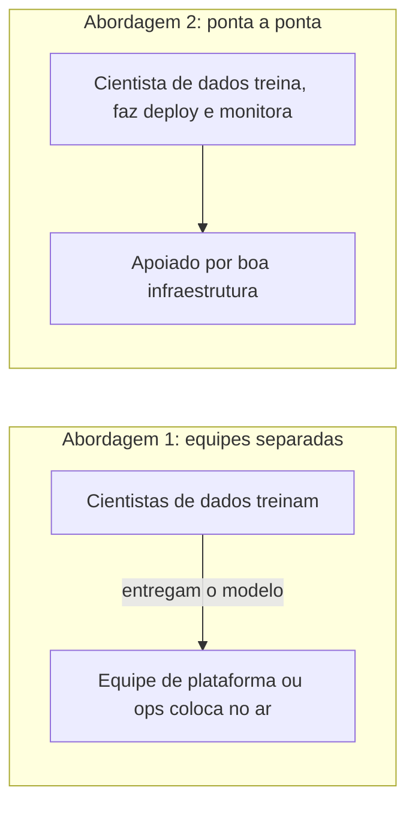

# 11. O lado humano de ML

> [!NOTE] Em uma frase
> Sistemas de ML são feitos por pessoas, usados por pessoas e afetam pessoas, então decisões de experiência do usuário, de organização de equipes e de ética fazem parte do design, não são um apêndice.

## Por que isso importa

Em 2020, com as provas finais do ensino médio canceladas pela pandemia, o órgão regulador de exames do Reino Unido usou um algoritmo para atribuir as notas dos A-levels, os exames que decidem a entrada na universidade. O algoritmo combinava a avaliação dos professores com o desempenho histórico de cada escola. O resultado: alunos excelentes de escolas com histórico fraco tiveram notas rebaixadas, enquanto escolas particulares pequenas foram favorecidas. Houve protestos, e o governo acabou descartando as notas do algoritmo.

O modelo não tinha um bug no sentido técnico. O problema estava nas escolhas: o que otimizar, quais dados usar, quem seria afetado e como contestar. Este capítulo sai da parte técnica dos oito capítulos anteriores e trata de três assuntos humanos: a experiência de quem usa o sistema, a organização de quem o constrói, e a responsabilidade sobre quem é afetado por ele. A autora considera a última parte o tema mais importante do livro.

## O que você precisa saber antes

- [Capítulo 1](01-visao-geral-de-sistemas-de-ml.md): justiça e interpretabilidade como diferenças entre ML em pesquisa e em produção.
- [Capítulo 6](06-desenvolvimento-e-avaliacao-offline.md): avaliação por fatias, que é uma das ferramentas da IA responsável.
- [Capítulo 10](10-infraestrutura-e-ferramentas.md): a infraestrutura que permite a um cientista de dados cuidar de um sistema de ponta a ponta.

## As ideias centrais

### Experiência do usuário

Sistemas de ML se comportam de modo diferente de software tradicional em três aspectos, e cada um afeta quem usa:

- **São probabilísticos**: a mesma entrada pode gerar saídas diferentes em momentos diferentes (porque o modelo foi atualizado, ou porque o contexto mudou).
- **Estão "quase sempre" certos**: nunca 100%, e não se sabe de antemão quando vão errar.
- **Podem ser lentos**: inferência às vezes demora mais do que o usuário tolera.

O livro propõe respostas para cada um.

**Consistência.** Um usuário vê a opção "filtro de hotéis com café da manhã" sugerida no topo, sai da página, volta, e a sugestão sumiu, porque o modelo recalculou. Isso frustra mais que ajuda. A solução não é deixar de personalizar, mas decidir **quando** a consistência importa mais que a precisão. Uma regra possível: manter as sugestões fixas durante uma sessão e só atualizá-las quando o usuário fizer algo que indique mudança de intenção.

**Previsões quase certas.** Um modelo que gera código ou layouts a partir de uma descrição raramente acerta tudo de primeira. Se o usuário não consegue corrigir a saída com facilidade, o sistema é inútil para ele. Uma estratégia é mostrar **várias sugestões** em vez de uma, aumentando a chance de uma estar certa, e permitir edição. Isso também gera dados valiosos: a sugestão escolhida vira feedback para o modelo.

**Falha suave.** Se um modelo às vezes demora demais, pode-se ter um **modelo reserva**, mais simples e rápido, ou uma heurística, para quando o principal não responder dentro do prazo. Um sistema que decide, para cada pedido, se vale esperar o modelo grande ou responder com o pequeno, troca um pouco de precisão por uma experiência estável.

### Equipes: especialistas e cientistas de dados de ponta a ponta

**Especialistas do domínio.** Médicos, advogados, analistas de crédito conhecem o problema melhor que qualquer engenheiro, mas costumam participar só da etapa de rotular dados. O livro defende envolvê-los no ciclo inteiro: na formulação do problema, na engenharia de features, na análise de erros e na avaliação. Para isso, é preciso dar a eles ferramentas que não exijam programar.

**Quem cuida de produção?** O livro compara duas organizações:

- **Equipes separadas**: os cientistas de dados desenvolvem, e uma equipe de engenharia ou operações coloca e mantém em produção. Vantagem: cada um faz o que sabe. Desvantagens: custo de comunicação e coordenação; dificuldade de depurar, porque quem conhece o modelo não conhece a produção e vice-versa; jogo de empurra quando algo dá errado; e uma visão estreita de cada lado sobre o sistema.
- **Cientistas de dados donos de todo o processo**: a mesma pessoa ou equipe desenvolve, coloca no ar e monitora. Vantagem: menos atrito e mais responsabilidade. Desvantagem: é difícil contratar quem saiba tudo isso, e muitos cientistas de dados não querem gastar o tempo configurando infraestrutura.

A conclusão da autora é que a segunda abordagem só funciona se houver **ferramentas e infraestrutura boas** que escondam a complexidade, exatamente o assunto do capítulo 10. Com elas, um cientista de dados consegue cuidar do ciclo inteiro sem precisar virar especialista em Kubernetes.

### IA responsável

IA responsável é a prática de projetar, desenvolver e colocar em produção sistemas de ML considerando justiça, privacidade, transparência e responsabilidade sobre os efeitos. A autora insiste que isso não é abstração filosófica: é prática de engenharia, e falhar nela custa confiança, dinheiro e, às vezes, vidas.

O livro usa dois estudos de caso. O primeiro é o das notas dos A-levels, já descrito. Lições tiradas: o objetivo escolhido (manter a distribuição de notas parecida com a dos anos anteriores) não era o que importava para os alunos (notas justas individualmente); não houve avaliação por fatias para ver o impacto em grupos diferentes, como alunos de escolas públicas; e faltou transparência e um caminho fácil para contestar.

O segundo é o do aplicativo de corrida Strava, que publicou em 2018 um mapa de calor com as atividades agregadas de seus usuários. Os dados eram "anonimizados", mas em regiões remotas os únicos usuários eram soldados, e o mapa revelou a localização e as rotinas de bases militares. Lição: dados anonimizados podem não ser anônimos quando combinados com contexto, e configurações de privacidade que exigem que o usuário saia ativamente (opt-out) transferem a responsabilidade para quem menos entende o risco.

A partir disso, o livro propõe um conjunto de práticas:

1. **Descobrir as fontes de viés do modelo**: viés pode entrar nos dados de treino, nos labels, nas features, na função objetivo e na avaliação.
2. **Entender as limitações de uma abordagem baseada em dados**: o modelo só reflete os dados que viu; envolver pessoas que conhecem o contexto afetado ajuda a ver o que os dados não mostram.
3. **Entender os trade-offs entre objetivos**: técnicas de privacidade (como privacidade diferencial, que adiciona ruído para proteger indivíduos) podem reduzir a precisão, e de forma desigual entre grupos; técnicas de compressão de modelos podem afetar mais os grupos sub-representados.
4. **Agir cedo**: quanto antes um problema ético é considerado, mais barato é corrigi-lo.
5. **Criar model cards**: documentos curtos que acompanham o modelo dizendo para que ele serve, com quais dados foi treinado, como foi avaliado, em quais grupos funciona pior e quais são os usos não recomendados.
6. **Estabelecer processos para mitigar vieses**: revisões, ferramentas e responsáveis definidos, não só boa vontade.
7. **Manter-se atualizado**: a área evolui rápido, em pesquisa e em regulação.

O fechamento da autora é um alerta: um framework como esse ajuda a cumprir requisitos de conformidade, mas não substitui a pergunta anterior, se o produto deveria ser construído.

## Onde isso aparece no mundo real

- **Notas dos A-levels de 2020** e **mapa de calor do Strava** são os dois casos centrais do capítulo e foram amplamente noticiados.
- **Sugestões múltiplas** são o padrão em ferramentas de autocompletar código e texto, que mostram alternativas e deixam o usuário escolher e editar.
- **Model cards** foram propostos em um artigo de pesquisadores do Google em 2019 e hoje são publicados junto com muitos modelos abertos.

## Erros comuns de quem está aprendendo

- **Achar que viés é só problema de dados.** Ele também entra pela função objetivo, pelas features e pela forma de avaliar.
- **Confiar que dados anonimizados são anônimos.** Combinados com contexto, muitas vezes não são.
- **Tratar IA responsável como checklist de conformidade.** O checklist não responde se o sistema deveria existir.
- **Otimizar só a precisão, esquecendo a experiência.** Um modelo um pouco menos preciso, mas consistente e corrigível, pode ser muito mais útil.

## Verifique se entendeu

1. Por que uma recomendação que muda a cada visita pode piorar a experiência, e como mitigar? (Experiência do usuário)
2. Quais as desvantagens de separar quem desenvolve o modelo de quem o coloca em produção? (Equipes)
3. Que condição torna viável o cientista de dados de ponta a ponta? (Equipes)
4. Que lição sobre anonimização o caso do Strava ensina? (IA responsável)
5. O que vai em um model card e para quem ele serve? (IA responsável)

## Para ir além

- [summary.md oficial](https://github.com/chiphuyen/dmls-book/blob/main/summary.md): o resumo da autora deste capítulo deixa claro por que ela considera IA responsável o tema mais importante do livro.
- [resources.md oficial](https://github.com/chiphuyen/dmls-book/blob/main/resources.md): leituras complementares sobre experiência do usuário, organização de equipes e IA responsável.
- [MLOps guide da autora](https://huyenchip.com/mlops/): inclui uma parte sobre carreira e organização de equipes de ML.

---
Anterior: [10. Infraestrutura e ferramentas para MLOps](10-infraestrutura-e-ferramentas.md) · Voltar ao livro: [Guia de leitura](index.md)
