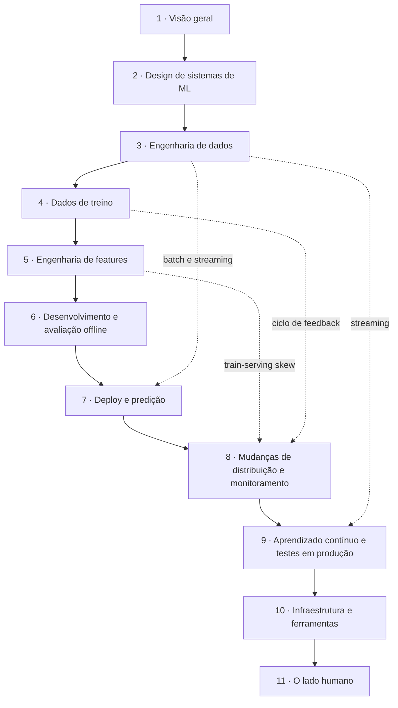

# Designing Machine Learning Systems — guia de leitura

> [!NOTE] Em uma frase
> O modelo é a menor parte de um sistema de ML; o livro trata do resto: dados, features, deploy, monitoramento e as pessoas que mantêm tudo isso funcionando.

## Para quem é e quando ler

*Designing Machine Learning Systems* (Chip Huyen, O'Reilly, 2022) nasceu do curso de Stanford CS 329S e é escrito para quem precisa levar machine learning (ML, programas que aprendem comportamento a partir de exemplos) para produção: engenheiros de software que começam a trabalhar com modelos, cientistas de dados que querem entender o que acontece depois do notebook, e líderes técnicos que precisam decidir se e como investir em ML.

Leia quando você já sabe, em linhas gerais, o que é treinar um modelo, mas ainda não sabe responder perguntas como "de onde vêm as features em produção?", "por que o modelo piorou se ninguém mexeu nele?" ou "com que frequência retreinar?". Não é preciso ter experiência prática com ML: este guia define cada termo na primeira vez e linka o [glossário](../../glossario.md).

## O que o livro NÃO é

- **Não é um livro de algoritmos.** Não ensina como funciona uma rede neural nem deriva fórmulas. Para isso, veja o guia de [Deep Learning](../deep-learning/index.md).
- **Não é um tutorial de ferramenta.** Cita Kafka, Airflow, Kubernetes e outras, mas para ilustrar conceitos, não para ensinar a configurá-las. As ferramentas mudam; os problemas descritos continuam.
- **Não é sobre modelos de linguagem grandes.** Foi escrito antes da onda de LLMs. Quase tudo vale para eles, mas o livro não trata de prompts, RAG ou agentes.

## Como o livro está organizado

Os capítulos seguem o ciclo de vida de um sistema de ML: decidir o que construir, preparar os dados, desenvolver o modelo, colocá-lo no ar, mantê-lo funcionando, e a infraestrutura e as pessoas por trás de tudo.

- **Fundamentos (1–2)**: quando usar ML, requisitos e como formular um problema.
- **Dados (3–5)**: engenharia de dados, dados de treino e features.
- **Modelo (6)**: escolha, treino e avaliação offline.
- **Produção (7–9)**: deploy, monitoramento e atualização contínua.
- **Organização (10–11)**: infraestrutura, equipes e IA responsável.

## Como ler

- **Primeira leitura**: capítulos 1, 2, 5, 7, 8 e 9, nesta ordem. Eles carregam a tese do livro: o que muda quando ML sai do notebook.
- **Pode deixar para depois**: o capítulo 3 se você já conhece bancos e filas (ele cobre o básico de engenharia de dados), e a parte de treino distribuído do capítulo 6, que só importa quando os modelos não cabem em uma máquina.
- **Ritmo**: um capítulo por semana funciona bem. Ao terminar cada um, tente aplicar a um sistema que você conhece: onde estão os labels, como as features são calculadas, quem perceberia se o modelo piorasse.
- **Ponte com outros livros do guia**: o capítulo 3 conversa com DDIA (formatos, bancos, batch e streaming); os capítulos 7 a 10 conversam com o que se sabe de operação de software em geral.

## O que você leva ao terminar

- Um critério para decidir quando ML é a ferramenta certa e quando uma regra basta.
- O hábito de ligar toda métrica de modelo a uma métrica de negócio.
- Reconhecer e evitar vazamento de dados e train-serving skew, os dois erros mais caros e mais silenciosos.
- Saber escolher entre predição em batch e online, e entre rodar na nuvem ou no dispositivo.
- Entender por que modelos pioram em produção e o que monitorar para perceber.
- Um mapa da infraestrutura de MLOps e das decisões de construir ou comprar.
- Vocabulário para discutir experiência do usuário, organização de equipes e IA responsável.

## Capítulos

1. [Visão geral de sistemas de ML](01-visao-geral-de-sistemas-de-ml.md): quando usar ML e por que produção é diferente de pesquisa e de software tradicional.
2. [Introdução ao design de sistemas de ML](02-introducao-ao-design-de-sistemas-de-ml.md): de objetivo de negócio a problema de ML, os quatro requisitos e o ciclo iterativo.
3. [Fundamentos de engenharia de dados](03-fundamentos-de-engenharia-de-dados.md): fontes, formatos, modelos de dados, fluxo entre processos e batch versus streaming.
4. [Dados de treino](04-dados-de-treino.md): amostragem, labels, desbalanceamento de classes e aumento de dados.
5. [Engenharia de features](05-engenharia-de-features.md): operações comuns, vazamento de dados e como escolher features.
6. [Desenvolvimento e avaliação offline](06-desenvolvimento-e-avaliacao-offline.md): escolher modelos, ensembles, experimentos, treino distribuído e baselines.
7. [Deploy e serviço de predição](07-deploy-e-predicao.md): predição em batch e online, compressão de modelos e nuvem versus borda.
8. [Mudanças de distribuição e monitoramento](08-mudancas-de-distribuicao-e-monitoramento.md): por que modelos pioram, os tipos de shift e o que monitorar.
9. [Aprendizado contínuo e testes em produção](09-aprendizado-continuo-e-testes-em-producao.md): atualizar modelos com frequência e testá-los com tráfego real.
10. [Infraestrutura e ferramentas para MLOps](10-infraestrutura-e-ferramentas.md): as camadas de infraestrutura, a plataforma de ML e construir versus comprar.
11. [O lado humano de ML](11-o-lado-humano-de-ml.md): experiência do usuário, organização de equipes e IA responsável.

## Fontes públicas para acompanhar

Os links verificados (resumos oficiais da autora, notas de aula, resumos de terceiros) estão em [fontes públicas](fontes.md).
