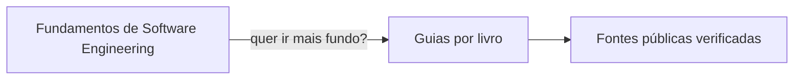

# Guia Teórico de Software Engineering

> [!IMPORTANT] Comece por aqui
> **[Fundamentos de Software Engineering](fundamentos/index.md)** é um percurso único em 11 módulos, do código bem organizado até machine learning em produção. Foi escrito para ser lido do começo ao fim, sem precisar de nenhum livro.

## Para quem é

Para quem já programa, mesmo que pouco, e sente que falta a teoria por trás: por que sistemas caem quando crescem, por que código vira bagunça, o que de fato acontece quando se "treina um modelo". Cada termo técnico é definido na primeira vez em que aparece e reunido no [glossário](glossario.md).

## O que tem aqui

**1. [Fundamentos de Software Engineering](fundamentos/index.md).** O guia principal. Onze módulos em três partes: código e arquitetura, dados e escala, inteligência artificial. Cada módulo se sustenta sozinho e termina indicando onde aprofundar.

**2. Guias por livro.** Para quem quer ir além de um módulo, há um guia de leitura de cada livro, com o essencial de cada capítulo explicado sem jargão. Nenhum é obrigatório.

| Área | Livros |
|---|---|
| [Arquitetura de Software](arquitetura/index.md) | [Clean Architecture](arquitetura/clean-architecture/index.md) · [Domain-Driven Design](arquitetura/ddd/index.md) · [Fundamentals of Software Architecture](arquitetura/fundamentals-software-architecture/index.md) |
| [System Design](system-design/index.md) | [Designing Data-Intensive Applications](system-design/ddia/index.md) · [System Design Interview](system-design/system-design-interview/index.md) |
| [Inteligência Artificial](ia/index.md) | [Deep Learning](ia/deep-learning/index.md) · [Designing Machine Learning Systems](ia/designing-ml-systems/index.md) |

**3. [Fontes públicas](referencias/fontes-completas.md).** Os links que sustentam o guia, cada um aberto e verificado: resumos de terceiros, material oficial gratuito e artigos que aprofundam.

## Dois jeitos de ler

No **site**, você tem busca, grafo de notas e modo escuro. No **GitHub**, cada página é um arquivo markdown que renderiza no próprio repositório, inclusive os diagramas. O conteúdo é o mesmo.

## Licença

Conteúdo sob CC BY-SA 4.0. Pode copiar e adaptar, citando a origem e mantendo a licença. Este guia explica e orienta; ele não substitui nem reproduz os livros.
