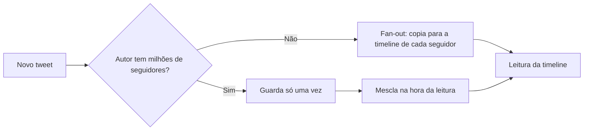

# 1. Aplicações confiáveis, escaláveis e sustentáveis

> [!NOTE] Em uma frase
> Antes de escolher banco, fila ou cache, é preciso saber o que "funcionar bem" quer dizer: continuar certo quando algo quebra, continuar rápido quando o uso cresce e continuar fácil de mudar quando a equipe e o produto mudam.

## Por que isso importa

Imagine um app de entregas que começou com um servidor e um PostgreSQL. No primeiro ano tudo vai bem. No segundo, o número de pedidos multiplica por dez, o painel do restaurante fica lento na hora do almoço, um disco falha numa sexta à noite e metade da equipe original já saiu. Nenhum desses problemas é "um bug": são propriedades do sistema inteiro que ninguém definiu no começo.

A maior parte das aplicações modernas é **intensiva em dados**, e não em CPU: o gargalo não é calcular, é guardar, buscar, mover e manter coerente uma quantidade grande e variável de dados. Quem constrói esse tipo de sistema raramente escreve um banco do zero. Junta peças prontas (banco, [cache](../../glossario.md#cache), índice de busca, [fila](../../glossario.md#fila-e-mensageria), processamento em lote) e, ao juntar, vira projetista de um sistema de dados novo. Este capítulo dá o vocabulário para avaliar esse sistema: confiabilidade, escalabilidade e manutenibilidade.

## O que você precisa saber antes

- Nada além de já ter usado um banco de dados em uma aplicação web (fazer `SELECT` e `INSERT`).
- [Latência e throughput](../../glossario.md#latência-e-throughput): latência é quanto uma requisição demora; throughput é quantas o sistema atende por segundo.
- [Disponibilidade](../../glossario.md#disponibilidade): fração do tempo em que o sistema responde corretamente.

## As ideias centrais

### Confiabilidade: continuar certo quando algo dá errado

Um sistema é **confiável** quando continua fazendo o que o usuário espera mesmo diante de problemas. O livro separa dois termos que no dia a dia viram sinônimos:

- **Falha de componente** (*fault*): uma peça se desvia do esperado. Um disco morre, um processo trava, um operador roda o comando no servidor errado.
- **Falha do sistema** (*failure*): o sistema como um todo deixa de servir o usuário.

O objetivo não é zerar as falhas de componente, que é impossível, e sim impedir que elas virem falhas do sistema. Isso é **tolerância a falhas**. Algumas empresas chegam a provocar falhas de propósito em produção (a Netflix ficou conhecida pelo Chaos Monkey, que derruba máquinas aleatoriamente) para garantir que o mecanismo de tolerância é exercitado de verdade, e não só no papel.

As falhas vêm de três fontes:

1. **Hardware.** Discos, memória, energia, rede. Em um cluster com 10 mil discos, algum disco morre todo dia. A resposta clássica é redundância (RAID, fontes duplas); a resposta moderna é software que tolera a perda de máquinas inteiras, o que também permite reiniciar uma máquina por vez para aplicar atualizações.
2. **Erros de software.** Mais perigosos porque são correlacionados: o mesmo bug existe em todas as máquinas e dispara ao mesmo tempo. Exemplo real: o segundo bissexto de 30 de junho de 2012 travou servidores Linux em vários lugares de uma vez por causa de um bug no kernel. Não há cura simples; ajudam testes, isolamento de processos, deixar processos caírem e reiniciarem, e monitorar o sistema em produção.
3. **Erros humanos.** Estudos de grandes serviços mostram que erros de configuração feitos por operadores causam mais indisponibilidade que hardware. A defesa é projetar para errar menos e errar barato: interfaces que dificultam o erro, ambientes de teste parecidos com produção, rollback rápido, liberação gradual e [observabilidade](../../glossario.md#observabilidade) (logs, métricas e traces que deixam ver o que está acontecendo).

### Escalabilidade: descrever carga antes de falar em "escalar"

Dizer "o sistema é escalável" não significa nada sozinho. A pergunta útil é: **se a carga crescer de tal jeito, quais são nossas opções para lidar com isso?** Para responder, primeiro se descreve a carga com **parâmetros de carga**, números que fazem sentido para aquele sistema: requisições por segundo, proporção de leituras e escritas, usuários simultâneos, taxa de acerto do cache.

O exemplo clássico do livro é a timeline do Twitter (dados de 2012). Postar um tweet era raro (cerca de 4,6 mil por segundo em média); ler a timeline era muito mais comum (cerca de 300 mil por segundo). Havia duas abordagens:

- **Abordagem 1, montar na leitura.** Guardar os tweets numa tabela e, quando alguém abre a timeline, buscar os tweets de todas as pessoas que ela segue e juntar. Escrever é barato; ler é caro.
- **Abordagem 2, espalhar na escrita** (*fan-out*). Cada usuário tem uma "caixa de entrada" de timeline já pronta. Quando alguém tweeta, o sistema insere o tweet na caixa de cada seguidor. Ler fica baratíssimo; escrever fica caro.

Como leituras são duas ordens de grandeza mais frequentes, a abordagem 2 venceu. Mas um famoso com 30 milhões de seguidores gera 30 milhões de inserções por tweet. A solução final foi híbrida: fan-out para a maioria, montar na leitura para as contas gigantes. O parâmetro de carga decisivo, portanto, era a **distribuição de seguidores por usuário**, não o número bruto de tweets.

### Medir desempenho com percentis, não com médias

Com a carga descrita, mede-se o desempenho. Em serviços online o que importa costuma ser o **tempo de resposta**, e ele nunca é um número só: a mesma requisição demora 20 ms numa vez e 900 ms na outra por causa de pausas de coleta de lixo, perda de pacote, disco ocupado. É uma distribuição.

A média esconde quem está sofrendo. Por isso se usam **percentis**: ordene todos os tempos; o valor do meio é a mediana ([p50](../../glossario.md#p50-p99-percentis-de-latência)); o valor abaixo do qual estão 99% das requisições é o p99. Se o p50 é 80 ms e o p99 é 1,5 s, metade dos usuários está bem e 1 em cada 100 espera quase 2 segundos.

Dois detalhes importantes:

- **Os percentis altos importam mais do que parecem.** A Amazon descreve metas internas no p99,9 porque os clientes mais lentos costumam ser os que têm mais dados na conta, ou seja, os mais valiosos.
- **Amplificação de cauda.** Se uma página chama 10 serviços em paralelo e espera todos, basta um lento para a página toda ficar lenta. Quanto mais chamadas por requisição, mais provável que o usuário pegue a "cauda" de algum serviço.

Metas como "p99 abaixo de 300 ms" viram contratos e objetivos internos (o [SLO](../../glossario.md#slo) é exatamente isso).

### Como lidar com o crescimento

As opções clássicas são **escalar verticalmente** (máquina maior) e **escalar horizontalmente** (mais máquinas, também chamado de arquitetura *shared-nothing*). Na prática se mistura: poucas máquinas fortes costumam ser mais simples que muitas fracas. Sistemas **elásticos** adicionam recursos sozinhos quando a carga sobe, o que ajuda com carga imprevisível, mas acrescenta peças móveis.

Não existe arquitetura escalável genérica. Um sistema que atende 100 mil requisições pequenas por segundo é muito diferente de um que atende 3 requisições gigantes por minuto, mesmo que o volume de dados seja igual. A arquitetura se apoia em suposições sobre quais operações serão comuns; se as suposições estiverem erradas, o esforço de escalar foi desperdiçado. Por isso, em produto novo, vale mais iterar rápido do que escalar para uma carga hipotética.

### Manutenibilidade: o custo que vem depois

A maior parte do custo de um software está na manutenção, não no desenvolvimento inicial: corrigir, operar, investigar falhas, adaptar a novas plataformas e requisitos. O livro divide a manutenibilidade em três princípios:

- **Operabilidade:** facilitar a vida de quem mantém o sistema rodando. Bom monitoramento, comportamento previsível, documentação, bons padrões que podem ser alterados.
- **Simplicidade:** remover **complexidade acidental**, aquela que vem da implementação e não do problema em si. A ferramenta principal é a **abstração**: uma boa abstração esconde detalhe e é reaproveitada (SQL esconde estruturas em disco; uma linguagem de alto nível esconde registradores).
- **Evolutibilidade:** facilitar mudanças futuras. Requisitos sempre mudam; sistemas simples e bem abstraídos mudam com menos dor.

## Onde isso aparece no mundo real

- **Timeline do Twitter.** O caso da seção de escalabilidade é real e mostra que a escolha entre trabalho na escrita e trabalho na leitura depende do perfil de uso, não de uma regra geral. Feeds de Instagram e LinkedIn enfrentam a mesma decisão.
- **Chaos engineering na Netflix.** Derrubar instâncias de propósito força a equipe a manter a tolerância a falhas viva, em vez de descobri-la quebrada no dia do incidente.
- **SLOs com p99.** Equipes de plataforma definem metas como "99% das requisições em menos de 500 ms, medido em janelas de 30 dias" e alertam quando a meta está sendo consumida rápido demais. É a aplicação direta dos percentis deste capítulo.

## Erros comuns de quem está aprendendo

- **Achar que "escalável" é um selo.** Escalabilidade é sempre relativa a um parâmetro de carga. A correção é perguntar "escala em relação a quê?" e escrever o número.
- **Monitorar só a média de latência.** Uma média de 100 ms convive com um p99 de 5 s. Meça percentis, e calcule-os direito: tirar a média de percentis de várias máquinas é matematicamente errado; agregue os histogramas.
- **Tratar confiabilidade só como hardware.** Redundância de disco não protege contra bug que roda em todas as réplicas nem contra deploy errado. Pense nas três fontes de falha.
- **Otimizar escala antes de ter usuários.** Em produto novo, a suposição sobre o padrão de carga quase sempre está errada; a flexibilidade para mudar vale mais.

## Verifique se entendeu

1. Qual a diferença entre falha de componente e falha do sistema, e por que o objetivo é tolerar a primeira? (Confiabilidade)
2. No caso do Twitter, por que a abordagem de fan-out venceu e por que ela precisou de um caso especial? (Escalabilidade)
3. Por que um p99 alto prejudica mais uma página que chama 10 serviços do que uma que chama 1? (Medir desempenho com percentis)
4. Dê um exemplo de complexidade acidental em um sistema que você conhece e uma abstração que a removeria. (Manutenibilidade)

## Para ir além

- [Timi Learning, série DDIA](https://timilearning.com/tags/ddia/): o primeiro post resume o capítulo com mais detalhe sobre percentis e o caso do Twitter.
- [Murat Demirbas, índice dos posts sobre DDIA](https://muratbuffalo.blogspot.com/2024/12/index-for-designing-data-intensive.html): o post do capítulo 1 traz a leitura crítica de um pesquisador de sistemas distribuídos.
- [ept/ddia-references](https://github.com/ept/ddia-references): a lista de referências do capítulo 1 inclui os estudos sobre causas de indisponibilidade e o material da Amazon sobre percentis.

---
Próximo: [2. Modelos de dados e linguagens de consulta](02-modelos-de-dados-e-linguagens-de-consulta.md) · Voltar ao livro: [Guia de leitura](index.md)
