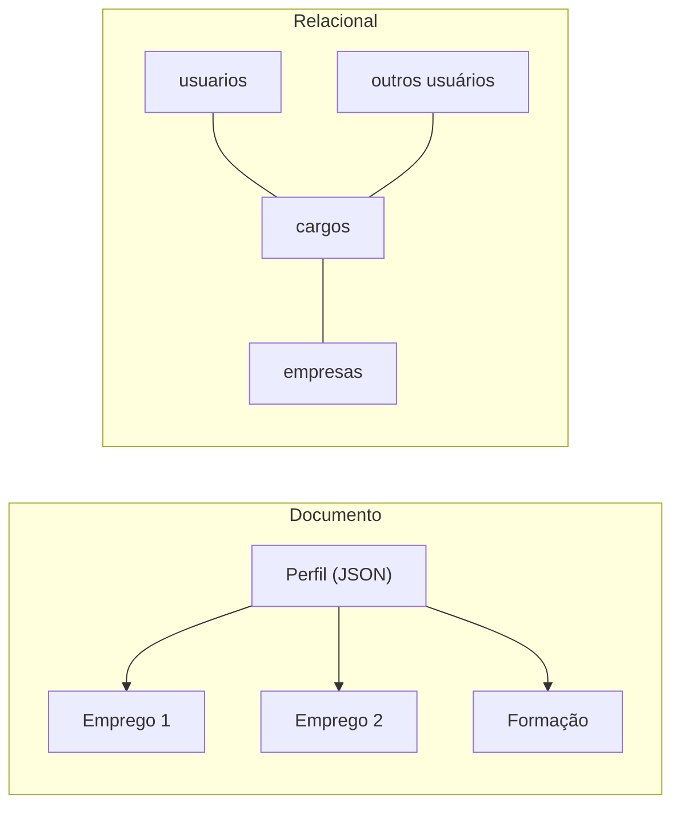

# 2. Modelos de dados e linguagens de consulta

> [!NOTE] Em uma frase
> O formato em que você guarda os dados (tabelas, documentos ou grafos) decide quais perguntas ficam fáceis e quais ficam penosas, então a escolha deve seguir o formato das relações entre os seus dados.

## Por que isso importa

Pense em um currículo no LinkedIn. Ele tem um nome, uma lista de empregos, uma lista de formações, uma lista de contatos. Se você guarda isso como um único documento JSON, carregar o perfil inteiro é uma leitura só. Mas "empresa" e "escola" não são só textos: são entidades com página própria, logotipo e outros funcionários. No momento em que você quer perguntar "quem mais trabalhou nesta empresa?", o documento único começa a atrapalhar.

Todo sistema é construído em camadas de modelos: o mundo real vira objetos na sua linguagem, os objetos viram tabelas, documentos ou grafos, esses viram bytes em disco. Cada camada esconde a de baixo. O modelo de dados que você escolhe no meio dessa pilha molda o código que você escreve e o que o banco consegue otimizar. É, talvez, a decisão de projeto mais difícil de reverter.

## O que você precisa saber antes

- [Capítulo 1](01-confiavel-escalavel-sustentavel.md): dá a ideia de manutenibilidade e evolutibilidade, que é o critério para comparar modelos aqui.
- Noção básica de SQL (tabela, linha, `JOIN`) e de JSON.

## As ideias centrais

### Relacional contra documentos

O **modelo relacional** organiza dados em relações (tabelas), cada uma um conjunto de linhas com as mesmas colunas. Proposto por Edgar Codd em 1970, ele venceu os modelos hierárquico e de rede dos anos 70 e dominou por décadas porque escondia do programador o caminho físico até os dados: você diz o que quer, e o banco decide como buscar.

O **modelo de documentos** (MongoDB, CouchDB, e colunas JSON no PostgreSQL) guarda cada registro como uma árvore autocontida, normalmente JSON. Ele ganhou força nos anos 2010 sob o rótulo NoSQL, por três motivos: facilidade de escalar escritas, vontade de usar software livre em vez de bancos comerciais, e frustração com o **descompasso de impedância** (*impedance mismatch*), o trabalho de traduzir objetos aninhados do código para tabelas planas e de volta.

O que cada um faz bem:

- **Documentos brilham com relações um-para-muitos em árvore.** O currículo com sua lista de empregos é uma árvore: cada emprego pertence a um único perfil. Ler o documento inteiro de uma vez é rápido (**localidade**: tudo está junto no disco) e o JSON espelha o objeto no código.
- **Relacional brilha com relações muitos-para-um e muitos-para-muitos.** Muitos perfis apontam para a mesma empresa. Guardar o nome da empresa como texto repetido em cada perfil é duplicação; guardar um ID e fazer `JOIN` é **normalização**. Bancos de documentos historicamente tinham suporte fraco a junções, e aí o código da aplicação acaba fazendo as junções na mão, com várias consultas.

O lado esquerdo é bom quando tudo pertence a um dono; o direito é bom quando várias coisas compartilham a mesma entidade.

### Esquema na escrita contra esquema na leitura

Costuma-se dizer que bancos de documentos "não têm esquema". O livro corrige: o esquema existe, só que fica implícito no código que lê os dados.

- **Esquema na escrita** (*schema-on-write*), típico do relacional: o banco valida toda escrita contra uma estrutura declarada. Parecido com tipagem estática.
- **Esquema na leitura** (*schema-on-read*), típico de documentos: qualquer JSON entra; quem lê interpreta. Parecido com tipagem dinâmica.

Exemplo: você decide separar `nome` em `primeiro_nome` e `sobrenome`. No relacional, roda um `ALTER TABLE` e um `UPDATE` (migração). No modelo de documentos, escreve os novos documentos no formato novo e põe no código um "se não tiver `primeiro_nome`, divide o `nome`". Esquema na leitura é vantajoso quando os itens são heterogêneos de verdade ou quando a estrutura é ditada por sistemas externos que você não controla.

Os dois mundos estão convergindo: PostgreSQL e MySQL suportam colunas JSON com índice, e vários bancos de documentos passaram a oferecer junções.

### Linguagens declarativas contra imperativas

Uma linguagem **imperativa** diz passo a passo como obter o resultado: percorra a lista, teste cada item, acumule. Uma **declarativa** descreve o resultado desejado e deixa o "como" para o sistema. SQL é declarativa: `SELECT * FROM animais WHERE familia = 'tubarões'` não diz em que ordem ler nem qual índice usar.

Por que isso importa tanto:

- O banco pode trocar o algoritmo por baixo (criar índice, reordenar junções, paralelizar em vários núcleos) sem você mudar uma linha.
- A consulta não depende de ordem de execução, então é mais fácil executá-la em paralelo.

A analogia do livro é o CSS na web: você declara "itens selecionados ficam azuis" em vez de escrever JavaScript que percorre a árvore do documento mudando cores. O navegador cuida do resto, inclusive quando a página muda.

O livro também apresenta o **MapReduce** como modelo intermediário: você escreve duas funções (map e reduce) em código comum, e o sistema distribui a execução. Funciona, mas obriga a pensar em duas funções coordenadas; por isso o MongoDB acabou adicionando um pipeline de agregação declarativo. O MapReduce volta com detalhe no [capítulo 10](10-processamento-em-lote.md).

### Modelos de grafos

Quando quase tudo se relaciona com quase tudo, nem tabelas nem documentos são naturais. Um **grafo** tem **vértices** (as coisas: pessoas, cidades, eventos) e **arestas** (as relações: "mora em", "nasceu em", "conhece"). Exemplos: a rede social do Facebook, o mapa de ruas de um GPS, os links da web usados pelo PageRank.

Há dois sabores:

- **Grafo de propriedades** (Neo4j, consultado com a linguagem **Cypher**): cada vértice e cada aresta tem um rótulo e um conjunto de propriedades chave-valor.
- **Triple-store** (consultado com **SPARQL**): tudo é uma tripla (sujeito, predicado, objeto), como `(Lucy, nasceu_em, Idaho)`.

O ponto forte aparece em consultas de caminho de comprimento variável. "Encontre pessoas que nasceram nos EUA e moram na Europa" exige descer uma hierarquia de locais de profundidade desconhecida (cidade dentro de estado dentro de país dentro de continente). Em Cypher isso cabe em poucas linhas com um operador de "siga esta aresta zero ou mais vezes". Em SQL é possível, mas exige `WITH RECURSIVE` e fica bem mais longo. O livro também cita **Datalog**, uma linguagem mais antiga e mais acadêmica, base de sistemas como o Datomic, em que você define regras que se combinam.

Grafos também se adaptam bem à evolução: novos tipos de vértice e aresta entram sem mudar os existentes.

## Onde isso aparece no mundo real

- **Perfis e catálogos em bancos de documentos.** Sistemas de conteúdo e catálogos de produtos com atributos muito variados (um celular tem campos que uma camiseta não tem) costumam usar MongoDB ou colunas JSON no PostgreSQL, justamente pelo esquema na leitura.
- **Redes sociais e antifraude em grafos.** Detectar contas falsas que compartilham cartão, dispositivo e endereço é uma consulta de caminhos; bancos como Neo4j e o TAO do Facebook (um armazenamento orientado a grafo) existem para isso.
- **ORMs.** Hibernate, ActiveRecord e Django ORM são a tentativa de diminuir o descompasso de impedância sem abandonar o relacional. Ajudam, mas não eliminam o problema.

## Erros comuns de quem está aprendendo

- **"NoSQL não tem esquema."** Tem, só não é imposto pelo banco. A correção é documentar e versionar o formato esperado no código, porque cada leitor precisa saber lidar com todas as versões antigas.
- **Escolher documentos para dados cheios de referências cruzadas.** Começa simples e, quando o produto pede "mostrar quem mais trabalhou aqui", vira junção manual e dado duplicado inconsistente. Desenhe as relações antes de escolher.
- **Achar que relacional é antiquado.** O modelo relacional absorveu JSON, busca textual e consultas recursivas. Ele continua sendo o padrão sensato quando não há motivo forte para outro.
- **Confundir "declarativo" com "lento".** Justamente por ser declarativa, uma consulta SQL ganha de graça as otimizações do banco, coisa que um laço escrito à mão nunca terá.

## Verifique se entendeu

1. Por que um currículo é bom candidato a documento, e o que muda quando "empresa" vira uma entidade com página própria? (Relacional contra documentos)
2. Explique a diferença entre esquema na escrita e esquema na leitura usando o exemplo de dividir o campo nome. (Esquema na escrita contra esquema na leitura)
3. Que liberdade o banco ganha quando você escreve uma consulta declarativa? (Linguagens declarativas contra imperativas)
4. Que tipo de consulta torna um grafo claramente melhor que tabelas? (Modelos de grafos)

## Para ir além

- [Notas de keyvanakbary](https://github.com/keyvanakbary/learning-notes/blob/master/books/designing-data-intensive-applications.md): a seção do capítulo 2 lista os termos (impedance mismatch, schema-on-read, triple-store) com definições curtas.
- [Notas por capítulo no Mintlify](https://mintlify.wiki/ps06756/Designing-Data-Intensive-Applications): a página do capítulo 2 traz exemplos de consultas em SQL e Cypher lado a lado.
- [Timi Learning, série DDIA](https://timilearning.com/tags/ddia/): o post do capítulo 2 aprofunda a comparação entre documentos e relacional.

---
Anterior: [1. Aplicações confiáveis, escaláveis e sustentáveis](01-confiavel-escalavel-sustentavel.md) · Próximo: [3. Armazenamento e recuperação](03-armazenamento-e-recuperacao.md) · Voltar ao livro: [Guia de leitura](index.md)
