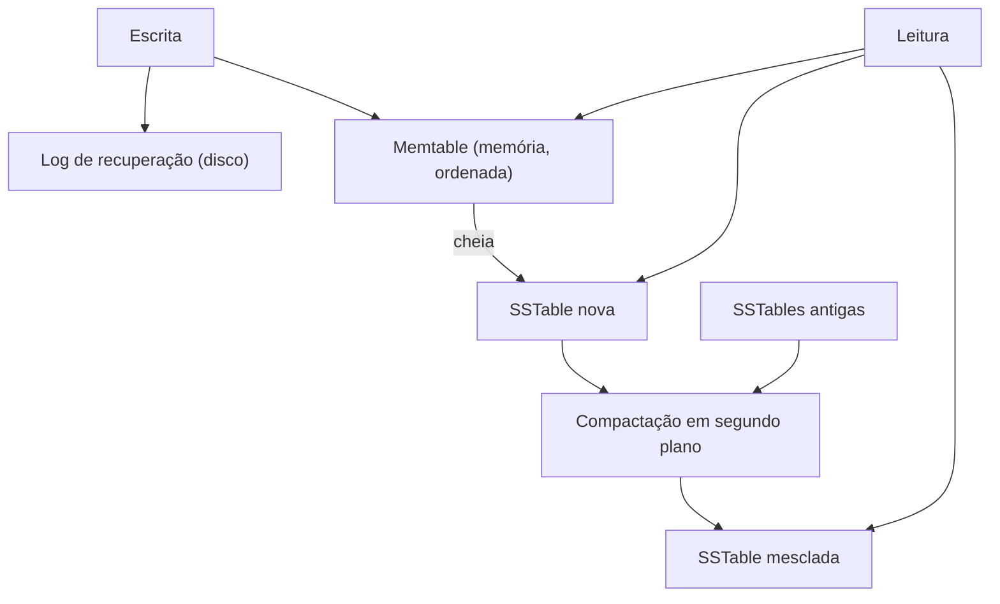

# 3. Armazenamento e recuperação

> [!NOTE] Em uma frase
> Todo banco equilibra o custo de escrever com o custo de ler: índices aceleram leituras e cobram nas escritas, e as duas grandes famílias de motores de armazenamento fazem essa troca de jeitos diferentes.

## Por que isso importa

Você não vai escrever um motor de banco. Mas vai escolher entre PostgreSQL, Cassandra, RocksDB e um data warehouse, e vai decidir quais índices criar. Se não souber o que acontece embaixo, essas escolhas viram superstição: "Cassandra é rápido para escrita", "nunca crie índice demais". Este capítulo explica de onde vêm essas regras.

O livro começa com o banco mais simples possível, duas funções de shell: `set` acrescenta `chave,valor` no fim de um arquivo; `get` procura com `grep` a última linha com aquela chave. Escrever é rapidíssimo (só anexar no fim do arquivo). Ler fica pior a cada linha nova, porque varre o arquivo todo. Toda a engenharia de armazenamento é uma série de respostas a esse problema.

## O que você precisa saber antes

- [Capítulo 2](02-modelos-de-dados-e-linguagens-de-consulta.md): os modelos de dados que estes motores implementam por baixo.
- Saber que ler do disco é muito mais lento que ler da memória, e que ler em sequência é muito mais rápido que pular para posições aleatórias.

## As ideias centrais

### Índices e o log que só cresce

Um **índice** é uma estrutura extra, derivada dos dados, que ajuda a encontrar registros sem varrer tudo. A troca é sempre a mesma: **todo índice acelera leituras e deixa escritas mais lentas**, porque cada escrita também precisa atualizar o índice. Por isso o banco não indexa tudo por padrão; você escolhe.

O índice mais simples para aquele arquivo que só cresce (um **log**, no sentido de sequência de registros só de acréscimo) é um **índice hash** em memória: um mapa de cada chave para a posição em bytes da sua última versão no arquivo. É o que o Bitcask (motor do Riak) faz. Para o arquivo não crescer para sempre, ele é quebrado em **segmentos**; de tempos em tempos, uma **compactação** junta segmentos jogando fora versões antigas de cada chave. Limitações: todas as chaves precisam caber na memória, e buscar intervalos ("todas as chaves entre `a` e `f`") é ineficiente.

### SSTables e LSM-trees

A melhoria seguinte é manter cada segmento **ordenado por chave**. Esse arquivo ordenado se chama **SSTable** (*Sorted String Table*). Ordenar traz três vantagens: juntar segmentos vira o algoritmo de merge do mergesort, que lê tudo em sequência; o índice em memória pode ser esparso (uma chave a cada alguns kilobytes basta, porque o resto está em ordem); e buscas por intervalo ficam naturais.

Mas como manter ordenado se as escritas chegam em ordem aleatória? Assim:

1. A escrita vai para uma árvore balanceada em memória, a **memtable**.
2. Quando a memtable passa de alguns megabytes, ela é gravada em disco como uma nova SSTable, já ordenada.
3. Leituras procuram primeiro na memtable, depois na SSTable mais recente, depois na anterior, e assim por diante.
4. Em segundo plano, compactação junta SSTables e descarta valores sobrescritos ou apagados.
5. Para não perder a memtable se o processo cair, cada escrita também é anexada a um log de recuperação no disco.

Essa estrutura é a **LSM-tree** (*Log-Structured Merge-Tree*), usada por LevelDB, RocksDB, Cassandra, HBase e pelo índice do Lucene/Elasticsearch. Para não ler todas as SSTables quando a chave não existe, usa-se um **filtro de Bloom**, estrutura compacta que responde "com certeza não está aqui" ou "talvez esteja".

### B-trees

A **B-tree** é a estrutura de índice mais usada há cinco décadas, padrão em PostgreSQL, MySQL (InnoDB), Oracle e SQL Server. Em vez de segmentos de tamanho variável, ela divide o disco em **páginas** de tamanho fixo (em geral 4 KB ou mais) e as organiza em árvore: cada página guarda chaves e referências para páginas filhas que cobrem intervalos de chaves. Com ramificação de algumas centenas, quatro níveis bastam para centenas de terabytes.

A diferença fundamental: a B-tree **sobrescreve páginas no lugar**; a LSM-tree **nunca sobrescreve**, só anexa e depois compacta. Sobrescrever no lugar é arriscado: se o processo cai no meio de dividir uma página cheia em duas, a árvore fica corrompida. Por isso B-trees usam um **WAL** (*write-ahead log*), em que toda mudança é registrada antes de ser aplicada às páginas, permitindo refazer o trabalho depois de uma queda.

### LSM contra B-tree: a troca na prática

- **LSM-trees costumam escrever mais rápido.** Gravam em sequência e comprimem melhor. Cada dado é reescrito algumas vezes pela compactação (**amplificação de escrita**), mas em geral menos que numa B-tree, que reescreve a página inteira para mudar um byte.
- **B-trees costumam ler de forma mais previsível.** Cada chave existe em um só lugar, o que também facilita travas por intervalo de chaves para transações.
- **O calcanhar de aquiles da LSM é a compactação.** Ela disputa disco com as escritas do usuário. Se a taxa de escrita é alta demais, a compactação fica para trás, o número de SSTables cresce e as leituras pioram. Isso afeta especialmente os percentis altos de latência e precisa ser monitorado.

O livro insiste que a única resposta honesta é testar com a sua carga.

### Outros tipos de índice e bancos em memória

- **Índice secundário:** sobre uma coluna que não é a chave primária, onde muitas linhas podem ter o mesmo valor.
- **Índice clusterizado contra heap file:** o índice pode guardar a linha inteira (como a chave primária do InnoDB) ou só um ponteiro para um arquivo à parte. Um **índice de cobertura** guarda algumas colunas extras para responder consultas sem ir à tabela.
- **Índices multidimensionais:** para buscar por latitude e longitude ao mesmo tempo, como R-trees no PostGIS.
- **Bancos em memória** (Redis, VoltDB, Memcached como cache): são rápidos não por evitar o disco na leitura, que o cache do sistema operacional já faria, mas por não precisar codificar estruturas em formato de disco.

### OLTP, OLAP e armazenamento por coluna

Há dois padrões de acesso muito diferentes:

- **OLTP** (*online transaction processing*): o app do usuário. Muitas consultas pequenas, cada uma buscando poucas linhas por chave. Gargalo: tempo de busca em disco.
- **OLAP** (*online analytic processing*): o analista perguntando "qual a receita por loja em cada mês?". Poucas consultas, cada uma varrendo milhões de linhas, mas só algumas colunas. Gargalo: banda de leitura.

Por isso empresas copiam os dados dos bancos de produção para um **data warehouse** separado, por um processo de **ETL** (extrair, transformar, carregar), para que a análise não derrube o app. O esquema típico é o **esquema estrela**: uma tabela de fatos enorme (cada venda) cercada de tabelas de dimensão (produto, loja, data).

Para OLAP, guardar por linha é desperdício: a tabela de fatos pode ter 100 colunas, e a consulta usa 4. O **armazenamento orientado a colunas** guarda cada coluna em um arquivo próprio, todos na mesma ordem de linhas. A consulta lê só as colunas que usa. E colunas comprimem muito bem: uma coluna `loja_id` com poucos valores distintos vira um bitmap por valor, compactado com codificação de comprimento de sequência (*run-length*). Exemplos: Amazon Redshift, ClickHouse, BigQuery, o formato Parquet. Também se usam **visões materializadas** e cubos de dados, resultados de agregações pré-calculados que trocam flexibilidade por velocidade.

## Onde isso aparece no mundo real

- **RocksDB por toda parte.** É a LSM-tree embutida em muitos sistemas: o MyRocks (motor do MySQL no Facebook), o CockroachDB por muito tempo, o armazenamento de estado do Kafka Streams.
- **Índice demais no PostgreSQL.** Uma tabela de eventos com dez índices sofre a cada `INSERT`, exatamente a troca da primeira seção. Remover índices não usados é otimização clássica.
- **BigQuery e Parquet.** Consultas analíticas cobradas por bytes lidos ficam baratas quando você seleciona poucas colunas, porque o armazenamento é colunar. `SELECT *` custa caro por esse motivo.

## Erros comuns de quem está aprendendo

- **"Mais índices, mais rápido."** Só nas leituras. Cada índice cobra em toda escrita e ocupa espaço.
- **"LSM é sempre melhor para escrita."** Depende de a compactação acompanhar. Sob escrita contínua e pesada, ela atrasa e a latência de leitura dispara.
- **Rodar análise pesada no banco de produção.** Uma varredura de milhões de linhas disputa disco e cache com o app. Separe OLTP de OLAP.
- **Achar que banco em memória é rápido só por não ler disco.** A maior vantagem é não serializar estruturas para o formato de disco; e muitos persistem em disco do mesmo jeito.

## Verifique se entendeu

1. Por que todo índice deixa escritas mais lentas? (Índices e o log que só cresce)
2. Descreva o caminho de uma escrita numa LSM-tree, da memória até a compactação. (SSTables e LSM-trees)
3. Por que uma B-tree precisa de WAL e uma LSM-tree não sobrescreve nada? (B-trees)
4. Em que situação a LSM-tree perde para a B-tree? (LSM contra B-tree)
5. Por que um data warehouse guarda dados por coluna? (OLTP, OLAP e armazenamento por coluna)

## Para ir além

- [Notas de keyvanakbary](https://github.com/keyvanakbary/learning-notes/blob/master/books/designing-data-intensive-applications.md): a seção do capítulo 3 compara LSM e B-tree em tópicos curtos.
- [Murat Demirbas, índice dos posts sobre DDIA](https://muratbuffalo.blogspot.com/2024/12/index-for-designing-data-intensive.html): o post do capítulo 3 comenta os motores de armazenamento com olhar de pesquisador.
- [ept/ddia-references](https://github.com/ept/ddia-references): a lista do capítulo 3 tem os papers originais da LSM-tree, do Bigtable e de C-Store (armazenamento por coluna).

---
Anterior: [2. Modelos de dados e linguagens de consulta](02-modelos-de-dados-e-linguagens-de-consulta.md) · Próximo: [4. Codificação e evolução](04-codificacao-e-evolucao.md) · Voltar ao livro: [Guia de leitura](index.md)
