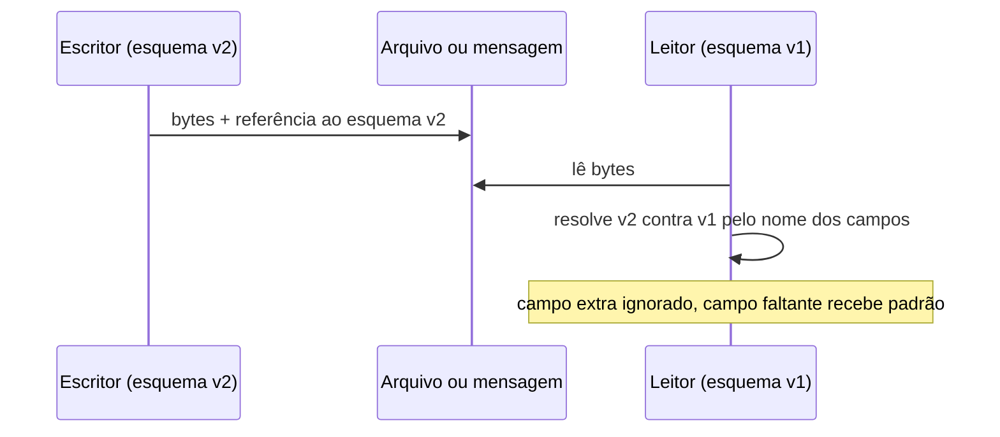

# 4. Codificação e evolução

> [!NOTE] Em uma frase
> Num sistema real, versões antigas e novas do código convivem e trocam dados entre si, então o formato desses dados precisa ser escolhido para que nenhum lado quebre quando o outro muda.

## Por que isso importa

Você adiciona um campo `telefone` ao objeto `Cliente` e faz o deploy. O deploy é gradual (**rolling upgrade**: troca-se uma instância por vez para não derrubar o serviço), então durante dez minutos metade das instâncias roda o código novo e metade o antigo. Uma instância nova grava um cliente com telefone; uma antiga lê esse registro, não conhece o campo, atualiza o nome e grava de volta. O telefone sumiu. Ninguém escreveu um bug "de verdade": o formato de dados não estava preparado para duas versões ao mesmo tempo.

E não é só no deploy. Aplicativos de celular ficam meses sem atualizar. Dados gravados há cinco anos continuam no banco. Este capítulo trata de como manter essa convivência sem dor.

## O que você precisa saber antes

- [Capítulo 2](02-modelos-de-dados-e-linguagens-de-consulta.md): a ideia de esquema na escrita e esquema na leitura, que reaparece aqui.
- Saber o que é uma API HTTP e já ter visto um JSON.

## As ideias centrais

### Codificar é traduzir de memória para bytes

Na memória, dados vivem em objetos, listas e ponteiros, otimizados para a CPU. Para gravar em arquivo ou mandar pela rede, é preciso transformar tudo em uma sequência de bytes. Essa tradução se chama **codificação** (ou serialização); o caminho de volta, **decodificação**.

Duas propriedades guiam o capítulo:

- **Compatibilidade para trás** (*backward compatibility*): código novo consegue ler dados escritos por código antigo. Costuma ser fácil, porque quem escreve o código novo conhece o formato antigo.
- **Compatibilidade para frente** (*forward compatibility*): código antigo consegue ler dados escritos por código novo. É mais difícil: exige que o código antigo ignore com elegância o que não conhece.

O exemplo do telefone perdido é uma falha de compatibilidade para frente.

Os formatos nativos de linguagem (`pickle` do Python, `Serializable` do Java) são tentadores e o livro desaconselha: prendem você a uma linguagem, costumam ser inseguros (decodificar bytes de fonte não confiável pode executar código arbitrário) e tratam versionamento como detalhe.

### JSON, XML e os formatos binários de esquema

**JSON, XML e CSV** são legíveis por humanos e universais, ótimos para troca entre organizações. Têm problemas sutis: JSON não distingue inteiro de ponto flutuante, e números acima de 2^53 perdem precisão em JavaScript (o Twitter passou a mandar IDs de tweet também como string por isso); não suportam bytes binários sem codificar em Base64; CSV nem tem esquema.

Para uso interno, onde se controla os dois lados, formatos binários com esquema são mais compactos e mais seguros na evolução. O livro compara três.

**Protocol Buffers** (Google) e **Thrift** (Facebook): você escreve um esquema, e cada campo recebe um **número de tag**.

```
message Pessoa {
  string nome = 1;
  int64 id_favorito = 2;
  repeated string interesses = 3;
}
```

Os bytes gravados não trazem o nome do campo, só a tag e o valor. Isso torna tudo compacto e define as regras de evolução:

- Pode adicionar campo novo com tag nova. Código antigo, ao ver uma tag desconhecida, a pula (compatibilidade para frente).
- Campo novo não pode ser obrigatório, ou código novo não conseguiria ler dados antigos sem ele (compatibilidade para trás).
- Pode remover campo opcional, mas **nunca reutilizar sua tag**.
- Nome do campo pode mudar à vontade; a tag, jamais.

**Avro** (do ecossistema Hadoop) faz diferente: não há tags. Os bytes são só os valores, na ordem do esquema. Para decodificar, o leitor precisa do **esquema exato do escritor** e compara com o seu próprio **esquema do leitor**, casando campos pelo nome. Campo que só o escritor tem é ignorado; campo que só o leitor tem recebe o valor padrão. Por isso, em Avro, só se pode adicionar ou remover campos que tenham valor padrão.



Como o leitor obtém o esquema do escritor? Num arquivo grande, ele vai uma vez no cabeçalho. Num banco, cada registro leva um número de versão e há um **registro de esquemas** (*schema registry*). Numa conexão de rede, os dois lados negociam ao conectar. A vantagem do Avro é servir bem a esquemas gerados automaticamente: dá para exportar uma tabela inteira de banco para Avro sem atribuir tags à mão.

O livro defende que esquemas trazem benefícios além de compactação: são documentação que nunca fica desatualizada, permitem checar compatibilidade antes do deploy e geram código tipado.

### Dados em repouso: o banco

Num banco, quem escreve é você do passado e quem lê é você do futuro. Isso exige compatibilidade para trás. E como várias versões do app escrevem ao mesmo tempo, também para frente: é o caso do telefone perdido. A correção é a aplicação preservar campos desconhecidos ao ler e regravar.

Outra ideia: **dados sobrevivem ao código**. Um deploy troca o código em minutos, mas linhas gravadas há anos continuam no formato antigo, a menos que se faça uma migração cara. A maioria dos bancos lida com isso de modo preguiçoso: adicionar uma coluna com padrão nulo não reescreve nada; linhas antigas simplesmente leem nulo.

### Dados em movimento: serviços e mensagens

**Serviços via REST e RPC.** Numa arquitetura de serviços, servidor e clientes são atualizados separadamente, então servidor novo precisa atender cliente antigo (para trás nas requisições) e cliente antigo precisa aceitar resposta nova (para frente nas respostas). APIs públicas acabam mantendo várias versões lado a lado por anos.

O livro critica o **RPC** (*remote procedure call*), a ideia de fazer chamada de rede parecer chamada de função local. Uma chamada local ou funciona, ou lança exceção. Uma chamada de rede pode também: se perder, expirar sem você saber se foi executada, demorar segundos, ou ser executada duas vezes se você tentar de novo. Por isso o retry só é seguro com [idempotência](../../glossario.md#idempotência) (repetir a operação dá o mesmo resultado). Frameworks modernos como gRPC assumem essas diferenças em vez de escondê-las.

**Passagem de mensagens assíncrona.** Com um broker ([fila](../../glossario.md#fila-e-mensageria) como Kafka ou RabbitMQ) no meio, quem envia não espera o destinatário. O broker absorve picos, reentrega se o consumidor cair e permite um produtor falar com vários consumidores. O formato da mensagem segue as mesmas regras de compatibilidade, e consumidores que republicam mensagens precisam preservar campos que não conhecem.

## Onde isso aparece no mundo real

- **Schema Registry com Kafka.** Muitas empresas publicam eventos em Avro ou Protobuf e um registro de esquemas recusa, no momento da publicação, um esquema novo que quebre compatibilidade com consumidores existentes.
- **gRPC entre microsserviços.** Protobuf é o formato padrão do gRPC; a regra "nunca reutilize uma tag" é cobrada em revisão de código em muitas equipes, porque o erro só aparece com versões misturadas em produção.
- **Apps móveis antigos.** Uma API que remove um campo do JSON quebra usuários que não atualizaram o app; por isso APIs públicas versionam (`/v1/`, `/v2/`) e anunciam desativação com meses de antecedência.

## Erros comuns de quem está aprendendo

- **Testar só com todas as instâncias na mesma versão.** O problema aparece durante o deploy gradual. Pense sempre em "versão N e N+1 juntas".
- **Reutilizar o número de tag de um campo removido.** Dados antigos com aquela tag serão lidos como o campo novo, com tipo e significado errados.
- **Tornar obrigatório um campo novo.** Leitura de dados antigos passa a falhar. Campos novos devem ser opcionais ou ter padrão.
- **Tratar RPC como chamada local.** Sem timeout, sem retry idempotente e sem pensar em "executou ou não?", o primeiro problema de rede vira duplicidade ou travamento.

## Verifique se entendeu

1. No exemplo do telefone perdido, qual compatibilidade faltou e como corrigir? (Codificar é traduzir; Dados em repouso)
2. Por que em Protocol Buffers você pode renomear um campo mas não mudar sua tag? (JSON, XML e os formatos binários)
3. Como o Avro decodifica dados sem tags, e o que acontece com um campo que só o leitor conhece? (JSON, XML e os formatos binários)
4. Cite três jeitos em que uma chamada de rede difere de uma chamada de função local. (Dados em movimento)

## Para ir além

- [Timi Learning, série DDIA](https://timilearning.com/tags/ddia/): o post do capítulo 4 detalha Protobuf, Thrift e Avro com exemplos de bytes.
- [Notas por capítulo no Mintlify](https://mintlify.wiki/ps06756/Designing-Data-Intensive-Applications): a página do capítulo 4 mostra esquemas de exemplo e cenários de evolução.
- [ept/ddia-references](https://github.com/ept/ddia-references): a lista do capítulo 4 aponta para a documentação oficial de Protobuf, Thrift e Avro e para os textos críticos sobre RPC.

---
Anterior: [3. Armazenamento e recuperação](03-armazenamento-e-recuperacao.md) · Próximo: [5. Replicação](05-replicacao.md) · Voltar ao livro: [Guia de leitura](index.md)
