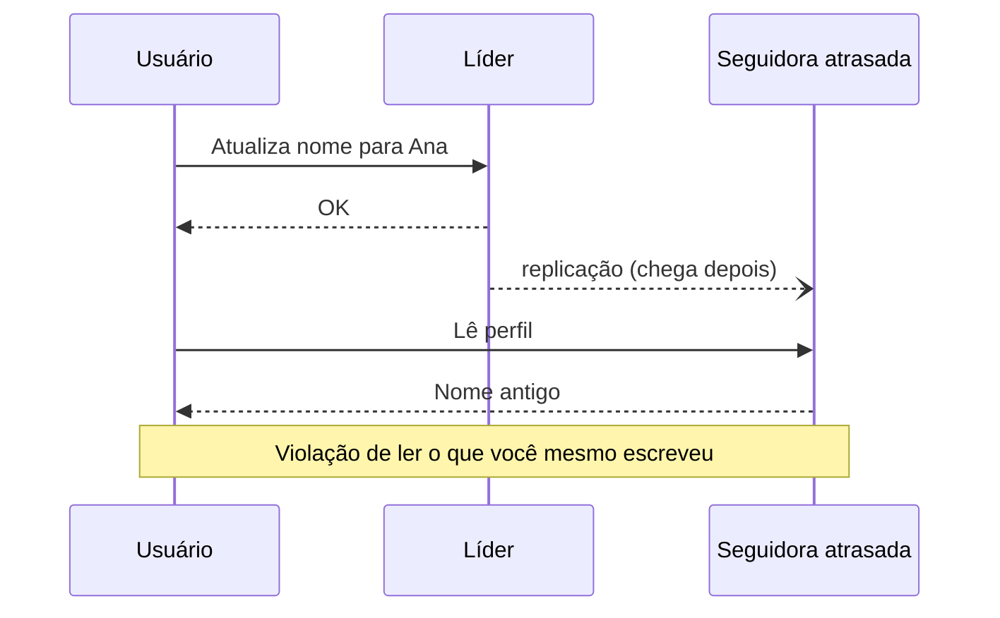

# 5. Replicação

> [!NOTE] Em uma frase
> Manter cópias do mesmo dado em várias máquinas é fácil enquanto nada muda; todo o trabalho está em propagar as mudanças, e cada forma de propagar troca simplicidade, velocidade e garantias de um jeito diferente.

## Por que isso importa

Em 2012, o GitHub teve um incidente em que uma réplica de MySQL desatualizada foi promovida a principal depois de uma falha. A nova principal não tinha as últimas escritas da antiga e começou a gerar IDs que já tinham sido usados. Esses IDs também estavam guardados num Redis, e dados privados de alguns usuários apareceram para outros. Nada ali era exótico: era replicação assíncrona com troca automática de líder, a configuração mais comum do mundo.

A [replicação](../../glossario.md#replicação) existe por três razões: manter o sistema no ar quando uma máquina cai (alta [disponibilidade](../../glossario.md#disponibilidade)), deixar dados perto dos usuários (menos [latência](../../glossario.md#latência-e-throughput)) e espalhar leituras por várias máquinas (mais throughput). Este capítulo assume que uma cópia inteira dos dados cabe em cada máquina; dividir dados grandes é assunto do capítulo 6.

## O que você precisa saber antes

- [Capítulo 3](03-armazenamento-e-recuperacao.md): a ideia de log de escritas (WAL), que é o que muitas réplicas copiam.
- [Capítulo 4](04-codificacao-e-evolucao.md): versões diferentes de software convivendo, o que também acontece entre réplicas.

## As ideias centrais

### Líder único: o padrão de quase todo banco

Uma réplica é eleita **líder** (ou primária). Toda escrita vai para ela. Ela grava localmente e envia a mudança para as **seguidoras** (réplicas, secundárias), que aplicam na mesma ordem. Leituras podem ir para qualquer uma. É o modelo do PostgreSQL, MySQL, MongoDB e também do Kafka.

**Síncrono ou assíncrono?** Na replicação síncrona, o líder espera a seguidora confirmar antes de responder ao cliente: a seguidora tem garantidamente a cópia, mas se ela travar, o líder trava junto. Na assíncrona, o líder responde sem esperar: rápido, mas escritas confirmadas podem se perder se o líder morrer antes de repassar. O meio-termo comum é **semissíncrono**: uma seguidora síncrona, o resto assíncrono.

**Como copiar a mudança?** Opções:
- Replicar o comando SQL: frágil, porque `NOW()` ou `RAND()` dão resultados diferentes em cada réplica.
- Enviar o WAL do motor de armazenamento: preciso, mas acopla as réplicas à mesma versão do motor.
- **Replicação lógica**: um log de mudanças por linha, independente do motor. É a base da captura de mudanças (CDC) que aparece no capítulo 11.

**Quando o líder morre** acontece o **failover**: detectar a falha (em geral por timeout), escolher uma nova líder (a mais atualizada) e reconfigurar clientes. Cada passo tem armadilhas: escritas não replicadas se perdem (o caso do GitHub); duas máquinas podem acreditar que são líderes ao mesmo tempo (**split brain**); um timeout curto demais causa failovers desnecessários sob carga.

### O atraso de replicação e os problemas que ele cria

Com replicação assíncrona, uma seguidora pode estar segundos ou minutos atrás do líder. Esse atraso (*replication lag*) gera [consistência eventual](../../glossario.md#consistência-forte-e-eventual): se as escritas pararem, as réplicas convergem, mas não se sabe quando. Três anomalias concretas:

- **Ler o que você mesmo escreveu.** Você edita o perfil, a página recarrega a partir de uma seguidora atrasada, e a edição parece ter sumido. Solução: ler do líder dados que o próprio usuário pode ter acabado de mudar, ou lembrar o momento da última escrita do usuário e só ler de réplicas que já passaram dele.
- **Leituras monotônicas.** Você atualiza a página duas vezes e cai em réplicas diferentes; um comentário aparece e depois some. Solução: fixar cada usuário sempre na mesma réplica.
- **Prefixo consistente.** Num chat, a resposta aparece antes da pergunta, porque vieram de partições diferentes com atrasos diferentes. Solução: garantir que escritas causalmente relacionadas sigam pela mesma rota.

### Múltiplos líderes

Às vezes se aceita escrita em mais de um lugar: um líder por datacenter (para cada região escrever localmente), apps que funcionam offline (cada celular é um "líder" que sincroniza depois) e edição colaborativa (Google Docs). O ganho é latência e tolerância a quedas de datacenter. O preço é enorme: **conflitos de escrita**. Duas pessoas mudam o título da mesma página ao mesmo tempo em lugares diferentes; ambas recebem "OK"; quem vence?

Estratégias:
- **Evitar:** rotear todas as escritas de um mesmo registro para o mesmo líder.
- **Última escrita vence** (*last write wins*, LWW): fica a de maior timestamp. Simples e perde dados silenciosamente.
- **Mesclar:** guardar as duas versões e deixar a aplicação ou o usuário resolver; ou usar **CRDTs**, estruturas de dados que se mesclam automaticamente de forma correta (um contador ou conjunto que converge sozinho).

O livro recomenda evitar múltiplos líderes sempre que possível, porque recursos como chaves autoincrementais e restrições de unicidade ficam muito difíceis.

### Sem líder: quóruns

O terceiro modelo, popularizado pelo Dynamo da Amazon e usado por Cassandra e Riak, não tem líder. O cliente manda cada escrita para várias réplicas em paralelo e lê de várias também.

Com **n** réplicas, exige-se **w** confirmações na escrita e **r** respostas na leitura. Se **w + r > n**, os conjuntos se sobrepõem e pelo menos uma das réplicas lidas tem o valor mais recente. Configuração típica: n = 3, w = 2, r = 2. Isso é um **quórum**.

Como réplicas desatualizadas se atualizam? Por **read repair** (ao ler, o cliente percebe a réplica velha e a corrige) e por **anti-entropia** (um processo de fundo compara réplicas). O livro alerta que o quórum não garante leitura do valor mais recente em vários casos de borda: escritas concorrentes, escrita que falhou em parte, réplica restaurada de uma cópia antiga. E há o **sloppy quorum**: quando as réplicas certas estão inacessíveis, aceitar escrita em outras máquinas e repassar depois (*hinted handoff*), o que aumenta disponibilidade e enfraquece ainda mais a garantia.

### Detectar escritas concorrentes

Duas escritas são **concorrentes** quando nenhuma sabia da outra, independentemente do relógio. Para saber se B "aconteceu depois" de A, não se olha a hora: olha-se se B foi feita por alguém que já tinha visto A. O mecanismo é o **número de versão** por chave, e com várias réplicas, o **vetor de versões** (um contador por réplica). Com ele, o banco consegue dizer "estas duas são irmãs concorrentes, guarde as duas" em vez de descartar uma.

## Onde isso aparece no mundo real

- **Incidente do GitHub (2012).** Promoção de réplica desatualizada, IDs reutilizados e dados expostos: o caso clássico de failover com replicação assíncrona.
- **Réplicas de leitura no RDS e no Cloud SQL.** Muito time manda leituras para réplicas e encontra exatamente o bug "salvei e não apareceu"; a correção costuma ser ler do primário logo após escrever.
- **Cassandra com níveis de consistência.** `QUORUM`, `ONE` e `ALL` são os valores de w e r desta página, escolhidos por consulta.

## Erros comuns de quem está aprendendo

- **Achar que réplica é backup.** Uma réplica copia também o `DELETE` errado, na hora. Backup é cópia em um ponto do tempo; são coisas diferentes.
- **Supor que w + r > n dá consistência forte.** Há casos de borda em que não dá. Quóruns melhoram a probabilidade, não a garantia.
- **Usar "última escrita vence" sem perceber que perde dados.** Se duas escritas concorrentes chegam, uma some sem erro. Só serve quando perder é aceitável.
- **Ignorar o atraso de replicação nos testes.** Em desenvolvimento, a réplica está sempre em dia. Em produção, sob carga, o atraso pode chegar a minutos.

## Verifique se entendeu

1. Qual a troca entre replicação síncrona e assíncrona, e o que é o arranjo semissíncrono? (Líder único)
2. Descreva uma anomalia de atraso de replicação e uma forma de evitá-la. (O atraso de replicação)
3. Por que múltiplos líderes tornam difícil garantir que um nome de usuário seja único? (Múltiplos líderes)
4. Com n = 5, quais valores de w e r garantem sobreposição, e por que isso ainda não é consistência forte? (Sem líder: quóruns)
5. Como saber se duas escritas foram concorrentes sem olhar o relógio? (Detectar escritas concorrentes)

## Para ir além

- [Timi Learning, série DDIA](https://timilearning.com/tags/ddia/): o post do capítulo 5 conta o incidente do GitHub e o problema de replicar comandos SQL com funções não determinísticas.
- [Notas de keyvanakbary](https://github.com/keyvanakbary/learning-notes/blob/master/books/designing-data-intensive-applications.md): a seção do capítulo 5 segue a mesma ordem do livro (líderes, atraso, multi-líder, sem líder).
- [ept/ddia-references](https://github.com/ept/ddia-references): a lista do capítulo 5, com 61 referências, inclui o paper do Dynamo e o relato do incidente do GitHub.

---
Anterior: [4. Codificação e evolução](04-codificacao-e-evolucao.md) · Próximo: [6. Particionamento](06-particionamento.md) · Voltar ao livro: [Guia de leitura](index.md)
