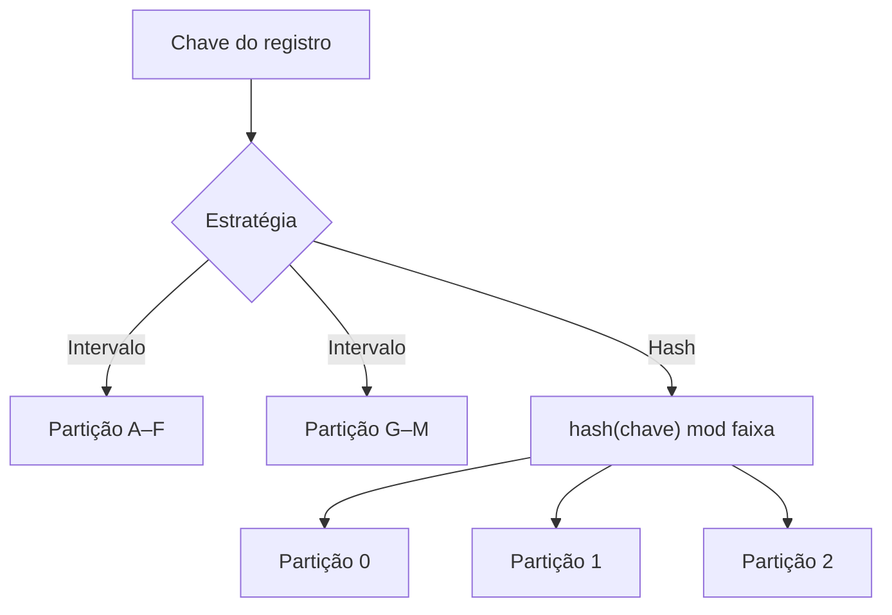

# 6. Particionamento

> [!NOTE] Em uma frase
> Quando os dados ou a carga não cabem numa máquina, você os divide em pedaços; a arte está em escolher o critério de divisão para que nenhum pedaço fique com trabalho demais.

## Por que isso importa

Imagine um sistema que guarda leituras de sensores de 1 milhão de dispositivos, a cada segundo. Nenhuma máquina guarda tudo isso, e nenhuma aguenta sozinha a taxa de escrita. A saída é dividir: o dispositivo 1 a 100 mil numa máquina, o próximo bloco em outra, e assim por diante. Funciona até o dia em que alguém escolhe a data como critério de divisão e descobre que, num dado momento, todas as escritas vão para a mesma máquina (a de "hoje"), enquanto as outras dez ficam paradas.

[Particionamento](../../glossario.md#particionamento-sharding), também chamado de *sharding*, é isso: cada registro pertence a exatamente uma partição, e cada partição é um pequeno banco por si só. O objetivo é escalar: espalhar dados e consultas por muitas máquinas. Na prática ele sempre anda junto com a replicação do [capítulo 5](05-replicacao.md): cada partição tem várias cópias, e uma máquina guarda a líder de umas partições e seguidoras de outras.

## O que você precisa saber antes

- [Capítulo 5](05-replicacao.md): replicação com líder e seguidoras, que se combina com particionamento.
- [Capítulo 3](03-armazenamento-e-recuperacao.md): índices primários e secundários.

## As ideias centrais

### Dividir por intervalo de chave ou por hash

O problema central é o **desequilíbrio** (*skew*): se a divisão for injusta, uma partição recebe mais dados ou mais consultas. Uma partição com carga desproporcional é uma **partição quente** (*hot spot*). Há duas estratégias básicas.

**Por intervalo de chave.** Cada partição fica com um intervalo contínuo, como os volumes de uma enciclopédia (A–B, C–D...). Os intervalos não precisam ter o mesmo tamanho; são ajustados à distribuição real dos dados. Vantagem: dentro de cada partição as chaves ficam ordenadas, então consultas por intervalo ("todas as leituras do sensor X entre 10h e 11h") são eficientes. Desvantagem: certos padrões de acesso criam partições quentes. Se a chave é o timestamp, todas as escritas de agora vão para a mesma partição. A correção é prefixar a chave com algo que espalhe, como o nome do sensor, ao custo de ter que consultar cada sensor separadamente. É o modelo do HBase, do Bigtable e de versões antigas do MongoDB.

**Por hash da chave.** Uma função de hash transforma a chave num número aparentemente aleatório, e cada partição fica com um intervalo de hashes. Chaves parecidas caem em lugares distantes, então a carga se espalha. O preço: perde-se a ordem, e uma consulta por intervalo precisa perguntar a todas as partições. O Cassandra faz um meio-termo: a primeira parte da chave composta é usada no hash (escolhe a partição) e o resto fica ordenado dentro dela. Assim, `(id_usuario, timestamp)` permite buscar eficientemente todas as postagens de um usuário em ordem de data.

Hash não resolve tudo. Se uma única chave é muito acessada (a conta de uma celebridade recebendo milhões de comentários), todas as requisições para ela vão à mesma partição. O livro sugere uma técnica manual: acrescentar um número aleatório de dois dígitos ao fim das chaves quentes, espalhando as escritas em 100 chaves, com o custo de ler as 100 e juntar na leitura.

### Índices secundários em dados particionados

Buscar por chave primária é fácil: a chave diz a partição. Mas e "todos os carros vermelhos"? A cor não determina a partição. Há duas abordagens:

- **Índice local (por documento).** Cada partição mantém um índice só dos seus próprios dados. Escrever é simples: tudo acontece numa partição. Ler é caro: a consulta por cor precisa ser enviada a todas as partições e os resultados reunidos, o padrão **scatter/gather** (espalhar e reunir), que sofre com a partição mais lenta. Usado por MongoDB, Cassandra, Elasticsearch.
- **Índice global (por termo).** O índice cobre todas as partições, mas ele próprio é particionado pelo termo indexado: as cores de A a M numa partição, de N a Z em outra. Ler fica eficiente: uma consulta vai a uma partição do índice. Escrever fica caro: uma escrita num documento pode atualizar partições de índice em várias máquinas. Na prática, esses índices costumam ser atualizados de forma assíncrona, então uma leitura logo depois da escrita pode não ver a mudança. O DynamoDB funciona assim nos índices secundários globais.

### Rebalanceamento: mover dados sem parar tudo

Com o tempo, a carga cresce, máquinas entram e saem. Mover partições de um nó para outro é **rebalancear**. Requisitos: no fim, carga justa; durante, o sistema continua atendendo; e mover só o necessário.

O livro aponta um erro clássico: **hash mod N**, ou seja, a partição é `hash(chave) % número_de_nós`. Parece natural, mas quando N muda de 10 para 11, quase todas as chaves mudam de nó, e o sistema precisa mover quase tudo.

Alternativas usadas:

- **Número fixo de partições.** Crie muito mais partições que nós (por exemplo, 1.000 partições para 10 nós). Quando um nó entra, ele "rouba" algumas partições inteiras dos outros. As chaves nunca mudam de partição; só partições inteiras mudam de nó. Usado por Riak, Elasticsearch, Couchbase. Exige escolher o número no começo.
- **Particionamento dinâmico.** Partições se dividem ao crescer demais e se fundem ao encolher, como nós de uma B-tree. Adequado para particionamento por intervalo; usado por HBase e MongoDB.
- **Proporcional aos nós.** Cada nó tem um número fixo de partições; um nó novo divide partições existentes ao meio. É o caso do Cassandra.

O livro recomenda um humano na decisão de rebalancear. Rebalanceamento automático combinado com detecção automática de falha pode ser perigoso: um nó lento é declarado morto, o sistema começa a mover dados para outros, isso sobrecarrega a rede e os outros nós, e a situação piora em cascata.

### Roteamento: quem sabe onde está cada chave?

Se as partições mudam de lugar, como o cliente sabe a qual máquina perguntar? Esse é um caso do problema geral de **descoberta de serviço**. Três desenhos:

1. O cliente fala com qualquer nó; se o nó não tem a partição, repassa a quem tem.
2. O cliente fala com uma camada de roteamento que conhece o mapa.
3. O próprio cliente conhece o mapa e vai direto.

Em todos, alguém precisa manter o mapa atualizado e concordar sobre ele. Muitos sistemas usam um serviço de coordenação como o **ZooKeeper** (um armazenamento pequeno e altamente confiável para metadados de configuração) para guardar quem é dono de cada partição; outros, como Cassandra e Riak, usam um **protocolo de fofoca** (*gossip*), em que os nós trocam o estado do cluster entre si.

## Onde isso aparece no mundo real

- **Chave de partição no DynamoDB e no Cassandra.** Escolher `data` como chave de partição de uma tabela de eventos é o erro clássico que cria partição quente; o padrão recomendado é algo de alta cardinalidade, como o ID do cliente.
- **Elasticsearch.** O número de shards primários de um índice é fixado na criação, exatamente a estratégia de número fixo de partições, e buscas fazem scatter/gather em todos os shards.
- **Kafka.** Tópicos são divididos em partições, e a chave da mensagem decide, por hash, a partição. Mensagens com a mesma chave ficam em ordem porque caem na mesma partição.

## Erros comuns de quem está aprendendo

- **Usar timestamp como chave de partição.** Todas as escritas recentes vão para um só lugar. Prefixe com algo que espalhe.
- **Usar hash mod N.** Mudar o número de nós move quase todos os dados. Use partições fixas ou dinâmicas.
- **Esquecer que índice secundário vira scatter/gather.** Uma consulta por um campo que não é a chave pode tocar todas as partições, e a latência passa a ser a da partição mais lenta.
- **Particionar cedo demais.** Particionar traz complexidade real (transações e junções entre partições ficam difíceis). Se os dados cabem numa máquina com réplicas, essa pode ser a melhor escolha.

## Verifique se entendeu

1. Por que particionar por intervalo de timestamp cria partição quente, e como corrigir? (Dividir por intervalo ou por hash)
2. O que se perde ao particionar por hash, e como o Cassandra recupera parte disso? (Dividir por intervalo ou por hash)
3. Compare índice local e índice global quanto ao custo de leitura e de escrita. (Índices secundários)
4. Por que hash mod N é ruim para rebalancear? (Rebalanceamento)
5. Quais as três formas de um cliente descobrir em que nó está uma chave? (Roteamento)

## Para ir além

- [Notas de keyvanakbary](https://github.com/keyvanakbary/learning-notes/blob/master/books/designing-data-intensive-applications.md): a seção do capítulo 6 resume estratégias de partição, rebalanceamento e roteamento.
- [Timi Learning, série DDIA](https://timilearning.com/tags/ddia/): o post do capítulo 6 explica com calma por que hash mod N falha.
- [Notas por capítulo no Mintlify](https://mintlify.wiki/ps06756/Designing-Data-Intensive-Applications): a página do capítulo 6 tem diagramas de índice local e global.

---
Anterior: [5. Replicação](05-replicacao.md) · Próximo: [7. Transações](07-transacoes.md) · Voltar ao livro: [Guia de leitura](index.md)
