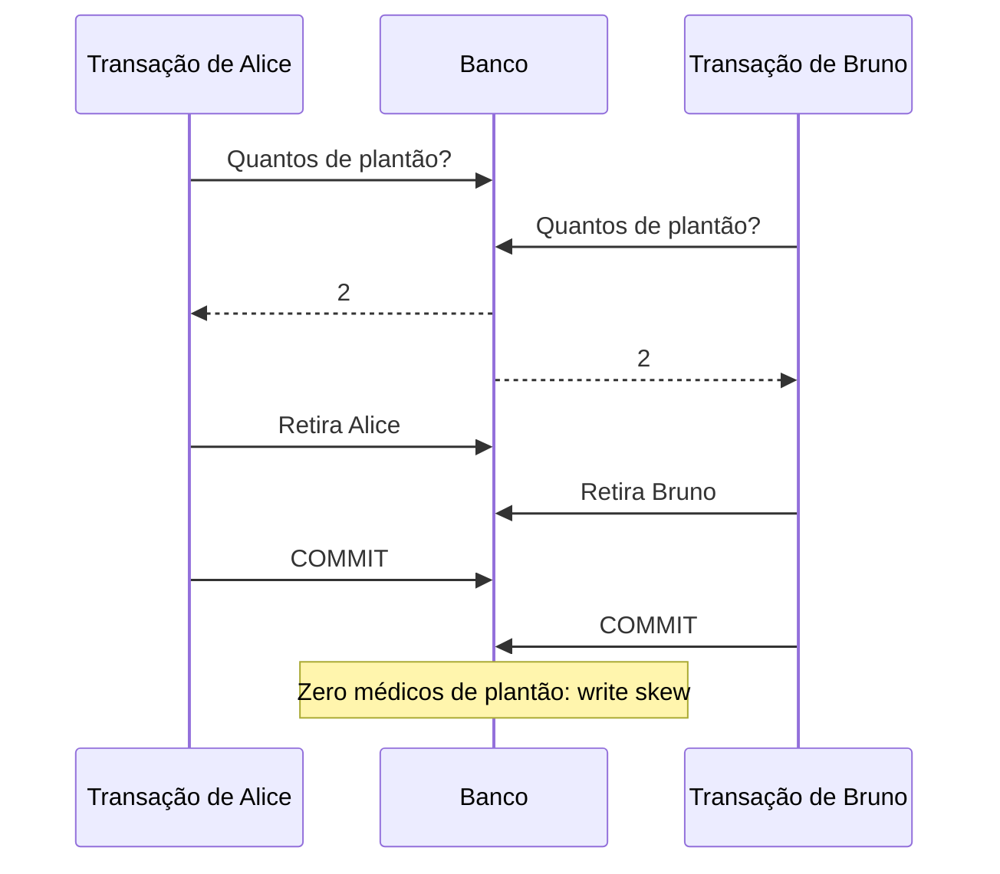

# 7. Transações

> [!NOTE] Em uma frase
> Uma transação agrupa várias leituras e escritas para que o banco as trate como uma coisa só, e o quanto ela protege você de outras transações simultâneas depende de um nível de isolamento que quase nunca é o mais forte.

## Por que isso importa

Um hospital mantém a regra de que sempre há pelo menos um médico de plantão. Alice e Bruno estão de plantão e ambos se sentem mal. Quase no mesmo instante, cada um abre o sistema e clica em "sair do plantão". O código de cada clique faz: "conte quantos médicos estão de plantão; se for 2 ou mais, me retire". As duas transações leem 2, as duas retiram seu médico, e agora não há ninguém de plantão. Cada transação, sozinha, estava certa. Juntas, quebraram a regra. E isso acontece num banco com transações ligadas, no nível de isolamento padrão de vários bancos populares.

Transações existem para que a aplicação não precise pensar em todas as coisas que podem dar errado: o processo cai no meio, a rede cai, duas pessoas mexem no mesmo dado. Elas simplificam muito a programação, mas só se você souber exatamente o que o seu banco garante.

## O que você precisa saber antes

- [Capítulo 3](03-armazenamento-e-recuperacao.md): o WAL, mecanismo que dá atomicidade e durabilidade.
- [Capítulo 5](05-replicacao.md): replicação, que interage com durabilidade.
- Já ter escrito `BEGIN ... COMMIT` em SQL ajuda, mas não é obrigatório.

## As ideias centrais

### O que ACID significa de verdade

[ACID](../../glossario.md#acid) é a sigla das garantias de transação, e o livro mostra que cada letra é mais estreita (ou mais vaga) do que parece:

- **Atomicidade:** não tem a ver com concorrência. Significa "tudo ou nada": se algo falha no meio, o banco desfaz o que já tinha feito (*abort*), e é seguro tentar de novo. Um nome melhor seria "abortabilidade".
- **Consistência:** são as regras do negócio (débitos e créditos batem). O livro observa que essa é responsabilidade da aplicação; o banco só ajuda com restrições declaradas. É uma letra que entrou mais para fechar a sigla.
- **Isolamento:** transações simultâneas não deveriam se atrapalhar. O ideal teórico é a **serializabilidade**: o resultado é o mesmo que se as transações tivessem rodado uma após a outra. Na prática, quase todo banco usa por padrão algo mais fraco.
- **Durabilidade:** o que foi confirmado não se perde. Na prática, significa gravado em disco não volátil e, em bancos replicados, copiado para outras máquinas. Nenhuma durabilidade é absoluta: discos corrompem, datacenters inteiros ficam sem energia.

Do lado oposto, sistemas que abrem mão dessas garantias foram apelidados de [BASE](../../glossario.md#base), termo informal que o livro descreve como quase vazio de significado.

Uma armadilha: **tentar de novo uma transação abortada nem sempre é seguro**. Se a transação foi confirmada mas a resposta se perdeu na rede, repetir duplica o efeito. Se o erro foi sobrecarga, repetir piora.

### Níveis fracos de isolamento e suas anomalias

Isolamento serializável tem custo, então bancos oferecem níveis mais fracos. Cada nível evita algumas anomalias e deixa outras passar.

**Read committed** (padrão do PostgreSQL e do Oracle). Garante duas coisas: não se lê dado que outra transação ainda não confirmou (**sem leitura suja**) e não se sobrescreve dado que outra transação ainda não confirmou (**sem escrita suja**). Implementado com travas de linha nas escritas e guardando o valor antigo para quem lê.

O que ele deixa passar: Ana tem R$ 500 em duas contas e transfere R$ 100 de uma para outra. Se ela consulta os dois saldos no meio da transferência, pode ver a conta 1 antes e a conta 2 depois, e achar que tem R$ 900. Isso é **read skew** (leitura inconsistente entre momentos). Para Ana, recarregar resolve. Para um backup que leva horas ou uma consulta analítica longa, é um problema sério.

**Snapshot isolation** (chamado de *repeatable read* no PostgreSQL e no MySQL). Cada transação lê de uma foto consistente do banco no instante em que começou, mesmo que outras mudem dados depois. A implementação é o **MVCC** (*multi-version concurrency control*): o banco guarda várias versões de cada linha, marcadas com o ID da transação que a criou e a que a apagou, e cada leitor enxerga só as versões visíveis para ele. A regra de ouro: leitores nunca bloqueiam escritores, e vice-versa.

### Atualizações perdidas e write skew

Há anomalias que acontecem entre duas escritas.

**Atualização perdida.** Dois processos leem um contador (42), somam 1 e gravam (43). O valor certo era 44. Ocorre em todo ciclo ler-modificar-gravar. Soluções: operações atômicas (`UPDATE contador SET valor = valor + 1`), trava explícita (`SELECT ... FOR UPDATE`), detecção automática pelo banco, ou compare-and-set (`UPDATE ... WHERE valor = 42`).

**Write skew.** É o caso do plantão médico. Duas transações leem o mesmo conjunto de dados, tomam uma decisão com base nele e escrevem em linhas **diferentes**. Como não há conflito na mesma linha, snapshot isolation não percebe. O padrão é sempre o mesmo: ler, verificar uma condição, escrever algo que muda a condição. Outros exemplos: reservar sala de reunião, escolher nome de usuário único, gastar saldo em duas compras simultâneas.

O que torna write skew traiçoeiro é o **fantasma** (*phantom*): a escrita de uma transação muda o resultado da consulta de busca da outra. Se a linha que importa ainda não existe (a reserva que ainda não foi criada), não há o que travar.

### Três jeitos de ser serializável

**Execução serial de verdade.** Rodar uma transação por vez, numa única thread. Parece absurdo, mas com tudo em memória e transações curtas enviadas inteiras como procedimentos armazenados (sem ida e volta de rede no meio), funciona. VoltDB e o Redis seguem essa linha. Limite: a vazão é a de um núcleo de CPU por partição.

**Travamento em duas fases** (*two-phase locking*, 2PL). Por décadas, o único algoritmo amplamente usado. Leitores pegam trava compartilhada, escritores pegam trava exclusiva, e ninguém solta nada até o fim da transação. Para pegar fantasmas, usam-se travas por intervalo de índice. Correto, mas lento: escritores bloqueiam leitores, a latência fica imprevisível e há **deadlocks** (transações esperando umas pelas outras em ciclo), resolvidos abortando uma.

**Serializable Snapshot Isolation** (SSI). Algoritmo de 2008, usado no nível serializável do PostgreSQL. É otimista: deixa as transações rodarem sobre um snapshot sem bloquear e, na hora do commit, verifica se alguma premissa lida foi invalidada por outra transação já confirmada. Se foi, aborta e manda tentar de novo. Funciona bem quando conflitos são raros, e mal quando há muita disputa pelos mesmos dados.

## Onde isso aparece no mundo real

- **PostgreSQL.** O padrão é read committed; `REPEATABLE READ` dá snapshot isolation; `SERIALIZABLE` usa SSI. Muita aplicação nunca muda o padrão e convive com write skew sem saber.
- **Saldo de carteira digital.** Conferir "tem saldo?" e depois debitar é o padrão clássico de write skew e atualização perdida; a correção comum é `SELECT ... FOR UPDATE` na linha da conta ou um `UPDATE ... WHERE saldo >= valor`.
- **ORMs.** Um código que carrega um objeto, altera um campo na memória e salva tudo é um ciclo ler-modificar-gravar e perde atualizações concorrentes, a menos que use versionamento otimista (uma coluna `version` conferida no `UPDATE`).

## Erros comuns de quem está aprendendo

- **Achar que "usar transação" basta.** O nível padrão quase nunca é serializável. Saiba qual é o seu e quais anomalias ele permite.
- **Confundir o C de ACID com consistência de replicação.** São coisas diferentes, e esta página e a de [consistência](09-consistencia-e-consenso.md) usam a palavra em sentidos distintos.
- **Repetir transação abortada sem pensar.** Se o commit aconteceu e só a resposta se perdeu, repetir duplica. Use chaves de [idempotência](../../glossario.md#idempotência).
- **Acreditar que snapshot isolation é serializável.** Ele evita read skew e leitura suja, mas não write skew.

## Verifique se entendeu

1. Por que atomicidade seria melhor chamada de abortabilidade? (O que ACID significa)
2. Qual anomalia read committed deixa passar e por que isso importa para backups? (Níveis fracos de isolamento)
3. O que diferencia write skew de atualização perdida? (Atualizações perdidas e write skew)
4. Por que snapshot isolation não pega o caso do plantão médico? (Atualizações perdidas e write skew)
5. Compare 2PL e SSI quanto a quando cada um perde desempenho. (Três jeitos de ser serializável)

## Para ir além

- [Timi Learning, série DDIA](https://timilearning.com/tags/ddia/): o post do capítulo 7 percorre cada anomalia com exemplos.
- [Murat Demirbas, índice dos posts sobre DDIA](https://muratbuffalo.blogspot.com/2024/12/index-for-designing-data-intensive.html): o post do capítulo 7 comenta níveis de isolamento com a visão de quem pesquisa o tema.
- [ept/ddia-references](https://github.com/ept/ddia-references): a lista do capítulo 7 tem o paper original de SSI e a crítica clássica aos níveis de isolamento ANSI.

---
Anterior: [6. Particionamento](06-particionamento.md) · Próximo: [8. Os problemas dos sistemas distribuídos](08-os-problemas-dos-sistemas-distribuidos.md) · Voltar ao livro: [Guia de leitura](index.md)
