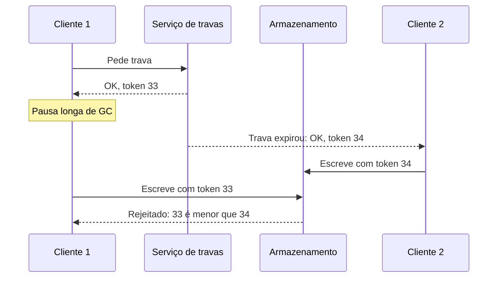

# 8. Os problemas dos sistemas distribuídos

> [!NOTE] Em uma frase
> Numa única máquina as coisas funcionam ou quebram; entre várias máquinas, partes quebram enquanto outras seguem, e nenhum nó consegue ter certeza do que está acontecendo com os outros.

## Por que isso importa

Seu serviço chama a API de pagamentos e, depois de 30 segundos, nada. O que aconteceu? Pode ser que a requisição tenha se perdido na rede. Pode ser que o servidor de pagamentos esteja travado. Pode ser que ele tenha processado o pagamento e a resposta tenha se perdido no caminho de volta. Pode ser que ele ainda esteja processando, numa fila. Do seu lado, todas essas situações parecem exatamente iguais: silêncio. E a decisão que você toma agora (cobrar de novo ou não?) depende de qual delas é verdade.

Este é o capítulo mais pessimista do livro, de propósito. Os capítulos anteriores falaram de replicação, particionamento e transações supondo que dá para saber o estado das coisas. Aqui o livro mostra tudo o que pode dar errado, para que no [capítulo 9](09-consistencia-e-consenso.md) faça sentido o esforço de construir garantias por cima disso.

## O que você precisa saber antes

- [Capítulo 5](05-replicacao.md): failover e split brain, que dependem de detectar falhas.
- [Capítulo 7](07-transacoes.md): transações, cujas garantias este capítulo coloca à prova num ambiente distribuído.

## As ideias centrais

### Falhas parciais

Um computador isolado é projetado para ser determinístico: ou funciona, ou falha por inteiro (tela azul, kernel panic). Isso é deliberado, porque é melhor travar de vez do que devolver resultado errado.

Em um sistema distribuído, a regra se inverte: o normal é que **algumas partes falhem enquanto outras funcionam**, de jeitos imprevisíveis. Isso é uma **falha parcial**, e ela é **não determinística**: a mesma operação pode funcionar ou não, e às vezes você nem sabe qual dos dois aconteceu.

Há duas filosofias. Supercomputadores tratam o cluster como uma grande máquina: se um nó falha, para tudo e recomeça do último checkpoint. Serviços de internet não podem parar, então precisam de software que tolere falhas parciais, construindo um sistema confiável a partir de peças não confiáveis.

### Redes não confiáveis e timeouts

Datacenters usam redes **assíncronas de pacotes**: um nó manda uma mensagem e a rede não garante nem quando ela chega, nem se chega. A requisição pode se perder, ficar parada numa fila, o nó remoto pode ter morrido ou pausado, ou a resposta pode se perder na volta. O remetente não tem como distinguir esses casos.

E isso não é teórico. O livro cita relatos de redes de datacenter com dezenas de falhas por mês, de um tubarão mordendo cabos submarinos, de placas de rede que derrubavam só os pacotes de entrada. Quando a rede separa grupos de nós que deixam de se falar, chama-se **partição de rede**.

A única ferramenta para detectar falha é o **timeout**: se não houver resposta em X segundos, considera-se o nó morto. Escolher X é uma troca sem resposta certa. Timeout longo: espera-se muito para reagir a uma falha real. Timeout curto: nós lentos, mas vivos, são declarados mortos; o trabalho deles é transferido para outros, que já estavam sobrecarregados, e o problema se espalha em cascata.

A razão de a demora ser tão variável é o **enfileiramento**: pacotes esperam em filas no switch, no sistema operacional, na máquina virtual. Por isso a boa prática é medir a distribuição real dos tempos de resposta e ajustar o timeout a ela, às vezes dinamicamente.

A rede telefônica antiga, ao contrário, reservava um circuito fixo por chamada e tinha atraso previsível. Datacenters não fazem isso porque o tráfego é em rajadas e compartilhar banda dinamicamente é muito mais eficiente. Atraso imprevisível é, portanto, uma escolha de custo, não uma lei da física.

### Relógios não confiáveis

Toda máquina tem um relógio de quartzo, e todo relógio de quartzo erra um pouco. Há dois tipos de relógio no sistema operacional:

- **Relógio de parede** (*time-of-day*): devolve a data e hora atuais. É sincronizado via **NTP** (*Network Time Protocol*, que ajusta a hora consultando servidores de referência). Pode pular para trás quando o NTP corrige, e ignora segundos bissextos de jeitos variados. Bom para mostrar a hora; ruim para medir duração.
- **Relógio monotônico:** só anda para frente. O valor absoluto não significa nada, mas a diferença entre duas leituras mede tempo decorrido com confiança. É o certo para timeouts.

O perigo maior é usar o relógio de parede para **ordenar eventos entre máquinas**. Na estratégia "última escrita vence" do [capítulo 5](05-replicacao.md), se o relógio do nó A está 3 ms adiantado em relação ao nó B, uma escrita feita depois em B pode ser descartada por parecer mais antiga. Silenciosamente. O livro sugere tratar uma leitura de relógio como um intervalo de confiança, não como um ponto. O Spanner, do Google, faz exatamente isso com a API TrueTime, que devolve "agora está entre T1 e T2", e espera a incerteza passar antes de confirmar uma transação.

### Pausas de processo

Mesmo com relógio perfeito, há outro problema: um processo pode **parar por um tempo arbitrário sem perceber**. Causas: pausa de coleta de lixo que congela tudo (*stop-the-world*), máquina virtual suspensa e migrada, notebook com a tampa fechada, o sistema operacional trocando páginas de memória com o disco, um `SIGSTOP`.

Exemplo do livro: um nó detém uma **concessão** (*lease*, uma trava com prazo de validade) de 10 segundos para ser o líder. Ele confere que ainda faltam 5 segundos, começa a processar uma requisição, e aí sofre uma pausa de 15 segundos. Ao voltar, acha que ainda é líder, mas a concessão expirou e outro nó assumiu. Agora há dois "líderes" escrevendo.

A defesa é o **fencing token**: cada vez que a trava é concedida, vem junto um número que sempre cresce. O armazenamento lembra o maior token já visto e rejeita escritas com token menor. Assim, o cliente que acordou de uma pausa não estraga nada.

### Verdade, maioria e nós mentirosos

Se um nó não pode confiar no próprio julgamento (ele pode estar pausado sem saber), como decidir algo? Pela **maioria**: um **quórum** de nós vota, e a decisão da maioria vale, mesmo que o nó em questão discorde. Um nó declarado morto pela maioria deve aceitar isso, ainda que se sinta vivo.

O livro também define **falhas bizantinas**: nós que mentem, de propósito ou por defeito, mandando mensagens falsas. Tolerar isso é muito caro e só se justifica em ambientes sem confiança mútua (aeroespacial, blockchains). Em um datacenter de uma empresa, assume-se que os nós podem falhar, mas não mentem.

Para raciocinar sobre algoritmos, usa-se um **modelo de sistema**, um conjunto de suposições sobre o que pode dar errado. O mais realista é o **parcialmente síncrono com falha e recuperação**: na maior parte do tempo, rede e relógios se comportam; às vezes, não; nós podem cair e voltar com o disco intacto. Algoritmos são então provados por duas propriedades: **segurança** (nada de ruim acontece, como dois líderes ao mesmo tempo) e **vivacidade** (algo de bom eventualmente acontece, como uma resposta chegar).

## Onde isso aparece no mundo real

- **Pausas de GC em bancos na JVM.** Cassandra, HBase e Elasticsearch são conhecidos por pausas longas de coleta de lixo que fazem o nó ser declarado morto e depois "voltar", gerando rebalanceamento desnecessário.
- **Segundo bissexto de 2012.** Um bug no tratamento do segundo extra travou servidores Linux em vários serviços; é por isso que hoje grandes empresas "espalham" o segundo extra ao longo do dia (*leap smearing*).
- **Travas distribuídas sem fencing.** O padrão de usar uma chave no Redis com expiração como trava distribuída é criticado justamente por não oferecer fencing token; o próprio Kleppmann escreveu sobre isso.

## Erros comuns de quem está aprendendo

- **Tratar timeout como "não aconteceu".** Timeout significa "não sei". A operação pode ter sido executada. Projete para isso com [idempotência](../../glossario.md#idempotência).
- **Ordenar eventos por timestamp de máquinas diferentes.** Relógios divergem por milissegundos ou mais. Use números de versão ou relógios lógicos.
- **Medir duração com o relógio de parede.** Se o NTP ajustar a hora, a "duração" pode até dar negativa. Use o relógio monotônico.
- **Supor que o próprio processo sabe que pausou.** Ele não sabe. Toda verificação "minha trava ainda vale?" pode estar velha no momento em que você age.

## Verifique se entendeu

1. Por que, ao receber um timeout, você não sabe se a operação foi executada? (Redes não confiáveis e timeouts)
2. Qual o risco de um timeout curto demais em um sistema sob carga? (Redes não confiáveis e timeouts)
3. Por que "última escrita vence" com relógio de parede pode perder dados? (Relógios não confiáveis)
4. Como um fencing token protege contra um processo que acordou de uma pausa? (Pausas de processo)
5. Qual a diferença entre uma propriedade de segurança e uma de vivacidade? (Verdade, maioria e nós mentirosos)

## Para ir além

- [Murat Demirbas, índice dos posts sobre DDIA](https://muratbuffalo.blogspot.com/2024/12/index-for-designing-data-intensive.html): o post do capítulo 8 discute modelos de sistema e relógios (inclusive hybrid logical clocks) com profundidade de pesquisador.
- [Timi Learning, série DDIA](https://timilearning.com/tags/ddia/): o post do capítulo 8 detalha relógios, pausas e fencing tokens.
- [ept/ddia-references](https://github.com/ept/ddia-references): a lista do capítulo 8 reúne os estudos sobre falhas de rede em datacenters e os textos sobre travas distribuídas.

---
Anterior: [7. Transações](07-transacoes.md) · Próximo: [9. Consistência e consenso](09-consistencia-e-consenso.md) · Voltar ao livro: [Guia de leitura](index.md)
