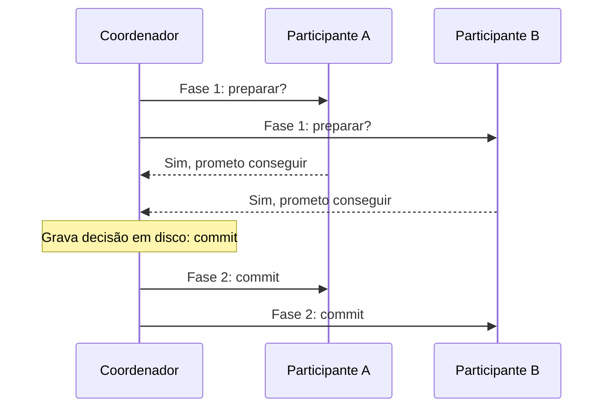

# 9. Consistência e consenso

> [!NOTE] Em uma frase
> Para que várias máquinas se comportem como se fossem uma só, elas precisam concordar sobre a ordem dos acontecimentos, e esse acordo, chamado consenso, é possível, mas custa desempenho e exige maioria.

## Por que isso importa

Alice e Bruno estão na mesma sala acompanhando a final da Copa em seus celulares. Alice atualiza e vê o placar final: acabou. Ela grita o resultado. Bruno atualiza a página dele logo depois e ainda vê o jogo em andamento, porque a requisição dele caiu numa réplica atrasada. Bruno sabe que o jogo acabou (ouviu Alice), e ainda assim o sistema mostra o passado. Cada réplica, isoladamente, estava "eventualmente consistente". O comportamento visível, porém, foi absurdo.

O [capítulo 8](08-os-problemas-dos-sistemas-distribuidos.md) mostrou que redes, relógios e processos não são confiáveis. Este capítulo constrói, por cima dessa bagunça, abstrações que permitem à aplicação ignorar parte dela, do mesmo jeito que transações escondem quedas e concorrência. A abstração mais importante é o **consenso**: fazer vários nós concordarem sobre algo, de forma irrevogável.

## O que você precisa saber antes

- [Capítulo 5](05-replicacao.md): atraso de replicação e [consistência eventual](../../glossario.md#consistência-forte-e-eventual).
- [Capítulo 8](08-os-problemas-dos-sistemas-distribuidos.md): timeouts, relógios, pausas, quóruns e fencing tokens.

## As ideias centrais

### Linearizabilidade: fingir que só existe uma cópia

**Linearizabilidade** (ou consistência forte, ou atomic consistency) é a garantia de que o sistema se comporta como se houvesse uma única cópia dos dados, e cada operação acontece num instante, entre o início e o fim da requisição. Consequência prática: **depois que alguém leu um valor novo, ninguém pode ler o antigo**. É exatamente o que faltou para Bruno.

Ela não é o mesmo que serializabilidade do [capítulo 7](07-transacoes.md). Serializabilidade fala de transações com várias operações parecerem executadas em alguma ordem serial. Linearizabilidade fala de um único registro parecer ter uma cópia só, com respeito ao tempo real. Um banco pode ter uma, a outra, as duas ou nenhuma.

Onde ela é necessária:
- **Eleição de líder e travas:** todos precisam concordar sobre quem detém a trava. É para isso que existem ZooKeeper e etcd.
- **Restrições de unicidade:** dois usuários não podem registrar o mesmo nome; é a mesma coisa que uma trava sobre o nome.
- **Canais cruzados:** um serviço grava uma imagem no armazenamento e manda uma mensagem pela fila para outro serviço redimensioná-la. Se a fila for mais rápida que a replicação do armazenamento, o segundo serviço lê a versão antiga.

Quem é linearizável? Replicação com líder único pode ser, se as leituras forem no líder. Algoritmos de consenso são. Replicação multi-líder não é. Sem líder com quóruns, em geral não é, pelos casos de borda do capítulo 5.

### O custo: CAP e latência

Se a rede se parte e uma réplica não alcança as outras, ela tem duas opções: recusar requisições (não fica disponível) ou responder com o que tem (deixa de ser linearizável). Essa é a forma correta de ler o teorema [CAP](../../glossario.md#cap): **quando houver partição de rede, escolha entre consistência e disponibilidade**. O livro critica o jeito popular de apresentá-lo ("escolha 2 de 3"), porque partições não são opcionais; elas acontecem, e o teorema só fala delas. Também é estreito demais: considera um único modelo de consistência e um único tipo de falha.

O motivo mais comum para abrir mão da linearizabilidade nem é tolerar partições: é **desempenho**. Garantir linearizabilidade exige coordenação, e o tempo de resposta fica proporcional à incerteza dos atrasos de rede. Até a memória RAM de um processador multinúcleo não é linearizável por padrão, pelo mesmo motivo.

### Ordem, causalidade e ordenação total

Por trás de tudo isso está a **ordem**. A ordem mais importante é a **causal**: se B foi feito por alguém que viu A, B depende de A, e todo mundo deve ver A antes de B. A pergunta vem antes da resposta. A criação da linha vem antes da atualização.

- **Ordem total:** quaisquer dois eventos podem ser comparados. A linearizabilidade impõe isso.
- **Ordem causal:** só eventos relacionados precisam estar ordenados; eventos concorrentes podem aparecer em qualquer ordem. É uma ordem parcial.

O livro mostra que a **consistência causal** é o modelo mais forte que ainda funciona durante partições de rede, e que muitas aplicações só precisam dela.

Como ordenar sem relógio confiável? Com **relógios de Lamport**: cada nó mantém um contador; toda operação leva `(contador, id_do_nó)`; ao receber uma mensagem com contador maior, o nó avança o seu. Isso gera uma ordem total consistente com a causalidade. Mas não basta para decidir na hora: para saber se um nome de usuário já foi pego, é preciso esperar ouvir todos os nós, porque alguém pode ter um timestamp menor ainda não visto. Falta saber quando a ordem está "fechada".

Isso leva ao **broadcast de ordem total**: um protocolo que entrega mensagens a todos os nós, sem perder nenhuma, **na mesma ordem para todos**. É exatamente o que a replicação de banco precisa: se todas as réplicas aplicarem as mesmas escritas na mesma ordem, ficam iguais. E o livro mostra que broadcast de ordem total equivale a consenso: quem tem um, constrói o outro.

### Commit em duas fases e seus limites

Transações que tocam várias partições ou vários sistemas precisam que todos confirmem ou todos desistam: **commit atômico**. O algoritmo clássico é o **2PC** (*two-phase commit*, não confundir com o 2PL do capítulo 7).

Ao responder "sim", o participante abre mão do direito de desistir: prometeu que, se mandado, vai confirmar. O ponto fraco aparece se o coordenador cair depois das promessas e antes de comunicar a decisão: os participantes ficam **em dúvida**, segurando travas, sem poder confirmar nem desistir sozinhos, até o coordenador voltar. 2PC bloqueia na falha do coordenador. Por isso, transações distribuídas entre sistemas diferentes (o padrão XA, por exemplo) têm fama de lentas e frágeis.

### Consenso tolerante a falhas

**Consenso** é: vários nós propõem valores e todos decidem o mesmo, com quatro propriedades. Acordo uniforme (ninguém decide diferente), integridade (ninguém decide duas vezes), validade (o decidido foi proposto por alguém) e terminação (todo nó que não cair acaba decidindo). A terminação é o que falta ao 2PC.

Algoritmos como **Paxos**, **Raft** e **Zab** (do ZooKeeper) resolvem isso desde que uma **maioria** de nós esteja viva e se comunicando. Com 5 nós, toleram 2 falhas. Funcionam assim, simplificando: há um líder por **época** (*term* no Raft), numerada em ordem crescente. Antes de decidir qualquer coisa, o líder precisa dos votos de uma maioria; como duas maiorias sempre têm um nó em comum, um líder de época antiga não consegue decidir nada depois que uma época nova começou. É a mesma ideia do fencing token, agora embutida no protocolo.

Na prática, poucos implementam consenso diretamente. Usa-se um serviço pronto: **ZooKeeper** ou **etcd**. Eles guardam pouca coisa (configuração, quem é líder, quem é dono de qual partição) e oferecem travas, eleição de líder, detecção de membros vivos e notificação de mudanças. Kafka (até migrar para seu próprio Raft, o KRaft), HBase e Kubernetes (via etcd) dependem disso.

## Onde isso aparece no mundo real

- **Kubernetes e etcd.** Todo o estado do cluster vive no etcd, que usa Raft; é por isso que se recomenda 3 ou 5 nós de controle, nunca 2 ou 4.
- **Spanner e CockroachDB.** Bancos que oferecem transações serializáveis distribuídas rodando consenso por partição e cuidando do tempo com rigor.
- **Unicidade de nome de usuário.** Qualquer sistema que garanta "nome único" em escala global está, conscientemente ou não, resolvendo consenso naquele ponto.

## Erros comuns de quem está aprendendo

- **Ler CAP como "escolha 2 de 3".** Partições acontecem; a escolha é o que fazer durante elas. Fora delas, a troca real é consistência contra latência.
- **Confundir linearizabilidade com serializabilidade.** Uma é sobre um objeto e tempo real; a outra, sobre transações e ordem serial.
- **Usar número par de nós no consenso.** Quatro nós toleram uma falha, igual a três, e custam mais.
- **Achar que 2PC resolve tudo.** Ele bloqueia se o coordenador cair na hora errada. Consenso tolerante a falhas é outra coisa.

## Verifique se entendeu

1. No caso de Alice e Bruno, que garantia faltou? (Linearizabilidade)
2. Por que "escolha 2 de 3" é uma leitura enganosa do CAP? (O custo: CAP e latência)
3. Qual a diferença entre ordem causal e ordem total, e qual delas sobrevive a partições? (Ordem, causalidade)
4. Em que momento um participante do 2PC fica preso, e por quê? (Commit em duas fases)
5. Por que dois líderes de épocas diferentes não conseguem decidir coisas contraditórias no Raft? (Consenso tolerante a falhas)

## Para ir além

- [Murat Demirbas, índice dos posts sobre DDIA](https://muratbuffalo.blogspot.com/2024/12/index-for-designing-data-intensive.html): os posts do capítulo 9 trazem leituras extras sobre FLP, Paxos e Raft.
- [Timi Learning, série DDIA](https://timilearning.com/tags/ddia/): o capítulo 9 está dividido em dois posts, um sobre linearizabilidade e ordem e outro sobre 2PC e consenso.
- [ept/ddia-references](https://github.com/ept/ddia-references): a lista do capítulo 9 inclui os papers de Raft, Paxos, Zab e a crítica ao teorema CAP.

---
Anterior: [8. Os problemas dos sistemas distribuídos](08-os-problemas-dos-sistemas-distribuidos.md) · Próximo: [10. Processamento em lote](10-processamento-em-lote.md) · Voltar ao livro: [Guia de leitura](index.md)
