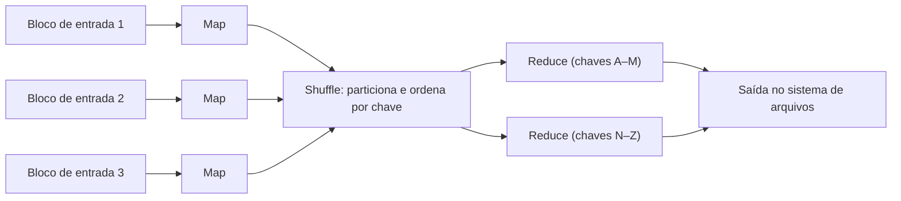

# 10. Processamento em lote

> [!NOTE] Em uma frase
> Processar em lote é ler um volume grande e fechado de dados, produzir um resultado novo e nunca alterar a entrada, o que torna possível errar, corrigir o código e simplesmente rodar de novo.

## Por que isso importa

Toda madrugada, uma loja virtual recalcula as recomendações de produtos de cada cliente a partir do histórico de compras de todos. Ninguém espera essa resposta em tempo real; o que importa é que o trabalho termine antes da manhã e que, se o algoritmo estiver errado, dê para corrigir e recalcular. Isso é processamento em **batch**, ou em lote.

O livro abre a terceira parte com uma distinção: **sistemas de registro** guardam a versão oficial dos dados (o banco transacional); **sistemas derivados** são produzidos a partir deles (caches, índices de busca, modelos, relatórios). Dado derivado é redundante, mas útil, e pode sempre ser refeito a partir da fonte. Batch é a forma mais antiga de produzir dado derivado. A diferença em relação ao streaming é resumida no glossário em [batch vs streaming](../../glossario.md#batch-vs-streaming): batch trabalha sobre um conjunto que tem fim.

## O que você precisa saber antes

- [Capítulo 3](03-armazenamento-e-recuperacao.md): armazenamento colunar e data warehouses, um destino comum de jobs em lote.
- [Capítulo 6](06-particionamento.md): particionamento por chave, que reaparece no MapReduce.
- Ter usado a linha de comando (`cat`, `grep`, `sort`) ajuda bastante.

## As ideias centrais

### A filosofia Unix

O livro começa por um exemplo de linha de comando. Para descobrir as cinco páginas mais acessadas de um site a partir do log do servidor web:

```
cat access.log | awk '{print $7}' | sort | uniq -c | sort -r -n | head -n 5
```

Cada programa faz uma coisa só, lê da entrada padrão e escreve na saída padrão, e todos falam a mesma "interface": linhas de texto. Isso permite combiná-los livremente num [pipeline](../../glossario.md#pipeline). E o `sort` do Unix lida sozinho com arquivos maiores que a memória, despejando partes ordenadas em disco e mesclando depois, a mesma ideia das SSTables do capítulo 3.

Princípios que o livro extrai daí e que valem para sistemas de dados:
- programas pequenos e combináveis;
- uma interface uniforme entre eles;
- **entrada imutável**: rodar de novo não estraga nada, então dá para experimentar à vontade;
- separar a lógica do programa da decisão de onde vêm e para onde vão os dados.

A limitação é rodar numa máquina só. O MapReduce é, em essência, essa filosofia distribuída por milhares de máquinas.

### MapReduce e o sistema de arquivos distribuído

O MapReduce, publicado pelo Google em 2004 e popularizado pelo Hadoop, lê e escreve arquivos num **sistema de arquivos distribuído** (o HDFS, no Hadoop), que espalha blocos de arquivos por muitas máquinas com réplicas.

Um job tem quatro passos, os mesmos do pipeline Unix:

1. Ler a entrada e quebrar em registros (cada linha do log).
2. **Map:** para cada registro, extrair pares chave-valor (a URL como chave).
3. Ordenar e agrupar todos os pares por chave. Essa etapa, o **shuffle**, é feita pelo framework: cada mapper particiona sua saída pelo hash da chave e cada reducer busca a sua parte de todos os mappers.
4. **Reduce:** para cada chave, receber todos os valores e produzir a saída (contar acessos por URL).



O framework tenta rodar cada mapper na máquina que já tem o bloco de entrada (**levar a computação até os dados**, em vez de mover os dados pela rede). Se uma tarefa falha, só ela é refeita, porque a entrada é imutável e a saída parcial é descartada. Problemas reais costumam exigir dezenas ou centenas de jobs encadeados, organizados por **orquestradores de workflow** como Oozie, Airflow ou Luigi.

### Junções em lote

Um job de lote frequentemente precisa juntar dois conjuntos: eventos de atividade de usuários e o banco de perfis, para saber, por exemplo, que páginas cada faixa etária visita. Consultar o banco remoto para cada evento seria lento demais e sobrecarregaria o banco. A solução é copiar o banco de perfis para o sistema de arquivos e fazer a junção localmente.

Há duas famílias:

- **Junção no reduce** (*sort-merge join*): os mappers dos dois conjuntos emitem a mesma chave (o ID do usuário). O shuffle junta tudo do mesmo usuário no mesmo reducer, com o perfil chegando primeiro. Funciona sempre, mas paga o custo da ordenação e da rede. Problema: uma chave com volume gigante (um usuário famoso) sobrecarrega um reducer só; a solução é espalhar as chaves quentes por vários reducers.
- **Junção no map:** quando um lado é pequeno o bastante para caber na memória, cada mapper carrega esse lado inteiro numa tabela hash e faz a junção sem shuffle (**broadcast hash join**). Ou, se os dois lados já estão particionados e ordenados do mesmo jeito, cada mapper junta suas partições correspondentes.

### Para que serve a saída

O resultado de um job de lote não é, em geral, um relatório para humanos. Exemplos do livro:

- **Construir índices de busca:** o Google criou o MapReduce para isso.
- **Construir bancos de chave-valor para leitura:** modelos de recomendação, classificadores de spam. O certo não é o job escrever linha a linha num banco de produção (lento, e pode deixar o banco meio atualizado se o job falhar), e sim gerar arquivos de banco prontos e trocá-los de uma vez.

Isso materializa um princípio: **saída imutável, tolerância a erro humano**. Se um deploy introduziu um bug, basta voltar o código e rodar de novo; a saída errada é jogada fora. O livro chama isso de tolerância a falhas humanas, algo que bancos que mutam estado no lugar não oferecem.

O livro também compara com bancos MPP (*massively parallel processing*, bancos analíticos paralelos): eles exigem modelar os dados antes de carregar; o Hadoop aceita qualquer arquivo e deixa a interpretação para depois, ideia que ficou conhecida como data lake.

### Além do MapReduce: engines de dataflow

O MapReduce tem um problema: cada job grava sua saída inteira em disco, replicada, antes de o próximo começar. Num workflow de 50 jobs, isso é muito I/O desperdiçado em estado intermediário que ninguém mais vai usar.

**Engines de dataflow** como Spark, Tez e Flink tratam o workflow inteiro como um único grafo de operadores. Os dados passam de um operador ao outro direto, em memória ou disco local, ordenando só quando necessário e reaproveitando a mesma máquina quando possível. Em caso de falha, recalculam o que se perdeu a partir de dados anteriores (o Spark rastreia a **linhagem** de cada pedaço de dado para isso). Para recálculos não darem resultados diferentes, os operadores precisam ser **determinísticos**.

Outras evoluções: interfaces de mais alto nível (Hive, Pig, Spark SQL, DataFrames), que voltam a ser declarativas e permitem otimização automática, como o SQL do [capítulo 2](02-modelos-de-dados-e-linguagens-de-consulta.md); e processamento de grafos em lote no modelo **Pregel** (ou *bulk synchronous parallel*), em que cada vértice troca mensagens com vizinhos em rodadas, útil para algoritmos como PageRank.

## Onde isso aparece no mundo real

- **Spark em data lakes.** Jobs diários em Spark lendo e escrevendo Parquet em armazenamento de objetos (S3, GCS) são o descendente direto do Hadoop.
- **Airflow orquestrando ETL.** DAGs do Airflow que encadeiam extração, transformação e carga são os "workflows de jobs" do livro.
- **Treino de modelos de ML.** Gerar o conjunto de [features](../../glossario.md#feature) para treinar um modelo é tipicamente um job de lote sobre o histórico inteiro, recalculável quando o código muda.

## Erros comuns de quem está aprendendo

- **Escrever direto no banco de produção de dentro do job.** Lento, sobrecarrega o banco e deixa dado parcial se o job falhar. Gere a saída e troque de uma vez.
- **Achar que MapReduce é o estado da arte.** Ele envelheceu; o livro já tratava Spark e Flink como sucessores. O que permanece são os princípios.
- **Usar operadores não determinísticos.** Ordem de iteração de hash, números aleatórios sem semente e hora atual tornam o recálculo após falha diferente do original.
- **Ignorar chaves quentes na junção.** Um reducer com 100 vezes mais dados atrasa o job inteiro.

## Verifique se entendeu

1. Que princípios da filosofia Unix reaparecem no MapReduce? (A filosofia Unix)
2. O que acontece na etapa de shuffle e por que ela é cara? (MapReduce e o sistema de arquivos distribuído)
3. Quando uma junção no map é possível e por que ela é mais barata? (Junções em lote)
4. Por que entrada e saída imutáveis tornam o batch tolerante a erros humanos? (Para que serve a saída)
5. Que desperdício as engines de dataflow eliminam? (Além do MapReduce)

## Para ir além

- [Notas por capítulo no Mintlify](https://mintlify.wiki/ps06756/Designing-Data-Intensive-Applications): a página do capítulo 10 tem diagramas de MapReduce e exemplos de junção.
- [Notas de keyvanakbary](https://github.com/keyvanakbary/learning-notes/blob/master/books/designing-data-intensive-applications.md): a seção do capítulo 10 resume as junções e a comparação com bancos MPP.
- [Murat Demirbas, índice dos posts sobre DDIA](https://muratbuffalo.blogspot.com/2024/12/index-for-designing-data-intensive.html): o post do capítulo 10 discute o papel atual do batch.

---
Anterior: [9. Consistência e consenso](09-consistencia-e-consenso.md) · Próximo: [11. Processamento de streams](11-processamento-de-streams.md) · Voltar ao livro: [Guia de leitura](index.md)
