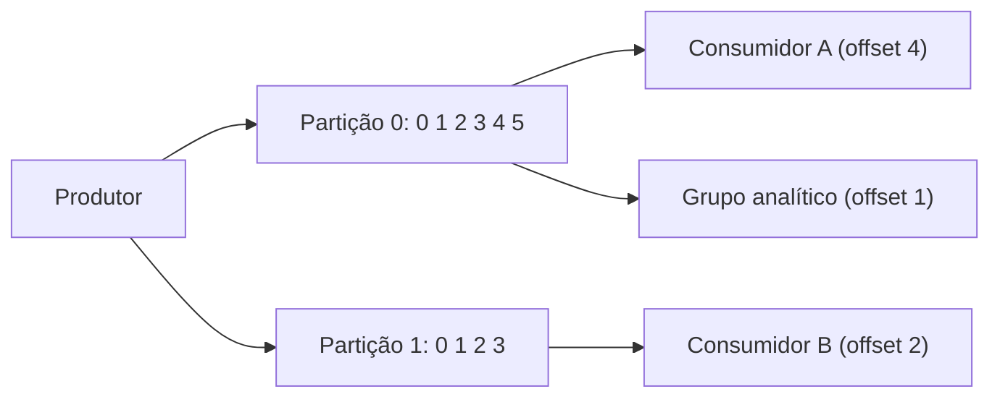

# 11. Processamento de streams

> [!NOTE] Em uma frase
> Um stream é um processamento em lote que nunca termina: em vez de esperar o dia acabar para processar os dados, cada evento é tratado logo que acontece.

## Por que isso importa

No [capítulo 10](10-processamento-em-lote.md), a loja recalculava recomendações toda madrugada. Mas um cliente que comprou uma barraca de camping às 10h deveria ver sacos de dormir já às 10h01, e não amanhã. E o sistema antifraude precisa bloquear um cartão no segundo seguinte a uma compra suspeita, não no relatório da noite. O mundo não espera o lote fechar.

**Streaming** é processar eventos conforme chegam, sem um fim definido (a diferença está resumida em [batch vs streaming](../../glossario.md#batch-vs-streaming)). Um **evento** é um registro pequeno, imutável, de algo que aconteceu em um momento: um clique, uma compra, uma leitura de sensor. Quem cria o evento é o **produtor**; quem processa, o **consumidor**. O desafio é tudo que o batch tinha de fácil (entrada fechada, reprocessar do zero) agora vira difícil.

## O que você precisa saber antes

- [Capítulo 10](10-processamento-em-lote.md): o raciocínio de dados derivados e jobs determinísticos.
- [Capítulo 4](04-codificacao-e-evolucao.md): passagem de mensagens assíncrona com brokers.
- [Fila e mensageria](../../glossario.md#fila-e-mensageria): componente que desacopla produtor e consumidor no tempo.

## As ideias centrais

### Transmitir eventos: filas tradicionais e logs

Produtores e consumidores podem se falar diretamente, mas o comum é um **broker de mensagens** no meio. Duas perguntas definem um sistema de mensageria: o que acontece se o produtor for mais rápido que o consumidor (descartar, enfileirar ou aplicar [backpressure](../../glossario.md#backpressure), isto é, frear o produtor)? E o que acontece se um nó cair (perde mensagens ou não)?

Há duas famílias de broker:

- **Fila tradicional** (RabbitMQ, ActiveMQ, SQS, padrões AMQP e JMS). O broker entrega cada mensagem a um consumidor, espera a confirmação (*ack*) e então **apaga** a mensagem. Bom para distribuir tarefas entre trabalhadores. Mas, se um consumidor falha antes do ack, a mensagem é reentregue a outro, possivelmente fora de ordem. E, uma vez processada, a mensagem some: não dá para reprocessar.
- **Broker baseado em log** (Kafka, Kinesis, Pulsar). O broker é um **log** só de acréscimo, dividido em partições. Mensagens não são apagadas ao serem lidas; cada consumidor guarda apenas o **offset** (a posição até onde já leu). Dentro de uma partição, a ordem é garantida. Para paralelizar, cada partição é atribuída a um consumidor de um grupo.

O log traz uma propriedade preciosa: como as mensagens ficam guardadas (em disco, por dias ou semanas), **um consumidor pode voltar e reprocessar**, exatamente como um job de lote reprocessa sua entrada. Ler é barato e não altera nada. Um consumidor lento não atrapalha os outros; se atrasar demais e passar do limite de retenção, perde mensagens, e por isso o atraso dos consumidores (*consumer lag*) é métrica essencial.

A troca: em fila tradicional, uma mensagem lenta não bloqueia as outras. No log, uma mensagem lenta numa partição segura todas as seguintes da mesma partição.

### Bancos de dados como streams

O livro faz uma conexão que é o coração da terceira parte: **um banco de dados também é um stream de mudanças**. O log de replicação do [capítulo 5](05-replicacao.md) já é um stream de eventos de escrita.

Isso resolve um problema prático. Uma aplicação guarda dados num banco, num cache e num índice de busca. Se o código escreve nos três (**escrita dupla**), cedo ou tarde eles divergem: duas escritas concorrentes chegam em ordem diferente em cada sistema, ou uma escrita falha no meio.

A alternativa é a **captura de mudanças de dados** (*change data capture*, CDC): ler o log de replicação do banco e publicar cada mudança como evento num log (como Kafka). O banco vira o líder, e o cache e o índice de busca viram seguidores que consomem as mudanças na mesma ordem. Ferramentas como Debezium fazem isso para MySQL e PostgreSQL. Para não guardar o log para sempre, usa-se **compactação de log**: manter só o valor mais recente de cada chave, o que permite reconstruir um seguidor do zero.

**Event sourcing** é a mesma ideia levada para o nível da aplicação. Em vez de guardar o estado atual ("carrinho tem 2 itens"), guarda-se a sequência de eventos do domínio ("item A adicionado", "item B adicionado", "item C removido"), imutável. O estado atual é derivado ao reprocessar os eventos. Vantagens: histórico completo, facilidade de criar novas visões dos mesmos dados, auditoria. Distinção importante: o **comando** (pedido do usuário, que pode ser recusado) só vira **evento** (fato) depois de validado.

Isso leva a uma ideia que o livro repete: **estado é o resultado de integrar um stream de eventos no tempo; stream é a derivada do estado**. O banco guarda a foto atual, e o log guarda o filme.

### Processar streams: usos e o problema do tempo

Processamentos comuns:
- **Processamento de eventos complexos:** procurar padrões ("três tentativas de login falhas seguidas de sucesso de outro país").
- **Analytics de stream:** taxas, médias e percentis em janelas de tempo.
- **Manter visões materializadas:** o cache ou índice de busca alimentado por CDC.
- **Busca sobre streams:** consultas guardadas que disparam quando um evento novo bate (alerta de imóvel novo no bairro).

O ponto mais sutil é o **tempo**. Há o **tempo do evento** (quando aconteceu no celular do usuário) e o **tempo de processamento** (quando chegou ao servidor). Um celular offline pode mandar eventos de horas atrás. Se você conta "pedidos por minuto" pelo tempo de processamento, uma reinicialização do consumidor cria um pico falso quando ele recupera o atraso.

Usando o tempo do evento, surge outro problema: **quando uma janela está completa?** Nunca se tem certeza; sempre pode chegar um evento atrasado (**retardatário**). Opções: ignorá-lo (e medir quantos foram ignorados) ou publicar uma correção. Tipos de janela: **tumbling** (fixas, sem sobreposição, como cada minuto cheio), **hopping** (fixas com sobreposição), **sliding** (todos os eventos a até X de distância uns dos outros) e **de sessão** (agrupa atividade de um usuário até um período de inatividade).

### Junções em streams

Três tipos:
- **Stream com stream:** juntar a busca feita e o clique no resultado, ambos eventos, dentro de uma janela de tempo. O processador guarda estado (buscas recentes) para casar com cliques que chegam depois.
- **Stream com tabela:** enriquecer cada evento de atividade com o perfil do usuário. Em vez de consultar o banco a cada evento, o processador mantém uma cópia local do perfil, atualizada por CDC.
- **Tabela com tabela:** manter uma visão materializada da junção de dois streams de mudanças, como a timeline do Twitter do [capítulo 1](01-confiavel-escalavel-sustentavel.md) mantida como cache.

Em todos, a ordem dos eventos entre streams diferentes importa e não é garantida, o que torna o resultado potencialmente não determinístico.

### Tolerância a falhas: exatamente uma vez

No batch, uma tarefa que falha é refeita do zero. Em streaming, não dá para esperar o fim, porque não há fim. Técnicas:

- **Microbatching** (Spark Streaming): dividir o stream em lotes de cerca de 1 segundo e tratar cada um como um mini-job.
- **Checkpoints** (Flink): gravar periodicamente o estado do processador para recomeçar dali.
- **Transações atômicas** entre a saída e o offset consumido (o Kafka oferece isso internamente).
- **[Idempotência](../../glossario.md#idempotência):** fazer o efeito de processar duas vezes igual a processar uma, por exemplo guardando o offset junto com a escrita e ignorando repetições.

O resultado desejado se chama **exatamente uma vez** (*exactly-once*), e o livro sugere que o nome mais honesto é **efetivamente uma vez**: a mensagem pode ser processada mais de uma vez, mas o efeito visível é como se fosse uma.

## Onde isso aparece no mundo real

- **Kafka como espinha dorsal.** O LinkedIn criou o Kafka para isso: um log central de eventos que alimenta busca, métricas, cache e data warehouse.
- **Debezium sincronizando Elasticsearch.** CDC do PostgreSQL para Kafka e daí para o índice de busca é o padrão que substitui escrita dupla.
- **Antifraude em tempo real.** Sistemas de pagamento rodam regras sobre janelas de eventos recentes de cada cartão, com Flink ou Kafka Streams.

## Erros comuns de quem está aprendendo

- **Escrever em banco e fila no mesmo código e achar que estão em sincronia.** Escrita dupla diverge. Use CDC ou o padrão de outbox (gravar o evento numa tabela na mesma transação e publicá-lo depois).
- **Agrupar janelas pelo tempo de processamento.** Atrasos e reinícios criam picos falsos. Use o tempo do evento e decida o que fazer com retardatários.
- **Acreditar em "exactly-once" de ponta a ponta sem idempotência.** Efeitos externos (mandar e-mail, cobrar cartão) ainda precisam ser idempotentes.
- **Ignorar o lag do consumidor.** Se ele crescer até passar da retenção, mensagens se perdem.

## Verifique se entendeu

1. Por que um broker baseado em log permite reprocessar e uma fila tradicional não? (Transmitir eventos)
2. Que problema a escrita dupla causa e como o CDC resolve? (Bancos de dados como streams)
3. Qual a diferença entre comando e evento no event sourcing? (Bancos de dados como streams)
4. Por que contar pedidos por minuto pelo tempo de processamento pode criar picos falsos? (Processar streams)
5. Por que "efetivamente uma vez" é um nome mais honesto que "exatamente uma vez"? (Tolerância a falhas)

## Para ir além

- [Murat Demirbas, índice dos posts sobre DDIA](https://muratbuffalo.blogspot.com/2024/12/index-for-designing-data-intensive.html): o post do capítulo 11 comenta processamento de streams com olhar crítico e indica leituras extras.
- [Notas por capítulo no Mintlify](https://mintlify.wiki/ps06756/Designing-Data-Intensive-Applications): a página do capítulo 11 traz diagramas de CDC, event sourcing e janelas.
- [ept/ddia-references](https://github.com/ept/ddia-references): a lista do capítulo 11 tem os textos de origem do Kafka e do modelo de dataflow com janelas.

---
Anterior: [10. Processamento em lote](10-processamento-em-lote.md) · Próximo: [12. O futuro dos sistemas de dados](12-o-futuro-dos-sistemas-de-dados.md) · Voltar ao livro: [Guia de leitura](index.md)
