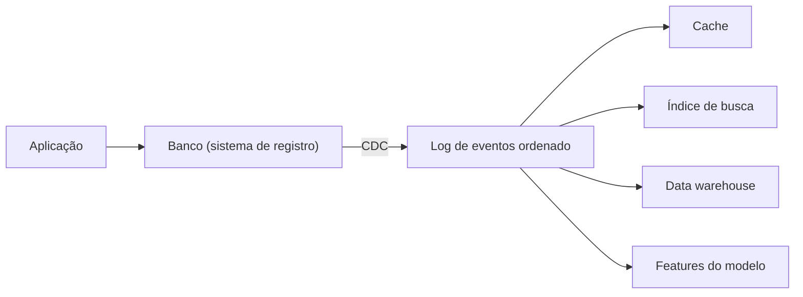

# 12. O futuro dos sistemas de dados

> [!NOTE] Em uma frase
> Nenhuma ferramenta faz tudo bem, então um sistema real combina várias; o jeito mais robusto de mantê-las coerentes é tratar uma como fonte e derivar as outras por fluxos de eventos, garantindo corretude de ponta a ponta e lembrando que os dados são sobre pessoas.

## Por que isso importa

Uma aplicação comum hoje tem PostgreSQL para o cadastro, Redis como cache, Elasticsearch para busca, um data warehouse para análise e um modelo de ML para recomendações. Cinco sistemas com cópias dos mesmos dados em formatos diferentes. A pergunta que todo time enfrenta: como garantir que, quando um produto muda de preço, todos os cinco reflitam a mudança, na ordem certa, sem perder nada e sem precisar de uma transação distribuída gigante?

Este capítulo é diferente dos anteriores: é a opinião do autor sobre como sistemas de dados deveriam ser construídos, juntando tudo o que veio antes. Algumas ideias já viraram prática comum; outras continuam propostas. Vale ler como argumento, não como descrição do estado da arte.

## O que você precisa saber antes

- [Capítulo 10](10-processamento-em-lote.md): dados derivados e reprocessamento.
- [Capítulo 11](11-processamento-de-streams.md): logs, CDC e event sourcing; esta página depende diretamente deles.
- [Capítulo 7](07-transacoes.md) e [capítulo 9](09-consistencia-e-consenso.md): transações e consenso, para entender o que o autor propõe trocar.

## As ideias centrais

### Integração de dados por fluxos derivados

O primeiro argumento: não existe ferramenta única que sirva a todos os padrões de acesso. Então o trabalho real é **integrar** ferramentas. E a forma mais confiável de integrar é deixar claro **qual sistema é a fonte da verdade** (sistema de registro) e quais são **derivados**, alimentados por um log de eventos em ordem.

Por que isso é melhor que transações distribuídas entre os sistemas? Transações distribuídas (o 2PC do capítulo 9) são frágeis e acoplam todos os sistemas ao mais lento. Um log ordenado, consumido por cada sistema derivado de forma idempotente, é assíncrono: se o índice de busca cair, os outros seguem, e ele recupera o atraso quando voltar.

Batch e streaming se combinam aqui. O livro discute a **arquitetura lambda** (rodar um caminho em lote, exato e lento, em paralelo com um caminho em stream, rápido e aproximado) e prefere unificar os dois no mesmo sistema, capaz tanto de reprocessar o histórico quanto de seguir os eventos novos. Reprocessar permite **evoluir o esquema** sem migração arriscada: cria-se uma nova visão derivada ao lado da antiga, migram-se os usuários aos poucos, e a velha é descartada.

### Desmembrar o banco de dados

O livro observa que um banco já faz, por dentro, o que essa arquitetura faz por fora: quando você cria um índice, o banco varre a tabela (como um batch), monta o índice e passa a atualizá-lo a cada escrita (como um stream). Um índice secundário é uma visão derivada, mantida automaticamente.

A proposta, chamada de **desmembrar o banco** (*unbundling*), é aplicar a mesma ideia entre sistemas: em vez de um banco que tenta fazer tudo, várias ferramentas especializadas, unidas por logs, como os programas Unix são unidos por pipes. A versão "à moda Unix" de um banco.

Isso muda o desenho das aplicações. Em vez de o código consultar o banco a cada requisição (puxar), os dados derivados são **empurrados** para quem precisa: uma mudança gera um evento que atualiza caches, telas abertas, notificações. A aplicação passa a ser uma **função que transforma fluxos** de eventos em estado derivado, num estilo que lembra planilhas: mude uma célula, e todas as fórmulas dependentes se recalculam sozinhas.

### Corretude de ponta a ponta

O segundo grande tema é a corretude. Transações dão uma sensação de segurança, mas não cobrem o caminho todo. Exemplo: um usuário clica em "pagar", a requisição chega ao servidor, a transação confirma, e a resposta se perde. O navegador mostra erro, o usuário clica de novo. A segunda transação também confirma. Cobrança dupla, com transações perfeitas.

O livro invoca o **argumento de ponta a ponta**, um princípio clássico de projeto de redes: algumas garantias só podem ser dadas pelas pontas da comunicação, não por camadas intermediárias. TCP elimina pacotes duplicados numa conexão, mas não requisições duplicadas de um usuário que recarregou a página. A solução precisa vir da ponta: o cliente gera um **ID único de requisição** no momento do clique, e o servidor grava esse ID com uma restrição de unicidade. A segunda tentativa encontra o ID já usado e não faz nada. É [idempotência](../../glossario.md#idempotência) construída na aplicação.

Essa ideia também permite **impor restrições sem coordenação síncrona**. Para garantir nome de usuário único com logs, todas as requisições para o mesmo nome vão para a mesma partição do log, e um consumidor único decide em ordem quem pegou primeiro. Para transferências entre contas, a requisição vira um único evento, com ID único, que depois é derivado em débito e crédito. Nenhuma transação distribuída é necessária.

O livro separa duas propriedades que a palavra "consistência" mistura:

- **Pontualidade** (*timeliness*): o usuário vê o estado atualizado. Violá-la é incômodo, mas temporário (o atraso de replicação some sozinho).
- **Integridade:** os dados não estão corrompidos nem perdidos; débito e crédito batem. Violá-la é permanente e grave.

A proposta é aceitar perder pontualidade de vez em quando, mas nunca integridade. Muitas restrições de negócio são mais flexíveis do que parecem: uma companhia aérea vende mais assentos do que tem (*overbooking*) e compensa depois. Pedir desculpas é um processo de negócio válido, se for raro.

Por fim, **confie, mas verifique**: hardware e software corrompem dados mais do que se imagina. Sistemas devem ter **auditoria**: checar periodicamente a integridade, e guardar eventos imutáveis permite recalcular e comparar.

### Fazer a coisa certa

O capítulo termina com ética. Sistemas de dados tomam decisões sobre pessoas: crédito, seguro, emprego, liberdade condicional. Modelos de **análise preditiva** aprendem com dados históricos e, por isso, reproduzem os vieses desses dados; quem é negado por um algoritmo muitas vezes nem sabe por quê nem tem como contestar. O livro pede responsabilidade sobre decisões automatizadas e cuidado com ciclos de realimentação (pontuação de crédito baixa impede emprego, que piora a pontuação).

Sobre **privacidade e rastreamento**, o autor propõe um exercício: troque a palavra "dados" por "vigilância" e veja se a frase ainda soa aceitável ("nossa empresa coleta vigilância em tempo real..."). Consentimento é frágil quando o usuário não entende o que está cedendo e não tem alternativa. Os pedidos concretos: coletar só o necessário, apagar quando não for mais preciso, tratar dados como algo que pode causar dano, e não só como ativo.

## Onde isso aparece no mundo real

- **Arquiteturas orientadas a eventos com Kafka.** Muitas empresas adotaram exatamente o desenho deste capítulo: banco como fonte, CDC para Kafka, sistemas derivados consumindo.
- **Chaves de idempotência em APIs de pagamento.** APIs como a do Stripe aceitam um cabeçalho de chave de idempotência que o cliente gera, aplicação direta do argumento de ponta a ponta.
- **LGPD e GDPR.** As leis de proteção de dados no Brasil e na Europa transformaram parte das recomendações éticas do capítulo em obrigação legal: finalidade, minimização e direito de apagar.

## Erros comuns de quem está aprendendo

- **Achar que transação no banco garante "sem duplicidade" para o usuário.** Retries do cliente atravessam transações. A deduplicação tem de ser de ponta a ponta.
- **Tratar todo atraso como violação grave.** Pontualidade e integridade são diferentes; muita coisa pode estar alguns segundos atrasada sem dano.
- **Ler o capítulo como descrição do mercado.** É uma proposta do autor. Algumas partes viraram padrão (CDC, logs centrais); outras seguem em debate.
- **Pular a parte de ética por parecer "não técnica".** Decisões de modelagem e retenção de dados são técnicas e têm consequências sobre pessoas reais.

## Verifique se entendeu

1. Por que integrar sistemas por um log ordenado é mais robusto que escrever em todos dentro de uma transação distribuída? (Integração de dados por fluxos derivados)
2. Em que sentido um índice secundário já é um "dado derivado"? (Desmembrar o banco de dados)
3. Como um ID de requisição gerado no cliente evita cobrança dupla? (Corretude de ponta a ponta)
4. Qual a diferença entre pontualidade e integridade, e qual delas é aceitável violar? (Corretude de ponta a ponta)
5. Que exercício o autor propõe para avaliar práticas de coleta de dados? (Fazer a coisa certa)

## Para ir além

- [Notas por capítulo no Mintlify](https://mintlify.wiki/ps06756/Designing-Data-Intensive-Applications): a página do capítulo 12 resume a proposta de desmembrar o banco com diagramas.
- [Notas de keyvanakbary](https://github.com/keyvanakbary/learning-notes/blob/master/books/designing-data-intensive-applications.md): a seção do capítulo 12 lista os argumentos de corretude e ética em tópicos.
- [ept/ddia-references](https://github.com/ept/ddia-references): a lista do capítulo 12 inclui o paper do argumento de ponta a ponta e textos sobre ética de dados.

---
Anterior: [11. Processamento de streams](11-processamento-de-streams.md) · Voltar ao livro: [Guia de leitura](index.md)
