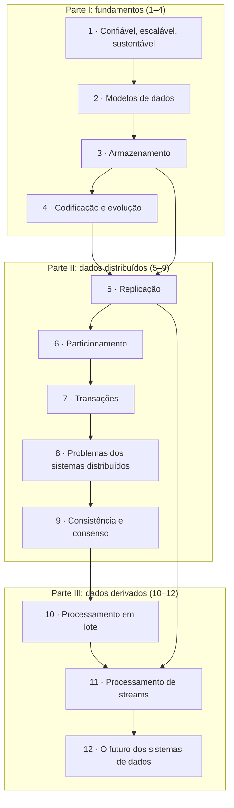

# Designing Data-Intensive Applications — guia de leitura

> [!NOTE] Em uma frase
> Todo sistema que guarda e move dados faz escolhas entre confiabilidade, escalabilidade e facilidade de manutenção; este livro mostra quais são essas escolhas e o que cada uma custa.

## Para quem é e quando ler

Para quem já constrói aplicações que usam banco de dados, cache ou fila e quer entender o que acontece por baixo dessas peças. O momento ideal é quando surgem perguntas como "por que salvei e não apareceu?", "qual banco escolher?", "o que acontece se o líder cair?" ou "como manter o índice de busca em sincronia com o banco?".

Não exige experiência com sistemas distribuídos. Exige ter escrito algum SQL e ter uma aplicação web na cabeça como referência. Os guias deste projeto definem cada termo na primeira vez em que aparece, então dá para acompanhar mesmo sem nunca ter operado um cluster.

## O que o livro NÃO é

- **Não é manual de uma ferramenta.** Ele cita PostgreSQL, Cassandra, Kafka e Spark como exemplos, mas o foco são os princípios que valem para qualquer uma delas.
- **Não é livro de entrevista de system design.** Não traz receitas de "projete o Twitter". Para isso, há o guia do [System Design Interview](../system-design-interview/index.md); DDIA explica o porquê por trás das respostas.
- **Não é tratado acadêmico.** Há teoria (linearizabilidade, consenso), mas sempre ligada a sistemas reais e incidentes.
- **Não é a palavra final sobre ferramentas.** A primeira edição é de 2017; ferramentas citadas evoluíram (o MapReduce cedeu lugar ao Spark, o Kafka deixou o ZooKeeper). Os princípios envelheceram bem. Existe uma segunda edição, revisada com um coautor e com os capítulos reorganizados; este guia segue a estrutura de 12 capítulos da primeira edição.

## Como o livro está organizado

São três partes. A primeira olha para uma máquina só; a segunda espalha os dados por várias; a terceira trata de como sistemas derivam dados uns dos outros.

- **Parte I, fundamentos (capítulos 1–4):** o que é um bom sistema de dados, como modelar dados, como eles são guardados em disco e como são codificados para trafegar entre versões diferentes do código.
- **Parte II, dados distribuídos (capítulos 5–9):** o que muda quando os dados vivem em várias máquinas: cópias, divisão, transações, falhas parciais e, no fim, como fazer as máquinas concordarem.
- **Parte III, dados derivados (capítulos 10–12):** como integrar vários sistemas produzindo dados derivados a partir de uma fonte, em lote ou em fluxo contínuo, e o que isso exige de corretude e de ética.

## Como ler

- **Ordem sugerida:** a do livro. Cada parte usa a anterior; em especial, o capítulo 9 depende do 8, e o 11 depende do 10 e do 5.
- **Para uma primeira passada rápida:** capítulos 1, 3, 5, 6, 7 e 11 cobrem o núcleo do que aparece no trabalho do dia a dia. Volte aos outros depois.
- **O que dá para pular na primeira leitura:** a seção de linguagens de consulta de grafos (capítulo 2), os detalhes de Thrift e Avro (capítulo 4) e a parte de processamento de grafos em lote (capítulo 10).
- **Ritmo:** um capítulo por semana funciona bem. Os capítulos 7, 8 e 9 são os mais densos; vale lê-los com calma, um de cada vez.
- **Como usar estes guias:** leia a página do capítulo antes (para saber o que procurar) ou depois (para checar o que ficou). As perguntas de "Verifique se entendeu" indicam a seção que responde cada uma.

## O que você leva ao terminar

- Saber descrever carga e desempenho com números (percentis) em vez de adjetivos.
- Escolher entre modelos de dados e motores de armazenamento pelo padrão de acesso, não por moda.
- Prever os problemas de replicação (dados atrasados, failover, conflitos) antes de eles aparecerem em produção.
- Saber o que o nível de isolamento do seu banco realmente garante e quais anomalias ele deixa passar.
- Entender por que redes e relógios não são confiáveis e como consenso, quóruns e fencing tokens contornam isso.
- Desenhar integração entre banco, cache, busca e análise com logs de eventos e CDC, em vez de escritas duplas.

## Capítulos

1. [Aplicações confiáveis, escaláveis e sustentáveis](01-confiavel-escalavel-sustentavel.md): o vocabulário para avaliar um sistema de dados e por que medir latência com percentis.
2. [Modelos de dados e linguagens de consulta](02-modelos-de-dados-e-linguagens-de-consulta.md): relacional, documentos e grafos, e quando cada um encaixa.
3. [Armazenamento e recuperação](03-armazenamento-e-recuperacao.md): como índices, LSM-trees, B-trees e armazenamento colunar guardam e encontram dados.
4. [Codificação e evolução](04-codificacao-e-evolucao.md): como formatos como JSON, Protobuf e Avro deixam versões antigas e novas do código conviverem.
5. [Replicação](05-replicacao.md): líder único, múltiplos líderes e sem líder, e os problemas do atraso entre réplicas.
6. [Particionamento](06-particionamento.md): dividir dados por intervalo ou hash, índices secundários, rebalanceamento e roteamento.
7. [Transações](07-transacoes.md): o que ACID promete, os níveis de isolamento e as anomalias que cada um deixa passar.
8. [Os problemas dos sistemas distribuídos](08-os-problemas-dos-sistemas-distribuidos.md): redes, relógios e pausas que tornam impossível ter certeza sobre outra máquina.
9. [Consistência e consenso](09-consistencia-e-consenso.md): linearizabilidade, ordenação, commit em duas fases e algoritmos de consenso como Raft.
10. [Processamento em lote](10-processamento-em-lote.md): da filosofia Unix ao MapReduce e às engines de dataflow como o Spark.
11. [Processamento de streams](11-processamento-de-streams.md): logs de eventos, CDC, event sourcing, janelas de tempo e processamento efetivamente uma vez.
12. [O futuro dos sistemas de dados](12-o-futuro-dos-sistemas-de-dados.md): integrar sistemas por dados derivados, corretude de ponta a ponta e ética.

## Fontes públicas para acompanhar

As [fontes públicas verificadas](fontes.md) reúnem notas por capítulo, séries de blog, um guia aberto com diagramas e o repositório oficial de referências do autor.
