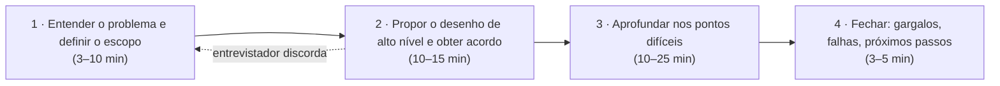

# 1. O método de 4 passos

> [!NOTE] Em uma frase
> Projetar um sistema não começa desenhando caixas: começa perguntando o que precisa ser construído, segue com um rascunho que todos aprovam, aprofunda nas partes difíceis e termina dizendo o que ficou de fora.

## Por que isso importa

Imagine que seu líder técnico diz, numa segunda-feira: "precisamos de um sistema de notificações". Um dev ansioso abre o editor e começa a escrever a tabela `notifications`. Três semanas depois descobre que as notificações eram push no celular (não e-mail), que o volume esperado era de 10 milhões por dia (não mil) e que o marketing queria agendar envios. Quase tudo que foi feito vai para o lixo. O problema não foi falta de técnica, foi falta de processo: ele respondeu antes de entender a pergunta.

Em uma entrevista de system design (a etapa em que pedem para você desenhar um sistema inteiro em 45 minutos, comum em empresas grandes de tecnologia), esse erro é fatal, e no trabalho real ele é caro. O capítulo 3 do volume 1 de Alex Xu propõe um roteiro de quatro passos que serve para os dois cenários. Este guia coloca esse capítulo primeiro porque todos os problemas das páginas seguintes ([rate limiter](problemas/01-rate-limiter.md), [chat](problemas/09-chat.md), etc.) são resolvidos com ele.

## O que você precisa saber antes

Nada além de saber o que é um servidor web e um banco de dados. Os componentes que aparecem nos desenhos (balanceador de carga, cache, fila) são explicados em [Escalar de zero a milhões](02-escalar-de-zero-a-milhoes.md), a próxima página; se algum termo aqui parecer estranho, ela resolve.

## As ideias centrais

### O que a entrevista (e o projeto real) avalia

A primeira ideia do livro desmonta uma expectativa errada: ninguém espera que você desenhe o sistema perfeito do Instagram em 45 minutos. Sistemas assim foram construídos por centenas de pessoas ao longo de anos. O que se avalia é o *processo*: se você faz boas perguntas, se colabora em vez de recitar uma resposta decorada, se percebe os pontos fracos do próprio desenho e se sabe justificar escolhas.

O livro lista os sinais ruins mais comuns, e eles valem para qualquer reunião de arquitetura:

- **Over-engineering** (superengenharia): construir para uma escala ou flexibilidade que ninguém pediu. Um sistema mais complexo custa mais para manter e falha de mais jeitos.
- **Mente estreita**: insistir numa solução sem considerar alternativas.
- **Teimosia**: ignorar as dicas do entrevistador, que muitas vezes está tentando te ajudar a não cair num buraco.

A boa notícia é que um processo repetível resolve a maior parte disso. É o que os quatro passos entregam.

Os tempos são os sugeridos pelo livro para uma entrevista de 45 minutos. No trabalho, cada passo pode durar dias, mas a proporção faz sentido: o grosso do esforço vai para o desenho e para o aprofundamento, não para o falatório inicial nem para o encerramento.

### Passo 1: entender o problema antes de responder

O passo mais importante, e o mais pulado. A regra é: não comece a desenhar enquanto não souber responder a estas perguntas.

- **Quais funcionalidades exatamente?** "Projete um news feed" pode significar só posts de amigos em ordem cronológica, ou um feed com ranking por relevância, anúncios, vídeos e stories. São sistemas muito diferentes.
- **Quantos usuários?** Mil usuários cabem num servidor só; cem milhões não.
- **Qual o ritmo de crescimento?** Esperar 10× em um ano muda as escolhas de hoje.
- **O que já existe?** Se a empresa já tem um serviço de autenticação e uma fila de mensagens, você usa, não reinventa.
- **Quais números importam?** Leituras por segundo, tamanho médio dos dados, latência aceitável (latência é o tempo entre o pedido e a resposta; veja [latência e throughput](../../glossario.md#latência-e-throughput)).

Um exemplo concreto, no estilo do livro, para "projete um news feed":

> Você: É app de celular, web ou os dois?
> Entrevistador: Os dois.
> Você: O feed é cronológico ou tem ranking?
> Entrevistador: Cronológico, para simplificar.
> Você: Quantos amigos um usuário pode ter? Quantos usuários ativos por dia?
> Entrevistador: Até 5.000 amigos; 10 milhões de usuários ativos por dia.
> Você: O post pode ter imagem e vídeo?
> Entrevistador: Sim.

Com quatro respostas, o problema virou outro: agora você sabe que o ranking está fora, que há mídia (precisa de armazenamento de arquivos e provavelmente de CDN) e que a escala é de dezenas de milhões de leituras por dia. Quando o entrevistador não sabe ou não quer responder, você assume algo razoável, *diz em voz alta* a suposição e anota. Isso não é fraqueza: é exatamente o que um engenheiro sênior faz numa reunião de kickoff.

### Passo 2: um desenho de alto nível que todos aprovam

Agora sim, caixas e setas. O objetivo deste passo é um rascunho do sistema inteiro, de ponta a ponta, sem detalhe fino: clientes (app, navegador), APIs, servidores web, banco de dados, cache, fila, CDN. Para o news feed, por exemplo, faz sentido separar dois fluxos: **publicar** um post (escrita) e **montar** o feed de alguém (leitura).

Três coisas fazem este passo funcionar:

1. **Tratar o entrevistador como colega de time.** Mostre o rascunho e pergunte "isso faz sentido para você?". Se ele discordar de algo grande, é muito mais barato corrigir agora do que depois de 20 minutos de detalhe. A seta tracejada no diagrama acima representa esse retorno.
2. **Fazer contas rápidas** quando o desenho depender de escala. Cabe num banco só? Precisa de cache? As técnicas estão em [Estimativas de ordem de grandeza](03-estimativas-de-ordem-de-grandeza.md). Antes de fazer as contas, vale perguntar se o entrevistador quer vê-las.
3. **Percorrer casos de uso concretos** pelo desenho ("o usuário A posta uma foto; o que acontece em cada caixa?"). Isso revela caixas faltando e casos de borda que você não tinha pensado.

Detalhes como esquema completo de banco ou endpoints de API entram só se o problema pedir. Para "projete o Google", ninguém quer ver as colunas das tabelas; para "projete um encurtador de URL", a API e o esquema *são* o problema.

### Passo 3: aprofundar onde dói

Com o desenho aprovado, você e o entrevistador escolhem os pontos que merecem atenção. Não dá para aprofundar tudo, e tentar é um erro. A pergunta-guia é: *qual parte deste sistema é difícil de verdade?* Em cada problema ela é diferente:

- num **encurtador de URL**, é a função que gera o código curto sem colisões;
- num **chat**, é manter conexões abertas com milhões de clientes e saber quem está online;
- num **news feed**, é distribuir um post para 5.000 feeds sem travar quando uma celebridade posta;
- num **rate limiter**, é contar requisições de forma correta quando há vários servidores ao mesmo tempo.

Um bom sinal de senioridade é perceber sozinho qual é esse ponto e propor aprofundar nele. Um sinal ruim é gastar 15 minutos detalhando o algoritmo de balanceamento de carga, que é um componente pronto e que ninguém pediu. Por isso, nas páginas de problema deste guia, existe sempre uma seção "Onde aprofundar" com os 2–3 pontos difíceis de cada sistema.

### Passo 4: fechar dizendo o que ficou de fora

Nos últimos minutos, o livro recomenda mostrar maturidade crítica sobre o próprio desenho. Bons tópicos para fechar:

- **Gargalos**: onde o sistema quebra primeiro se a carga dobrar? Nunca diga que o desenho é perfeito; todo desenho tem um ponto fraco.
- **Casos de erro**: o que acontece se um servidor cai, se a rede perde mensagens, se o banco fica lento?
- **Operação**: como monitorar (métricas, logs, alertas), como fazer deploy de uma versão nova sem derrubar tudo.
- **A próxima escala**: o desenho aguenta 1 milhão de usuários; o que mudaria para 10 milhões?
- **Resumo**: uma recapitulação curta das decisões e do porquê de cada uma.

### Fazer e não fazer

Juntando as recomendações do capítulo numa lista prática:

| Faça | Evite |
|---|---|
| Perguntar até entender o requisito | Responder a primeira pergunta com um desenho |
| Falar em voz alta o que está pensando | Ficar calado desenhando |
| Propor mais de uma abordagem quando houver | Defender a primeira ideia até o fim |
| Começar pelos componentes mais importantes | Mergulhar em detalhe antes de ter o todo |
| Pedir dicas quando travar | Ignorar as dicas que o entrevistador dá |

## Onde isso aparece no mundo real

- **Design docs e RFCs.** Muitas empresas pedem um documento antes de construir algo grande. A estrutura comum (contexto e requisitos, proposta, alternativas consideradas, riscos e pontos em aberto) é praticamente o método de 4 passos por escrito. A seção "alternativas consideradas" é o passo 4 obrigatório.
- **Reuniões de kickoff de projeto.** O passo 1 é a reunião em que se descobre que "relatório em tempo real" significa "atualizado uma vez por dia", o que corta 80% da complexidade.
- **Revisões de arquitetura.** Quando um time mais experiente revisa uma proposta, a primeira pergunta quase sempre é de escopo e escala ("quantas requisições por segundo isso recebe?"), e a segunda é "o que acontece quando isto cai?". São os passos 1 e 4.

## Erros comuns de quem está aprendendo

- **Achar que o passo 1 é perda de tempo.** Parece que perguntar é "enrolar". Na verdade é onde se decide 80% do desenho: as respostas às perguntas de escala determinam se você precisa de sharding, cache ou fila. Correção: só passe para o passo 2 quando conseguir escrever os requisitos em 3–5 linhas.
- **Decorar soluções.** Quem decorou "o desenho do Twitter" trava quando o entrevistador muda um requisito. Correção: estude cada problema como aplicação do método, prestando atenção ao *porquê* de cada caixa.
- **Aprofundar em tudo por igual.** Detalhar o balanceador de carga e não falar do ponto difícil. Correção: no passo 3, escolha explicitamente 2–3 pontos e diga por que eles.
- **Esconder os pontos fracos.** Dizer "este desenho não tem gargalos" é um sinal ruim. Correção: aponte você mesmo onde o sistema quebra primeiro e o que faria a respeito.

## Verifique se entendeu

1. Por que o livro diz que ninguém espera um desenho perfeito, e o que se avalia no lugar? (seção "O que a entrevista avalia")
2. Cite quatro perguntas de escopo que você faria antes de projetar um sistema de upload de fotos. (seção "Passo 1")
3. Para que serve percorrer um caso de uso concreto pelo desenho de alto nível? (seção "Passo 2")
4. Como decidir em que parte do sistema aprofundar? Dê um exemplo de algo que *não* vale aprofundar. (seção "Passo 3")
5. Que tópicos você abordaria nos últimos cinco minutos para mostrar senso crítico sobre o próprio desenho? (seção "Passo 4")

## Para ir além

- [Notas do capítulo no booknotes (preslavmihaylov)](https://github.com/preslavmihaylov/booknotes/tree/master/system-design/system-design-interview/chapter04): resume os quatro passos com os tempos sugeridos e a lista de faça/evite do capítulo.
- [Notas do capítulo no system-design-notes (liquidslr)](https://github.com/liquidslr/system-design-notes/tree/main/03.%20System%20Design%20Framework): versão em prosa do mesmo framework, boa para uma segunda leitura.
- [topofmind.dev, notas do livro](https://topofmind.dev/notes/system-design/system-design-interview-alex-xu/): inclui o capítulo do framework com comentários do autor das notas.
- [donnemartin/system-design-primer](https://github.com/donnemartin/system-design-primer): a seção "How to approach a system design interview question" traz um roteiro de 4 passos equivalente, com outro olhar.

---
Próximo: [Escalar de zero a milhões](02-escalar-de-zero-a-milhoes.md) · Voltar ao livro: [Guia de leitura](index.md)
