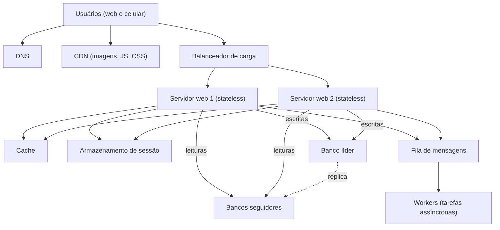

# 2. Escalar de zero a milhões de usuários

> [!NOTE] Em uma frase
> Um sistema grande não nasce grande: ele cresce trocando um gargalo por outro, e cada componente clássico (balanceador, réplica, cache, CDN, fila, shard) existe para resolver um gargalo específico.

## Por que isso importa

Pense num app de receitas feito num fim de semana: um servidor na nuvem roda o código, o banco de dados e serve as imagens. Funciona bem com 100 usuários. Aí uma receita viraliza no TikTok, chegam 50 mil pessoas em uma hora, o servidor fica sem memória e cai. Ao reiniciar, cai de novo. Não existe "botão de escalar": cada mudança que permitiria aguentar a carga resolve um problema específico e cria outro.

O capítulo 1 do volume 1 conta essa história passo a passo, de um servidor até milhões de usuários. É o vocabulário de todo o resto do livro: quando uma página de problema diz "coloque um cache na frente do banco" ou "particione por ID de usuário", a justificativa está aqui. Quem domina esta página consegue ler qualquer desenho de alto nível.

## O que você precisa saber antes

O [método de 4 passos](01-o-metodo-de-4-passos.md) dá o contexto de *quando* este vocabulário é usado (no passo 2, o desenho de alto nível). Fora isso, basta saber que um navegador faz uma requisição HTTP a um servidor e recebe uma resposta.

## As ideias centrais

### Do servidor único à primeira divisão

No começo, tudo roda numa máquina. O usuário digita `receitas.com`, o DNS (o "catálogo telefônico" da internet, que traduz nomes em endereços IP) devolve o IP do servidor, e o navegador conversa direto com ele.

O primeiro passo de crescimento é **separar o banco de dados** do servidor web. Motivo: os dois disputam CPU e memória de jeitos diferentes, e separados podem crescer de forma independente. Aqui aparece a primeira escolha: banco relacional (SQL, tabelas e JOINs, como PostgreSQL e MySQL) ou não relacional (NoSQL, como chave-valor, documentos, colunas ou grafos). O livro recomenda relacional por padrão, e NoSQL quando você precisa de latência muito baixa, os dados não têm estrutura relacional, ou o volume é enorme e você só precisa serializar e guardar.

Depois vem a escolha entre dois jeitos de crescer:

- **Escala vertical** ("scale up"): trocar por uma máquina maior. É simples, mas tem teto (não existe máquina infinita) e a máquina continua sendo um ponto único de falha (se ela cai, tudo cai).
- **Escala horizontal** ("scale out"): adicionar mais máquinas. Não tem teto prático, mas exige que o sistema saiba distribuir o trabalho.

Para sistemas grandes, a resposta é horizontal. O resto do capítulo é sobre como fazer isso funcionar.

### Balanceador de carga e réplicas do banco

Com dois ou mais servidores web, alguém precisa decidir para qual vai cada requisição. Esse é o **balanceador de carga** (load balancer): ele recebe o tráfego num IP público e repassa para os servidores atrás dele, que ficam numa rede privada. Ganho imediato: se um servidor cai, o balanceador manda tudo para os outros; se o tráfego sobe, você adiciona servidores.

O banco ainda é único. A solução é a [replicação](../../glossario.md#replicação): manter cópias do mesmo dado em várias máquinas. No modelo que o livro apresenta, um banco **líder** (chamado de master nas edições antigas) recebe todas as escritas, e vários **seguidores** recebem cópias e atendem leituras. Como a maioria dos sistemas lê muito mais do que escreve (um feed é lido dezenas de vezes para cada post), isso multiplica a capacidade de leitura. Se um seguidor cai, as leituras vão para outro; se o líder cai, um seguidor é promovido (o livro alerta que, na prática, isso é delicado: o seguidor pode não ter as últimas escritas).

### Cache e CDN: não refazer trabalho

Mesmo com réplicas, ir ao banco é lento. Um [cache](../../glossario.md#cache) é uma cópia do dado num lugar mais rápido, em geral na memória (Redis e Memcached são os exemplos clássicos). O padrão mais comum é o *cache-aside* (chamado de read-through no livro): o servidor procura no cache; se não acha, busca no banco e guarda no cache para a próxima vez.

Cachear traz decisões que o livro lista explicitamente:

- **Quando usar**: dado lido com frequência e alterado raramente. Cache fica na memória e some se o servidor reinicia, então nunca guarde lá a única cópia de algo importante.
- **Expiração** (TTL, "time to live", o tempo até a cópia ser descartada): curta demais, você vai ao banco o tempo todo; longa demais, mostra dado velho.
- **Consistência**: banco e cache são atualizados em operações separadas, então por um momento podem discordar.
- **Ponto único de falha**: um servidor de cache sozinho, se cair, despeja toda a carga no banco de uma vez. Use vários.
- **Política de despejo**: quando o cache enche, quem sai? O mais comum é LRU (sai o usado há mais tempo).

A **CDN** (Content Delivery Network) é o mesmo princípio aplicado a arquivos estáticos (imagens, vídeos, CSS, JavaScript): uma rede de servidores espalhados pelo mundo que guarda cópias perto do usuário. A foto da receita sai de um servidor em São Paulo em vez de um na Virgínia. Os cuidados são parecidos: custo (você paga por tráfego), expiração e o que fazer se a CDN cair (o cliente deve conseguir buscar na origem).

### Tirar o estado do servidor web

Há um obstáculo escondido no balanceamento: se o servidor 1 guarda na memória a sessão do usuário (quem está logado, o carrinho), e a próxima requisição vai para o servidor 2, o usuário "perde" a sessão. Esse servidor é [stateful](../../glossario.md#stateless-e-stateful): guarda estado entre requisições.

A solução é deixar os servidores web **stateless**: o estado vai para um armazenamento compartilhado (Redis, um banco NoSQL), e qualquer servidor atende qualquer requisição. Isso é o que permite adicionar e remover servidores automaticamente conforme a carga (autoscaling). É uma das ideias mais repetidas no livro inteiro.

### Vários data centers, filas e observabilidade

Para usuários no mundo inteiro e para sobreviver à queda de uma região, o próximo passo é ter **vários data centers**. Um DNS geográfico (geoDNS) manda cada usuário para o mais próximo; se um data center cai, todo o tráfego vai para o outro. Os desafios são sincronizar dados entre eles e testar o deploy em todos.

A **[fila de mensagens](../../glossario.md#fila-e-mensageria)** desacopla quem pede um trabalho de quem o executa. Exemplo: o usuário sobe uma foto; o servidor web coloca "gerar miniaturas da foto 42" numa fila e responde na hora. Workers (processos que consomem a fila) fazem o trabalho pesado depois. Se a fila cresce, você adiciona workers; se os workers caem, as mensagens esperam na fila.

Com dezenas de servidores, você não consegue mais entrar em cada um para ver o que está acontecendo. O livro insiste em **logs, métricas e automação** (integração e deploy contínuos) como parte do desenho, não como luxo. Isso se conecta à ideia de [observabilidade](../../glossario.md#observabilidade).

### Sharding: quando o banco não cabe mais

Por fim, o próprio banco líder vira gargalo: dados demais para uma máquina, escritas demais para um líder só. A resposta é [particionar (sharding)](../../glossario.md#particionamento-sharding): dividir os dados em pedaços, cada um num servidor. Por exemplo, `user_id % 4` decide em qual dos quatro shards ficam os dados de cada usuário.

A decisão crítica é a **chave de shard**: ela precisa espalhar os dados de forma uniforme. Os problemas que o livro aponta:

- **Resharding**: quando um shard enche ou cresce mais rápido que os outros, redistribuir dados é caro. A técnica que suaviza isso é o [consistent hashing](problemas/02-consistent-hashing.md).
- **Celebridades (hotspot)**: se um shard guarda a Taylor Swift, ele recebe muito mais leitura que os outros. Às vezes a saída é dar um shard só para ela.
- **JOINs**: dados em shards diferentes não se juntam com um JOIN; é comum desnormalizar (duplicar dados para evitar o JOIN).

O livro fecha com uma lista que resume tudo: web tier stateless, redundância em cada camada, cache sempre que possível, vários data centers, estáticos na CDN, sharding no banco, componentes desacoplados em serviços independentes, e monitoramento com automação.

## Onde isso aparece no mundo real

- **Stack Overflow** ficou famoso por servir um dos sites mais acessados do mundo com poucos servidores grandes, usando escala vertical e cache agressivo. É um lembrete de que a trilha deste capítulo não é obrigatória: você sobe os degraus quando o gargalo aparece.
- **Instagram**, no começo, documentou publicamente a migração para PostgreSQL particionado por ID de usuário, com IDs que embutem o número do shard. É sharding com chave escolhida para que os dados de um usuário fiquem juntos.
- **Sessões em Redis** são padrão em praticamente todo framework web moderno exatamente para permitir servidores stateless atrás de um balanceador.

## Erros comuns de quem está aprendendo

- **Usar todos os componentes desde o primeiro dia.** O capítulo é uma trilha de crescimento, não uma lista de compras. Correção: cada componente entra quando um gargalo concreto aparece; no desenho, justifique cada caixa pelo problema que ela resolve.
- **Achar que cache é sempre bom.** Cache sem estratégia de expiração mostra dado velho; cache como única cópia perde dado. Correção: decida TTL, despejo e o que acontece quando o cache cai.
- **Esquecer que réplica atrasa.** Ler de um seguidor logo depois de escrever no líder pode devolver o valor antigo. Correção: para leituras que precisam do dado recém-escrito, leia do líder (veja [consistência](../../glossario.md#consistência-forte-e-eventual)).
- **Tratar sharding como simples.** Ele quebra JOINs, transações entre shards e cria hotspots. Correção: é o último degrau, não o primeiro.

## Verifique se entendeu

1. Por que escala vertical tem limite, e qual outro problema ela não resolve? (seção "Do servidor único à primeira divisão")
2. Num sistema com muito mais leituras que escritas, por que replicação com um líder e vários seguidores ajuda? (seção "Balanceador de carga e réplicas do banco")
3. Que cinco decisões você precisa tomar ao introduzir um cache? (seção "Cache e CDN")
4. Por que um servidor que guarda a sessão em memória atrapalha o balanceamento de carga? (seção "Tirar o estado do servidor web")
5. O que é uma chave de shard ruim, e que problema ela causa? (seção "Sharding")

## Para ir além

- [ByteByteGo, Scale From Zero To Millions Of Users](https://bytebytego.com/courses/system-design-interview/scale-from-zero-to-millions-of-users): o texto integral deste capítulo, publicado pelo autor, com as figuras originais de cada degrau.
- [Notas do capítulo no booknotes (preslavmihaylov)](https://github.com/preslavmihaylov/booknotes/tree/master/system-design/system-design-interview/chapter02): resumo em tópicos de cada componente e das considerações de cache e sharding.
- [topofmind.dev, notas do livro](https://topofmind.dev/notes/system-design/system-design-interview-alex-xu/): notas do capítulo 1 com diagramas e comentários críticos.
- [donnemartin/system-design-primer](https://github.com/donnemartin/system-design-primer): seções sobre DNS, CDN, balanceador, cache, replicação e particionamento, cada uma com prós e contras.

---
Anterior: [O método de 4 passos](01-o-metodo-de-4-passos.md) · Próximo: [Estimativas de ordem de grandeza](03-estimativas-de-ordem-de-grandeza.md) · Voltar ao livro: [Guia de leitura](index.md)
