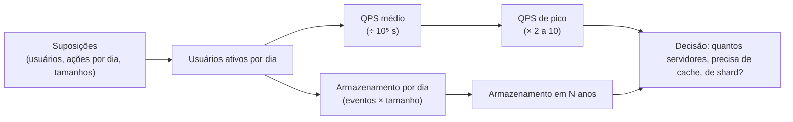

# 3. Estimativas de ordem de grandeza

> [!NOTE] Em uma frase
> Antes de escolher componentes, faça contas rápidas e arredondadas de requisições por segundo, armazenamento e latência; elas dizem se o problema cabe numa máquina ou exige uma frota, e o resultado só precisa estar certo na ordem de grandeza.

## Por que isso importa

Uma pessoa propõe "vamos guardar todos os logs de acesso no PostgreSQL". Outra pergunta: quantos acessos por dia? São 200 milhões, cada linha com uns 500 bytes. Isso dá 100 GB por dia, 36 TB por ano. De repente fica claro que um banco relacional numa máquina só não é o lugar, e a discussão muda de rumo em um minuto, sem protótipo nem teste de carga. É isso que uma *estimativa de guardanapo* (back-of-the-envelope, no original: contas feitas no verso de um envelope) entrega: uma noção de tamanho que separa ideias viáveis de ideias impossíveis.

O capítulo 2 do volume 1 é curto, mas é usado em todos os problemas do livro. Nas páginas de problema deste guia, a seção "Requisitos e escopo" quase sempre termina com uma conta dessas, e é ela que justifica coisas como "precisamos de sharding" ou "cabe tudo em memória".

## O que você precisa saber antes

O vocabulário de componentes de [Escalar de zero a milhões](02-escalar-de-zero-a-milhoes.md) (cache, réplica, shard), porque as contas servem para decidir quando cada um entra. E o conceito de [latência e throughput](../../glossario.md#latência-e-throughput): latência é quanto tempo uma operação demora; throughput é quantas operações por segundo o sistema aguenta.

## As ideias centrais

### Unidades: potências de dois e de dez

Dados são medidos em bytes (1 byte = 8 bits; um caractere ASCII ocupa 1 byte). Para contas de cabeça, trate as unidades como potências de mil, mesmo sabendo que a definição exata usa potências de dois (1 KB "de verdade" = 1.024 bytes). A diferença é de poucos por cento e não muda nenhuma decisão.

| Unidade | Aproximação | Exemplo para calibrar a intuição |
|---|---|---|
| KB (kilobyte) | 10³ bytes (mil) | um e-mail de texto |
| MB (megabyte) | 10⁶ bytes (milhão) | uma foto de celular comprimida |
| GB (gigabyte) | 10⁹ bytes (bilhão) | um filme em qualidade média |
| TB (terabyte) | 10¹² bytes (trilhão) | um disco de notebook grande |
| PB (petabyte) | 10¹⁵ bytes (quatrilhão) | o acervo de mídia de uma rede social média |

Um atalho útil: um dia tem 86.400 segundos, que você arredonda para **100 mil** (10⁵). Assim, "X por dia" dividido por 10⁵ dá "por segundo". Um milhão de eventos por dia é ~10 por segundo; um bilhão por dia é ~10 mil por segundo.

### Latências que todo dev deveria conhecer

Uma tabela famosa, originalmente compilada por Jeff Dean no Google, mostra quanto custam operações básicas num computador. Os valores exatos são de por volta de 2010 e o hardware melhorou, mas as *proporções* continuam valendo, e são elas que importam.

| Operação | Ordem de grandeza |
|---|---|
| Ler da cache L1 do processador | ~1 nanossegundo |
| Ler da memória RAM | ~100 nanossegundos |
| Comprimir 1 KB com um algoritmo rápido | ~10 microssegundos |
| Ler 1 MB sequencial da memória | ~250 microssegundos |
| Ida e volta de rede dentro do mesmo data center | ~500 microssegundos |
| Uma busca (seek) em disco rotativo | ~10 milissegundos |
| Ler 1 MB sequencial de disco rotativo | ~30 milissegundos |
| Pacote de ida e volta Califórnia → Holanda → Califórnia | ~150 milissegundos |

Lembrete das unidades: 1 milissegundo = 1.000 microssegundos = 1.000.000 nanossegundos. As conclusões que o livro tira da tabela:

- **Memória é rápida, disco é lento.** Ler da RAM é cerca de 100 mil vezes mais rápido que um seek em disco rotativo. É por isso que [cache](../../glossario.md#cache) funciona tão bem. SSDs encurtam bastante essa distância, mas a RAM continua ordens de grandeza à frente.
- **Evite seeks em disco.** Ler em sequência é muito mais barato do que pular entre posições.
- **Compressão é barata.** Comprimir antes de mandar pela rede quase sempre compensa.
- **Distância geográfica custa caro.** A física (velocidade da luz em fibra) impõe ~150 ms para cruzar o planeta e voltar. Nenhuma otimização de código resolve; só colocar dados mais perto do usuário (CDN, vários data centers).

### Disponibilidade em noves

[Disponibilidade](../../glossario.md#disponibilidade) é a fração do tempo em que o sistema funciona. Ela costuma ser dita em "noves", e é útil converter para tempo fora do ar, porque é assim que as pessoas sentem:

| Disponibilidade | Fora do ar por ano | Por mês (aprox.) |
|---|---|---|
| 99% ("dois noves") | ~3,65 dias | ~7 horas |
| 99,9% | ~8,8 horas | ~44 minutos |
| 99,99% | ~53 minutos | ~4,4 minutos |
| 99,999% | ~5,3 minutos | ~26 segundos |

Cada nove a mais divide o tempo de queda por dez e, na prática, custa muito mais engenharia. Provedores de nuvem publicam essas metas em contratos chamados SLA (Service Level Agreement, um acordo com consequência, como desconto na fatura, se a meta não for cumprida). Internamente, times usam [SLOs](../../glossario.md#slo), metas parecidas sem o lado contratual.

### O roteiro de uma estimativa

QPS (queries per second) é o número de requisições por segundo. O pico importa mais que a média, porque é no pico que o sistema cai.

### Um exemplo completo

Vamos estimar um app de fotos parecido com o Instagram. Suposições, todas ditas em voz alta e anotadas:

- 200 milhões de usuários ativos por mês; metade usa todo dia → **100 milhões de usuários ativos por dia** (DAU).
- Cada usuário ativo posta em média 0,5 foto por dia e abre o feed 20 vezes por dia.
- Uma foto ocupa em média 2 MB (já comprimida); os metadados (legenda, autor, data) ~1 KB.
- Guardamos tudo por 5 anos.

**Escritas (postagens):** 100 milhões × 0,5 = 50 milhões por dia. Dividindo por 10⁵ segundos: **~500 QPS** de escrita. Com pico de 2×: ~1.000 QPS.

**Leituras (feed):** 100 milhões × 20 = 2 bilhões por dia → **~20.000 QPS**, pico de ~40.000. A razão leitura/escrita é de 40 para 1: um sinal forte para réplicas de leitura e cache.

**Armazenamento de fotos:** 50 milhões × 2 MB = 100 TB por dia. Em um ano, ~36 PB; em 5 anos, **~180 PB**. Isso não cabe em banco nenhum: vai para armazenamento de objetos (como S3) e é servido por CDN.

**Metadados:** 50 milhões × 1 KB = 50 GB por dia, ~90 TB em 5 anos. Cabe num banco, mas não numa máquina só durante 5 anos: vai precisar de [particionamento](../../glossario.md#particionamento-sharding).

Em cinco minutos de conta, saíram quatro decisões de arquitetura. Nenhum número está "certo", e não precisa: errar por 2× não muda nada; errar por 1.000× muda tudo.

### Dicas do livro para não se perder

- **Arredonde sem dó.** "99.987 / 9,1" vira "100.000 / 10". O objetivo é o processo, não a precisão.
- **Escreva as suposições.** Você vai voltar a elas, e o entrevistador (ou colega) pode corrigir uma delas sem invalidar o resto.
- **Ponha unidade em tudo.** "5" é 5 KB ou 5 MB? Esse tipo de confusão gera erros de mil vezes.
- **Saiba o que costuma ser pedido:** QPS (médio e de pico), armazenamento, tamanho do cache e número de servidores.

## Onde isso aparece no mundo real

- **Planejamento de capacidade.** Antes de uma Black Friday, times de e-commerce fazem exatamente esta conta (QPS de pico esperado × custo por requisição) para decidir quantas máquinas reservar.
- **Escolha de armazenamento.** O salto de "cabe num PostgreSQL" para "precisa de armazenamento de objetos" quase sempre é decidido por uma estimativa de bytes por dia vezes dias de retenção, como no exemplo acima.
- **Metas de disponibilidade.** Quando alguém pede "cinco noves", converter para "5 minutos fora do ar por ano, incluindo deploys" costuma encerrar a conversa e trazer a meta para algo realista.

## Erros comuns de quem está aprendendo

- **Buscar precisão.** Gastar tempo calculando 86.400 exatos. Correção: ordem de grandeza é o objetivo; 10⁵ segundos por dia é suficiente.
- **Esquecer o pico.** Dimensionar pela média faz o sistema cair justamente no horário de maior uso. Correção: aplique um fator de pico (2× é o padrão do livro; eventos sazonais podem ser 10× ou mais).
- **Confundir usuários totais com ativos.** Um app com 1 bilhão de contas pode ter 100 milhões de ativos por dia. Correção: sempre parta de DAU.
- **Decorar a tabela de latências como verdade atual.** Os números são de uma época de discos rotativos. Correção: guarde as proporções (memória ≫ SSD ≫ disco ≫ rede entre continentes), não os valores exatos.

## Verifique se entendeu

1. Quantas requisições por segundo, em média, geram 500 milhões de eventos por dia? (seção "Unidades")
2. Por que um seek em disco é tão mais caro que uma leitura em memória, e que componente de arquitetura explora essa diferença? (seção "Latências que todo dev deveria conhecer")
3. Quanto tempo fora do ar por mês uma meta de 99,9% permite? (seção "Disponibilidade em noves")
4. No exemplo do app de fotos, que dado justificou usar armazenamento de objetos em vez de banco? (seção "Um exemplo completo")
5. Por que errar a estimativa por 2× não importa, mas errar por 1.000× sim? (seções "Um exemplo completo" e "Dicas do livro")

## Para ir além

- [Notas do capítulo no booknotes (preslavmihaylov)](https://github.com/preslavmihaylov/booknotes/tree/master/system-design/system-design-interview/chapter03): reproduz as tabelas de potências de dois, latências e disponibilidade, mais o exemplo de estimativa do livro.
- [Notas do capítulo no system-design-notes (liquidslr)](https://github.com/liquidslr/system-design-notes/tree/main/02.%20Back%20Of%20the%20Envelope%20Estimation): resumo em prosa com as mesmas tabelas.
- [donnemartin/system-design-primer](https://github.com/donnemartin/system-design-primer): seções "Powers of two table" e "Latency numbers every programmer should know", com a tabela completa e uma versão visual.
- [topofmind.dev, notas do livro](https://topofmind.dev/notes/system-design/system-design-interview-alex-xu/): notas do capítulo 2 com o exemplo trabalhado.

---
Anterior: [Escalar de zero a milhões](02-escalar-de-zero-a-milhoes.md) · Próximo: [Problema 1. Rate limiter](problemas/01-rate-limiter.md) · Voltar ao livro: [Guia de leitura](index.md)
