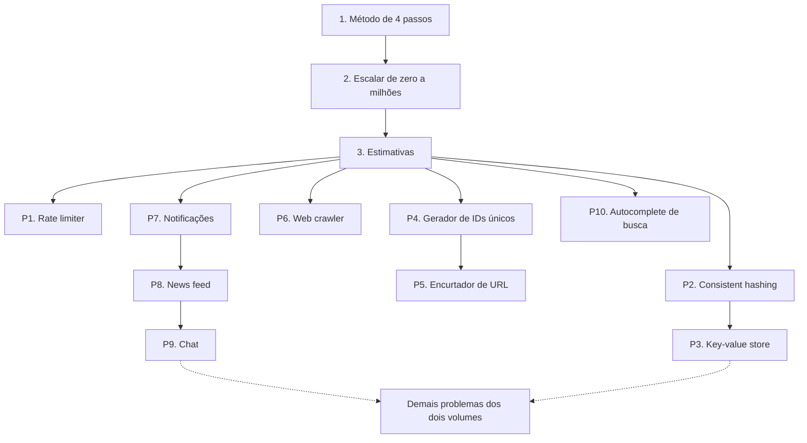

# System Design Interview — guia de leitura

> [!NOTE] Em uma frase
> Projetar um sistema é um processo repetível: entender o escopo, propor um desenho de alto nível, aprofundar onde dói e fechar com os trade-offs; o livro treina esse processo em dezenas de problemas.

## Para quem é e quando ler

Os dois volumes de *System Design Interview: An Insider's Guide*, de Alex Xu (o volume 2 com Sahn Lam), foram escritos para quem vai encarar a entrevista de system design, a etapa em que pedem para você desenhar um sistema inteiro (um encurtador de URL, um chat) em cerca de 45 minutos. Mas servem bem além disso: para o dev júnior ou pleno que quer entender como as peças de um sistema grande se encaixam e por que cada uma existe.

Leia depois de ter alguma experiência construindo uma aplicação web com banco de dados. Não é preciso ter operado sistemas distribuídos; o livro parte do servidor único. Se você quiser entender *por que* as técnicas funcionam (como a replicação garante consistência, o que exatamente um quorum promete), leia em paralelo ou depois o [Designing Data-Intensive Applications](../ddia/index.md), que é o aprofundamento teórico deste.

## O que o livro NÃO é

- **Não é um livro de teoria de sistemas distribuídos.** Ele apresenta técnicas (consistent hashing, vector clocks, gossip) em poucas páginas cada, o suficiente para usar num desenho, não para implementar ou provar.
- **Não é uma coleção de "respostas certas".** Cada problema mostra *uma* solução razoável. O valor está no raciocínio, e decorar desenhos é a forma mais rápida de travar quando um requisito muda.
- **Não é atual em tudo.** Alguns números (latências, preços) e produtos citados envelheceram; as páginas deste guia avisam onde isso importa.

## Como o livro está organizado

Os três primeiros capítulos do volume 1 são a base: o vocabulário de escala, as contas de ordem de grandeza e o método de 4 passos. Todo o resto são problemas, cada um resolvido com o mesmo método. Este guia reordena a base para começar pelo método e cobre os dez primeiros problemas do volume 1; os demais estão na lista do fim.

As setas indicam "ajuda ter lido antes": o key-value store usa consistent hashing; o encurtador de URL usa o gerador de IDs; o news feed e o chat reaproveitam ideias de notificações (fila, entrega assíncrona, conexões com o cliente).

## Como ler

1. **Leia as três páginas de base em ordem.** Elas dão o vocabulário de todas as outras.
2. **Nos problemas, siga a ordem numérica na primeira leitura**, porque a dificuldade cresce e cada um reaproveita ideias dos anteriores.
3. **Antes de ler cada problema, tente resolvê-lo.** Dê a si mesmo 20 minutos e um papel: escreva requisitos, desenhe o alto nível, escolha onde aprofundar. Depois compare com a página. É o jeito de treinar o método, não só de conhecer a resposta.
4. **Ritmo:** uma página por sessão de estudo é suficiente. Na primeira passada, pode pular os detalhes de algoritmos (vector clocks, Merkle trees) e voltar a eles depois.

## O que você leva ao terminar

- Um roteiro para atacar qualquer problema de design, em entrevista ou no trabalho.
- O vocabulário de componentes de sistemas grandes (balanceador, cache, CDN, réplica, shard, fila) e o problema que cada um resolve.
- Contas de ordem de grandeza para decidir se algo cabe numa máquina ou exige uma frota.
- Dez desenhos clássicos com seus pontos difíceis e trade-offs, que se combinam para resolver problemas novos.

## Capítulos

**Base**

- [1. O método de 4 passos](01-o-metodo-de-4-passos.md): como sair de um pedido vago para um desenho defendido, passando por escopo, alto nível, aprofundamento e fechamento.
- [2. Escalar de zero a milhões de usuários](02-escalar-de-zero-a-milhoes.md): a trilha de um servidor até milhões de usuários e o gargalo que cada componente resolve.
- [3. Estimativas de ordem de grandeza](03-estimativas-de-ordem-de-grandeza.md): contas de guardanapo de QPS, armazenamento, latência e disponibilidade.

**Problemas**

- [Problema 1. Rate limiter](problemas/01-rate-limiter.md): limitar quantas requisições cada cliente faz, com os algoritmos clássicos e o desafio de contar em vários servidores.
- [Problema 2. Consistent hashing](problemas/02-consistent-hashing.md): distribuir dados entre servidores de forma que adicionar ou remover um mova pouca coisa.
- [Problema 3. Key-value store](problemas/03-key-value-store.md): um banco chave-valor distribuído, com replicação, quorum, resolução de conflitos e detecção de falhas.
- [Problema 4. Gerador de IDs únicos](problemas/04-gerador-de-ids-unicos.md): gerar IDs únicos e ordenáveis em vários servidores sem coordenação central.
- [Problema 5. Encurtador de URL](problemas/05-encurtador-de-url.md): transformar URLs longas em códigos curtos e redirecionar milhões de acessos.
- [Problema 6. Web crawler](problemas/06-web-crawler.md): baixar bilhões de páginas respeitando os sites, sem repetir trabalho nem cair em armadilhas.
- [Problema 7. Sistema de notificações](problemas/07-sistema-de-notificacoes.md): enviar push, SMS e e-mail com filas, retentativas e sem duplicar mensagens.
- [Problema 8. News feed](problemas/08-news-feed.md): montar o feed de cada usuário e o dilema de distribuir posts na escrita ou na leitura.
- [Problema 9. Chat](problemas/09-chat.md): mensagens em tempo real com conexões persistentes, presença online e histórico.
- [Problema 10. Autocomplete de busca](problemas/10-autocomplete-de-busca.md): sugerir as buscas mais populares em milissegundos a cada tecla digitada.

**Os demais problemas dos dois volumes**

Os problemas abaixo não viraram página neste guia. Cada link leva às notas públicas do capítulo no repositório booknotes, listado em [fontes](fontes.md) (o repositório numera os capítulos com um a mais que o livro impresso); o repositório system-design-notes, também listado lá, tem uma pasta por problema com os mesmos nomes.

Volume 1:

- [YouTube](https://github.com/preslavmihaylov/booknotes/tree/master/system-design/system-design-interview/chapter15) (cap. 14): upload, transcodificação e streaming de vídeo com CDN.
- [Google Drive](https://github.com/preslavmihaylov/booknotes/tree/master/system-design/system-design-interview/chapter16) (cap. 15): armazenamento e sincronização de arquivos entre dispositivos, com blocos e conflitos.

Volume 2:

- [Proximity service](https://github.com/preslavmihaylov/booknotes/tree/master/system-design/system-design-interview/chapter17) (cap. 1): busca de lugares próximos com geohash e quadtree.
- [Nearby friends](https://github.com/preslavmihaylov/booknotes/tree/master/system-design/system-design-interview/chapter18) (cap. 2): localização de amigos em tempo real com pub/sub.
- [Google Maps](https://github.com/preslavmihaylov/booknotes/tree/master/system-design/system-design-interview/chapter19) (cap. 3): tiles de mapa, cálculo de rotas e estimativa de tempo de chegada.
- [Fila de mensagens distribuída](https://github.com/preslavmihaylov/booknotes/tree/master/system-design/system-design-interview/chapter20) (cap. 4): um Kafka simplificado, com partições, réplicas e garantias de entrega.
- [Monitoramento de métricas e alertas](https://github.com/preslavmihaylov/booknotes/tree/master/system-design/system-design-interview/chapter21) (cap. 5): coleta, banco de séries temporais e regras de alerta.
- [Agregação de cliques em anúncios](https://github.com/preslavmihaylov/booknotes/tree/master/system-design/system-design-interview/chapter22) (cap. 6): contagem em streaming com janelas de tempo e eventos atrasados.
- [Reserva de hotel](https://github.com/preslavmihaylov/booknotes/tree/master/system-design/system-design-interview/chapter23) (cap. 7): concorrência e overbooking em reservas.
- [Serviço de e-mail distribuído](https://github.com/preslavmihaylov/booknotes/tree/master/system-design/system-design-interview/chapter24) (cap. 8): um Gmail simplificado, com protocolos, armazenamento e busca.
- [Armazenamento de objetos tipo S3](https://github.com/preslavmihaylov/booknotes/tree/master/system-design/system-design-interview/chapter25) (cap. 9): buckets, objetos, durabilidade e erasure coding.
- [Leaderboard de jogo em tempo real](https://github.com/preslavmihaylov/booknotes/tree/master/system-design/system-design-interview/chapter26) (cap. 10): ranking com sorted sets do Redis.
- [Sistema de pagamentos](https://github.com/preslavmihaylov/booknotes/tree/master/system-design/system-design-interview/chapter27) (cap. 11): idempotência, reconciliação e integração com provedores de pagamento.
- [Carteira digital](https://github.com/preslavmihaylov/booknotes/tree/master/system-design/system-design-interview/chapter28) (cap. 12): transferências entre contas com consistência e event sourcing.
- [Bolsa de valores](https://github.com/preslavmihaylov/booknotes/tree/master/system-design/system-design-interview/chapter29) (cap. 13): matching de ordens com latência baixíssima.

## Fontes públicas para acompanhar

Todas as fontes verificadas estão em [fontes.md](fontes.md): notas por capítulo dos dois volumes, o capítulo 1 gratuito publicado pelo autor e o system-design-primer como referência complementar.
