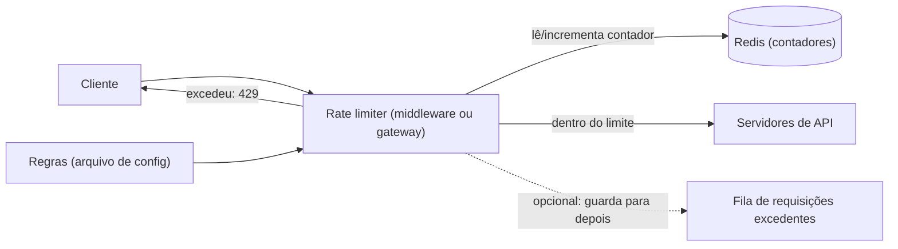

# Problema 1. Rate limiter

> [!NOTE] Em uma frase
> Um rate limiter conta quantas vezes cada cliente bateu na sua porta num intervalo e recusa o excesso, e o desenho inteiro gira em torno de como contar rápido, de forma justa e com vários servidores contando ao mesmo tempo.

## Por que isso importa

Imagine uma API pública de consulta de CEP. Um único cliente mal escrito entra num laço infinito e manda 5 mil requisições por segundo. Sem nenhum freio, o banco de dados satura, a [latência](../../../glossario.md#latência-e-throughput) (o tempo que cada resposta leva) sobe para todo mundo, e os clientes bem-comportados pagam pelo erro de um só. O mesmo vale para ataques: tentar senhas em massa num endpoint de login é só "muitas requisições do mesmo lugar".

O rate limiter (limitador de taxa) é o porteiro que resolve isso: "cada usuário pode fazer no máximo 100 requisições por minuto; da 101ª em diante, recuse". Ele protege a [disponibilidade](../../../glossario.md#disponibilidade) do serviço, corta custo (APIs pagas de terceiros cobram por chamada) e impõe planos comerciais ("plano grátis: 1.000 chamadas por dia"). Este é o primeiro problema do volume 1 (capítulo 4) e é um ótimo treino do [método de 4 passos](../01-o-metodo-de-4-passos.md): é pequeno o bastante para caber numa entrevista e tem decisões reais em cada passo.

## O que você precisa saber antes

- [O método de 4 passos](../01-o-metodo-de-4-passos.md): a estrutura que esta página segue (escopo, alto nível, aprofundar, fechar).
- [Escalar de zero a milhões](../02-escalar-de-zero-a-milhoes.md): o que são load balancer, servidores [stateless](../../../glossario.md#stateless-e-stateful) e [cache](../../../glossario.md#cache) em memória.
- [Estimativas de ordem de grandeza](../03-estimativas-de-ordem-de-grandeza.md): para dimensionar quanta memória os contadores ocupam.

## As ideias centrais

### Requisitos e escopo

Antes de desenhar, pergunte. As respostas mudam o desenho:

- **Do lado do cliente ou do servidor?** No cliente (o app limita a si mesmo) não serve como proteção: qualquer um pode alterar o cliente. O foco é o lado do servidor.
- **Limitar por quê?** Por ID de usuário, por IP, por chave de API, por endpoint. Normalmente é uma combinação configurável ("login: 5 por minuto por IP; busca: 100 por minuto por usuário").
- **Escala:** milhões de usuários, vários servidores de API atrás de um load balancer (o distribuidor de tráfego). Os contadores precisam ser compartilhados entre todos eles.
- **Requisitos não funcionais:** o limitador não pode adicionar latência perceptível (está no caminho de toda requisição), deve usar pouca memória e, se ele próprio cair, o sistema não deveria cair junto.
- **Avisar o cliente:** quem foi bloqueado precisa saber. O padrão HTTP é responder com o código **429 Too Many Requests**.

### Desenho de alto nível

A decisão estrutural é **onde** o limitador mora. Há três opções: dentro do código de cada serviço, como um componente separado na frente (um *middleware*, isto é, uma camada que intercepta a requisição antes do serviço), ou dentro de um API gateway (o serviço de entrada que já faz autenticação, roteamento e TLS). Se a empresa já tem um gateway, usá-lo é quase sempre o caminho mais barato.

Os contadores não podem viver na memória de cada servidor de API: com 10 servidores atrás de um load balancer, cada um veria só um décimo do tráfego de um usuário. Eles vão para um armazenamento compartilhado e muito rápido. Banco relacional em disco é lento demais para estar no caminho de cada requisição; o padrão é um cache em memória como o Redis, que oferece incremento atômico (`INCR`) e expiração automática de chaves (`EXPIRE`).

As **regras** ficam em arquivos de configuração (por exemplo, YAML) carregados periodicamente para um cache local do limitador, para não consultar disco a cada requisição. Requisições recusadas podem ser simplesmente descartadas ou, em casos como pedidos de compra, enfileiradas numa [fila](../../../glossario.md#fila-e-mensageria) para processar mais tarde.

A resposta ao cliente carrega cabeçalhos que dizem onde ele está: quantas requisições ainda restam na janela, qual é o limite e, quando bloqueado, quantos segundos esperar antes de tentar de novo (o livro usa nomes como `X-Ratelimit-Remaining`, `X-Ratelimit-Limit` e `X-Ratelimit-Retry-After`; o padrão HTTP também define o cabeçalho `Retry-After`).

### Onde aprofundar

**1. Qual algoritmo de contagem.** É o coração do problema. O livro apresenta cinco:

| Algoritmo | Como funciona | Ponto forte | Ponto fraco |
|---|---|---|---|
| Token bucket (balde de fichas) | Um balde com capacidade fixa é reabastecido a uma taxa constante (ex.: 10 fichas/s). Cada requisição gasta uma ficha; sem ficha, recusa. | Simples, pouca memória, permite rajadas curtas até o tamanho do balde. | Dois parâmetros (capacidade e taxa) difíceis de calibrar. |
| Leaking bucket (balde furado) | Requisições entram numa fila de tamanho fixo e saem a uma taxa constante. | Saída perfeitamente estável. | Uma rajada enche a fila com pedidos velhos e os novos são recusados. |
| Janela fixa | Conta requisições por janela de relógio (ex.: das 10:00:00 às 10:00:59). | Trivial de implementar com `INCR` + `EXPIRE`. | Na virada da janela, um cliente pode mandar o dobro do limite em poucos segundos. |
| Log de janela deslizante | Guarda o timestamp de cada requisição; conta quantos caem nos últimos 60 s. | Exato. | Guarda um timestamp por requisição, inclusive das recusadas: muita memória. |
| Contador de janela deslizante | Estima a janela móvel combinando a contagem da janela atual com uma fração da anterior. | Pouca memória e suaviza o pico da virada. | É uma aproximação: assume tráfego uniforme na janela anterior. |

Um exemplo do problema da janela fixa: limite de 5 por minuto. O cliente manda 5 às 10:00:59 e mais 5 às 10:01:00. Cada janela viu 5, ambas aprovam, e o servidor recebeu 10 em um segundo. O contador deslizante resolve isso assim: se às 10:01:15 a janela atual tem 3 requisições e a anterior teve 5, estima-se 3 + 5 × 75% = 6,75 (75% porque ainda faltam 45 dos 60 segundos da janela anterior dentro da janela móvel), acima do limite.

O token bucket é o mais comum na indústria; o livro cita Amazon e Stripe como usuários.

**2. Corridas entre servidores (race conditions).** Com vários servidores de limitador, a sequência "ler contador, checar, gravar contador + 1" quebra: dois servidores leem 99 ao mesmo tempo, ambos aprovam, ambos gravam 100, e o limite de 100 foi furado. Travas explícitas (locks) resolvem, mas deixam tudo lento. As soluções usuais são executar a lógica inteira de forma atômica no próprio Redis, com um script Lua (o Redis roda cada script sem intercalar outros comandos), ou usar estruturas como sorted sets (conjuntos ordenados) para o log deslizante.

**3. Sincronização entre data centers.** Se o tráfego de um usuário pode cair em limitadores diferentes (por exemplo, em regiões diferentes), eles precisam enxergar o mesmo contador. *Sticky sessions* (prender cada cliente sempre ao mesmo servidor) resolvem, mas tiram flexibilidade de escalar. O livro prefere um armazenamento central compartilhado, e para uso global aceita [consistência eventual](../../../glossario.md#consistência-forte-e-eventual): réplicas do contador em cada região que convergem com algum atraso, aceitando que o limite seja furado por pouco durante esse atraso.

### Trade-offs

- **Exatidão × memória:** o log deslizante é exato e caro; o contador deslizante é aproximado e barato. Para proteção contra abuso, aproximado basta.
- **Falhar aberto × falhar fechado:** se o Redis cair, o limitador deixa tudo passar (protege a disponibilidade, perde a proteção) ou bloqueia tudo (protege o backend, derruba o produto)? A maioria escolhe falhar aberto, mas é uma decisão de negócio.
- **Limite rígido × flexível:** rígido nunca excede o número; flexível tolera excessos curtos. Rajadas legítimas (um app abrindo e carregando dez coisas) pedem flexibilidade.
- **Camada:** o livro foca na camada HTTP (camada 7), mas dá para limitar por IP muito antes, na camada de rede, com ferramentas como o iptables do Linux. Quanto mais cedo, mais barato o bloqueio, e menos contexto você tem (não sabe quem é o usuário).

## Onde isso aparece no mundo real

- **APIs públicas:** GitHub e Stripe publicam seus limites e devolvem cabeçalhos informando quantas chamadas restam. A documentação do GitHub mostra limites diferentes para usuários anônimos e autenticados, exatamente a regra "por chave" discutida acima.
- **Login e recuperação de senha:** limitar por IP e por conta é a defesa básica contra tentativa de senhas em massa.
- **Proxies e gateways:** NGINX, Envoy e os API gateways das nuvens têm rate limiting embutido, geralmente com token bucket ou leaking bucket. Na prática, raramente se implementa do zero; o valor de entender os algoritmos é saber configurar e saber por que o limite "furou".

## Erros comuns de quem está aprendendo

- **Guardar o contador na memória de cada servidor.** Funciona com um servidor e quebra silenciosamente com dez. O contador é estado compartilhado e precisa de um lugar compartilhado.
- **Achar que janela fixa é "boa o bastante" sem pensar na virada.** O dobro do limite na fronteira é um comportamento real, que aparece em produção; se o backend não aguenta o dobro, use janela deslizante ou token bucket.
- **Ignorar o caso "o limitador caiu".** Ele está no caminho de toda requisição; é um ponto único de falha se ninguém decidiu o que acontece quando ele some.
- **Esquecer o cliente.** Responder 429 sem `Retry-After` faz clientes ingênuos tentarem de novo imediatamente, aumentando a carga. O cliente bem escrito espera e tenta com intervalos crescentes (backoff exponencial).

## Verifique se entendeu

1. Por que um rate limiter só no cliente não protege nada? (Requisitos e escopo)
2. Por que os contadores não ficam na memória de cada servidor de API, e por que não num banco relacional? (Desenho de alto nível)
3. Com limite de 10 por minuto em janela fixa, descreva uma sequência de requisições que deixa passar 20 em dois segundos. (Onde aprofundar, ponto 1)
4. Dois limitadores leem o mesmo contador ao mesmo tempo. O que pode dar errado e como o Redis ajuda? (Onde aprofundar, ponto 2)
5. O Redis dos contadores caiu. Defenda "falhar aberto" ou "falhar fechado" para uma API de pagamentos. (Trade-offs)

## Para ir além

- [booknotes, capítulo do rate limiter](https://github.com/preslavmihaylov/booknotes/tree/master/system-design/system-design-interview/chapter05): os cinco algoritmos com prós e contras, a arquitetura com Redis, as race conditions e os cabeçalhos 429, na sequência do livro.
- [liquidslr/system-design-notes, Rate Limiter](https://github.com/liquidslr/system-design-notes/tree/main/04.%20Rate%20Limiter): resumo em prosa com diagramas dos algoritmos.
- [topofmind.dev, notas do Alex Xu](https://topofmind.dev/notes/system-design/system-design-interview-alex-xu/): a seção do capítulo 4 é substancial e traz críticas e alternativas do autor das notas.

---
Anterior: [Estimativas de ordem de grandeza](../03-estimativas-de-ordem-de-grandeza.md) · Próximo: [Consistent hashing](02-consistent-hashing.md) · Voltar ao livro: [Guia de leitura](../index.md)
