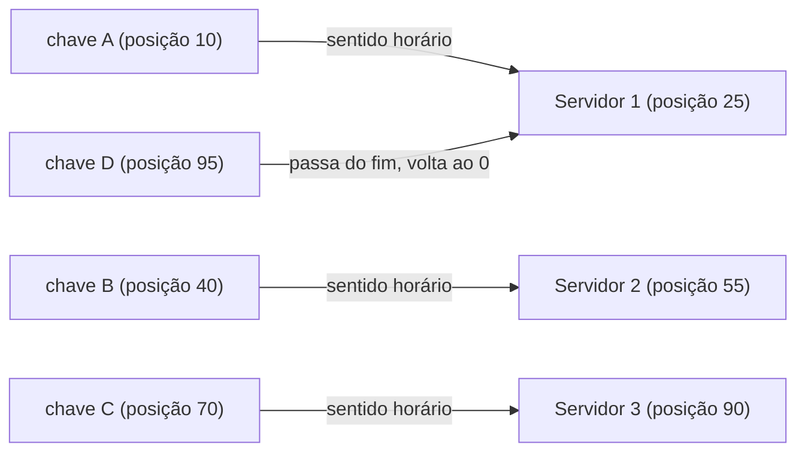

# Problema 2. Consistent hashing

> [!NOTE] Em uma frase
> Consistent hashing é um jeito de decidir em qual servidor cada dado mora de modo que, quando um servidor entra ou sai, só uma pequena parte dos dados precise mudar de lugar, em vez de quase todos.

## Por que isso importa

Você tem um cache com 4 servidores e precisa decidir em qual deles guardar cada chave (por exemplo, a sessão do usuário 8231). A ideia óbvia é: calcule um hash da chave (um número derivado dela, sempre o mesmo para a mesma chave) e pegue o resto da divisão por 4. `hash("usuario:8231") % 4 = 2`, então vai para o servidor 2. Funciona perfeitamente, até o dia em que um servidor cai ou você adiciona um quinto.

Com 5 servidores, a conta vira `% 5`, e o resto muda para quase todas as chaves. Na prática, cerca de 80% dos dados passam a ser procurados no servidor errado de uma vez. Num cache, isso significa que quase todo acesso vira *miss* (o dado não está onde se procura) e cai no banco de dados ao mesmo tempo, que pode não aguentar. Num banco [particionado](../../../glossario.md#particionamento-sharding), significa mover quase tudo pela rede. O capítulo 5 do volume 1 apresenta consistent hashing (hashing consistente) como a técnica que resolve isso, e ela reaparece logo em seguida como peça do [key-value store](03-key-value-store.md).

## O que você precisa saber antes

- [O método de 4 passos](../01-o-metodo-de-4-passos.md): esta página segue a mesma estrutura, mesmo sendo um problema mais "de algoritmo" do que de sistema completo.
- [Escalar de zero a milhões](../02-escalar-de-zero-a-milhoes.md): de onde vem a necessidade de dividir dados em várias máquinas (sharding).
- Função de hash: uma função que transforma qualquer entrada num número de tamanho fixo, espalhando entradas parecidas em números bem diferentes. O livro usa SHA-1 como exemplo, cujo resultado vai de 0 a 2¹⁶⁰ − 1.

## As ideias centrais

### Requisitos e escopo

Este capítulo não é um sistema com usuários, é um componente. Os requisitos são:

- **Distribuir chaves entre N servidores** de forma aproximadamente uniforme, para nenhum ficar sobrecarregado.
- **Minimizar o remanejamento** quando N muda: adicionar ou remover um servidor deve mover apenas cerca de 1/N das chaves, não quase todas.
- **Aguentar servidores heterogêneos** (alguns com mais capacidade que outros) e evitar "partições quentes", servidores que concentram carga demais.
- **Ser determinístico e barato:** qualquer cliente, sabendo a lista de servidores, calcula sozinho onde está a chave, sem consultar um diretório central.

### Desenho de alto nível

A ideia é parar de usar "resto da divisão pelo número de servidores" e passar a usar um espaço fixo de posições que não depende de N.

1. **O anel.** Pegue todo o intervalo de saída da função de hash (de 0 até o máximo) e imagine-o dobrado num círculo: depois do último valor vem o zero de novo.
2. **Servidores no anel.** Calcule o hash de cada servidor (do seu nome ou IP) e coloque-o naquele ponto do círculo.
3. **Chaves no anel.** Calcule o hash de cada chave com a **mesma** função e coloque-a no círculo.
4. **Regra de busca.** A partir da posição da chave, ande no sentido horário até encontrar o primeiro servidor. É ali que a chave mora.

Agora veja o que acontece quando o anel muda. Se entra um Servidor 4 na posição 65, apenas as chaves entre 55 e 65 (que antes iam até o Servidor 3) passam a parar no Servidor 4. Todo o resto continua onde estava. Se o Servidor 2 sai, só as chaves que ele guardava (entre 25 e 55) passam para o próximo no sentido horário, o Servidor 3. Em média, a mudança afeta k/N chaves (k = total de chaves, N = número de servidores), contra quase todas no hash módulo N.

### Onde aprofundar

**1. Distribuição desigual: o problema dos intervalos.** Com poucos servidores posicionados por hash, os intervalos entre eles no anel saem de tamanhos muito diferentes, por puro acaso. Um servidor pode ficar responsável por 40% do anel e outro por 5%. E quando um servidor sai, todo o seu intervalo cai em cima de **um único** vizinho, que pode dobrar de carga de repente.

**2. Nós virtuais, a solução.** Em vez de colocar cada servidor uma vez no anel, coloque-o muitas vezes: o Servidor 1 vira os pontos `S1#0`, `S1#1`, ..., `S1#199`, cada um com seu próprio hash. Cada ponto é um *nó virtual*. Com centenas de pontos por servidor espalhados pelo anel, cada servidor acaba responsável por muitos intervalos pequenos, e a soma deles fica perto da média. O livro cita que, com 100 a 200 nós virtuais por servidor, o desvio-padrão da carga cai para algo entre 10% e 5% da média. Bônus: quando um servidor sai, seus muitos intervalos se espalham entre **vários** vizinhos diferentes, não num só. E servidores mais potentes podem receber mais nós virtuais, ficando com uma fatia proporcional.

**3. Quais chaves mover, exatamente.** Ao adicionar um servidor, o intervalo afetado vai do novo servidor, no sentido anti-horário, até o servidor anterior. Só as chaves desse intervalo precisam ser copiadas para o novo dono. Ao remover, o intervalo do servidor que saiu é absorvido pelo próximo no sentido horário. Isso é o que permite a sistemas como o [key-value store](03-key-value-store.md) adicionar máquinas sem parar o mundo.

Como a busca é implementada na prática: as posições de todos os nós virtuais ficam numa lista ordenada; achar o dono de uma chave é uma busca binária pela primeira posição maior ou igual ao hash da chave (voltando ao início se passar do fim). Com 1.000 nós virtuais, são cerca de 10 comparações.

### Trade-offs

- **Mais nós virtuais × mais memória:** mais pontos no anel equilibram melhor a carga, mas os metadados (a lista ordenada) crescem e precisam ser conhecidos por todos os clientes. É um parâmetro de calibração, não "quanto mais melhor".
- **Equilíbrio de chaves ≠ equilíbrio de carga:** consistent hashing distribui *chaves* uniformemente. Se uma única chave é muito popular (o perfil de uma celebridade), o servidor dela esquenta do mesmo jeito. Isso pede soluções à parte, como replicar ou cachear as chaves quentes.
- **Simplicidade × controle:** o anel decide a posição por hash, sem nenhum diretório central. Isso é ótimo para não ter ponto único de falha, mas você perde o poder de dizer "ponha esta chave ali". Alguns sistemas preferem um número fixo de partições atribuídas explicitamente a máquinas, o que é mais fácil de operar e de rebalancear manualmente.

## Onde isso aparece no mundo real

- **Amazon Dynamo e Apache Cassandra:** o artigo do Dynamo (2007) popularizou o anel com nós virtuais para particionar dados; o Cassandra herdou a ideia com seus *vnodes*.
- **Discord:** o livro menciona o uso de consistent hashing no roteamento de mensagens do chat entre servidores.
- **CDNs e balanceadores:** o algoritmo Maglev, do Google, é uma variante usada em balanceadores de carga para que um mesmo cliente continue caindo no mesmo backend mesmo quando backends entram e saem. Clientes de Memcached também usam consistent hashing para escolher o servidor de cache de cada chave.

## Erros comuns de quem está aprendendo

- **Achar que o anel elimina movimentação de dados.** Ele reduz de "quase tudo" para "cerca de 1/N". Ainda é preciso copiar dados quando um servidor entra, e isso consome rede.
- **Esquecer os nós virtuais.** O anel com um ponto por servidor é a versão didática; sem nós virtuais, a distribuição real costuma ser bem desigual e a saída de um servidor sobrecarrega um único vizinho.
- **Confundir hash consistente com hash criptográfico.** O SHA-1 do exemplo é só uma função que espalha bem; segurança não é o ponto. Funções rápidas não criptográficas (como MurmurHash) são comuns na prática.
- **Usar funções de hash diferentes para servidores e chaves.** As duas precisam cair no mesmo espaço; senão as posições não se comparam.

## Verifique se entendeu

1. Com 4 servidores e `hash % 4`, por que adicionar um quinto servidor move cerca de 80% das chaves? (Por que isso importa)
2. Descreva, passo a passo, como achar o servidor de uma chave no anel. (Desenho de alto nível)
3. O Servidor 2 saiu do anel. Quais chaves mudam de dono e para onde vão? (Onde aprofundar, ponto 3)
4. Por que nós virtuais ajudam tanto no equilíbrio quanto na saída de um servidor? (Onde aprofundar, ponto 2)
5. Consistent hashing resolve o problema do perfil de uma celebridade acessado milhões de vezes por segundo? Por quê? (Trade-offs)

## Para ir além

- [booknotes, capítulo de consistent hashing](https://github.com/preslavmihaylov/booknotes/tree/master/system-design/system-design-interview/chapter06): o passo a passo do anel, os casos de adição e remoção e os nós virtuais, com imagens.
- [liquidslr/system-design-notes, Consistent Hashing](https://github.com/liquidslr/system-design-notes/tree/main/05.%20Consistent%20Hashing): resumo em prosa; o README raiz lista os papers originais por tema, incluindo o do Dynamo.
- [topofmind.dev, notas do Alex Xu](https://topofmind.dev/notes/system-design/system-design-interview-alex-xu/): a seção do capítulo 5 traz o anel em diagrama Mermaid.

---
Anterior: [Rate limiter](01-rate-limiter.md) · Próximo: [Key-value store](03-key-value-store.md) · Voltar ao livro: [Guia de leitura](../index.md)
