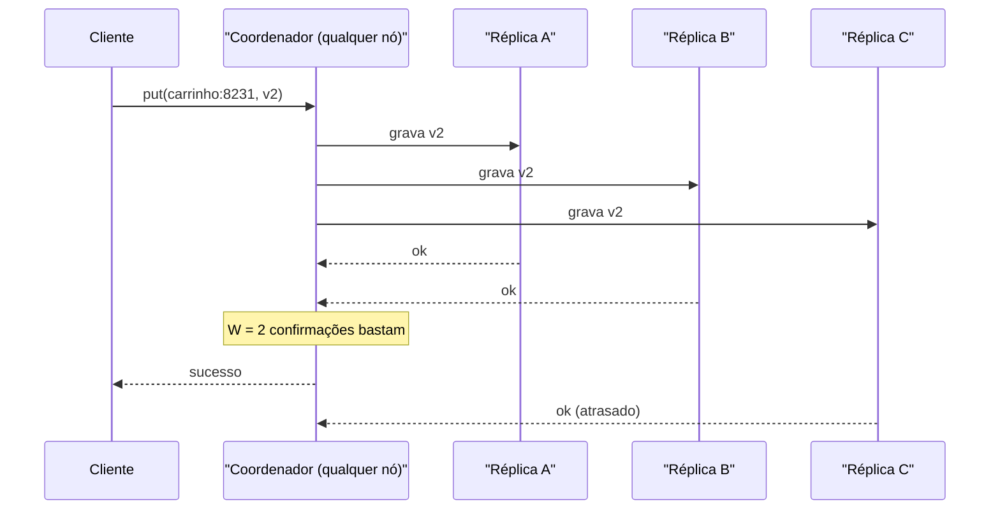

# Problema 3. Key-value store

> [!NOTE] Em uma frase
> Um key-value store distribuído guarda pares "chave → valor" em muitas máquinas, e quase todo o desenho é uma negociação entre responder sempre e responder sempre o valor mais recente.

## Por que isso importa

Um carrinho de compras numa loja online grande na Black Friday: milhões de usuários adicionando itens ao mesmo tempo, e a regra de negócio é que "adicionar ao carrinho" nunca pode falhar, porque cada falha é venda perdida. Foi esse o problema que levou a Amazon a construir o Dynamo, e é ele que o capítulo 6 do volume 1 reconstrói.

O dado é simples: uma chave (`carrinho:8231`) e um valor opaco (o conteúdo). Não há joins, não há consultas complexas. O que é difícil é a escala: os dados não cabem numa máquina, máquinas caem o tempo todo, e a rede entre data centers falha. Este capítulo é onde o livro junta numa só peça [particionamento](../../../glossario.md#particionamento-sharding), [replicação](../../../glossario.md#replicação), [consistência](../../../glossario.md#consistência-forte-e-eventual) e o teorema [CAP](../../../glossario.md#cap). É o capítulo mais denso do volume 1.

## O que você precisa saber antes

- [Consistent hashing](02-consistent-hashing.md): é o mecanismo que decide em qual máquina cada chave mora. Esta página assume o anel e os nós virtuais.
- [Escalar de zero a milhões](../02-escalar-de-zero-a-milhoes.md): replicação e sharding num nível introdutório.
- [Estimativas de ordem de grandeza](../03-estimativas-de-ordem-de-grandeza.md): útil para dimensionar quantas máquinas o armazenamento exige.

## As ideias centrais

### Requisitos e escopo

O livro fixa um conjunto de requisitos típico de um sistema estilo Dynamo:

- Operações só `put(chave, valor)` e `get(chave)`, com pares pequenos (menos de 10 KB).
- Capacidade de guardar muito dado e escalar adicionando máquinas, de preferência automaticamente.
- **Alta [disponibilidade](../../../glossario.md#disponibilidade):** o sistema responde mesmo durante falhas.
- Baixa latência.
- **Consistência ajustável:** a aplicação escolhe o quanto quer pagar por dados atualizados.

O ponto de partida é o CAP: quando a rede se parte em pedaços que não se falam (uma *partição de rede*), o sistema precisa escolher entre recusar requisições até a rede voltar (CP, prioriza consistência; é o que um banco faria com saldo bancário) ou continuar aceitando e reconciliar depois (AP, prioriza disponibilidade). Para o carrinho, a escolha é AP: aceitar escritas sempre e lidar com versões conflitantes depois. Isso é [consistência eventual](../../../glossario.md#consistência-forte-e-eventual): as cópias divergem por um tempo e convergem.

### Desenho de alto nível

Não há líder: todos os nós são iguais e qualquer um pode receber uma requisição e atuar como *coordenador* (o nó que repassa a operação para os nós certos e devolve a resposta ao cliente). Isso elimina o ponto único de falha que um líder seria.

- **Particionamento:** as chaves são distribuídas pelo anel de consistent hashing com nós virtuais.
- **Replicação:** cada chave é copiada nos N primeiros servidores *distintos* encontrados no sentido horário a partir da sua posição (N = 3 é comum). Pular nós virtuais da mesma máquina garante que as três cópias estejam em máquinas diferentes; idealmente, também em data centers diferentes.
- **Quórum:** de cada operação, o coordenador espera W confirmações de escrita ou R respostas de leitura das N réplicas antes de responder.

Dentro de cada nó, o caminho de escrita segue o padrão de bancos como o Cassandra: a escrita vai primeiro para um *commit log* (um arquivo só de acréscimo, para não perder nada se a máquina reiniciar), depois para uma tabela em memória; quando ela enche, é despejada em disco como um arquivo ordenado e imutável chamado SSTable. A leitura procura primeiro na memória e, se não achar, consulta as SSTables, usando um *filtro de Bloom* (estrutura compacta que responde "com certeza não está aqui" ou "talvez esteja") para evitar abrir arquivos à toa.

### Onde aprofundar

**1. Quóruns: a consistência como botão.** Com N réplicas, se W + R > N, toda leitura toca pelo menos uma réplica que recebeu a última escrita confirmada, e por isso enxerga o valor mais recente (o livro chama isso de consistência forte; veja a ressalva em Trade-offs). Exemplos com N = 3:
- W = 1, R = 3: escrita muito rápida, leitura lenta.
- W = 3, R = 1: leitura rápida, escrita lenta e frágil (basta uma réplica fora para a escrita falhar).
- W = 2, R = 2: equilíbrio comum.
- W + R ≤ N (por exemplo, W = 1, R = 1): rápido, mas a leitura pode ver dado velho.

**2. Conflitos e vector clocks.** Num sistema AP, dois clientes podem gravar a mesma chave em réplicas diferentes durante uma partição, criando duas versões irmãs. Como saber se uma versão é sucessora da outra ou se elas conflitam? O livro usa *vector clocks* (relógios vetoriais): cada versão carrega uma lista de pares [servidor, contador]. Ex.: uma versão D3 com `[(Sx, 2), (Sy, 1)]` e uma D4 com `[(Sx, 2), (Sz, 1)]`. Nenhuma tem todos os contadores maiores ou iguais aos da outra, então são concorrentes, e alguém precisa reconciliar. No Dynamo, quem reconcilia é a aplicação na próxima leitura (para o carrinho, fazer a união dos itens). Custo: o cliente fica mais complexo, e a lista cresce, exigindo um limite que descarta os pares mais antigos.

**3. Detectar e se recuperar de falhas.**
- **Detecção por gossip (fofoca):** cada nó mantém uma lista de membros com um contador de batimento (*heartbeat*), incrementa o seu periodicamente e manda a lista para alguns nós aleatórios, que a repassam. Se o contador de um nó para de subir por tempo demais segundo vários nós, ele é considerado fora. Evita que cada nó precise checar todos os outros.
- **Falhas temporárias, sloppy quorum e hinted handoff:** em vez de exigir as N réplicas "oficiais", o coordenador usa os W primeiros nós *saudáveis* do anel. Se um nó oficial está fora, outro guarda a escrita junto com uma "dica" (*hint*) de quem é o dono; quando o dono volta, a escrita é devolvida a ele.
- **Falhas permanentes, anti-entropia com Merkle trees:** para reconciliar réplicas que divergiram, cada uma monta uma *Merkle tree* (árvore de hashes em que cada nó pai é o hash dos filhos). Comparando a raiz e descendo só pelos ramos diferentes, duas réplicas descobrem quais faixas de chaves divergem transferindo apenas os hashes, não os dados todos.

### Trade-offs

- **Disponibilidade × consistência:** a escolha AP deixa o carrinho sempre gravável, ao custo de conflitos que alguém precisa resolver. Um item removido pode "ressuscitar" ao unir versões, e o Dynamo aceitou isso conscientemente.
- **W e R:** cada combinação troca latência de leitura, latência de escrita e frescor do dado. Não existe configuração certa, existe a certa para aquela carga.
- **Sem líder:** remove o ponto único de falha e permite qualquer nó atender, mas empurra complexidade para quóruns, gossip, hints e Merkle trees.
- **Ressalva sobre "forte":** W + R > N dá uma garantia bem mais fraca do que a linearizabilidade (o significado rigoroso de consistência forte). Com sloppy quorum, escritas concorrentes e falhas parciais, ainda é possível ler dado velho em casos de borda. O livro simplifica aqui; DDIA, capítulo 5, discute os limites dos quóruns em detalhe.

## Onde isso aparece no mundo real

- **Amazon Dynamo (2007):** o artigo que inspira o capítulo inteiro, usado internamente para carrinhos e sessões. O DynamoDB, serviço gerenciado da AWS, tem o nome mas uma arquitetura diferente (com líderes por partição).
- **Apache Cassandra e Riak:** implementações abertas da mesma família, com anel, quóruns ajustáveis por requisição (`ONE`, `QUORUM`, `ALL` no Cassandra), gossip e hinted handoff.
- **Redis e Memcached:** também são key-value, mas focados em memória e cache; o desenho deste capítulo é sobre armazenamento durável e distribuído.

## Erros comuns de quem está aprendendo

- **Ler CAP como "escolha 2 de 3" para sempre.** A escolha só é forçada durante uma partição de rede. Fora dela, o trade-off do dia a dia é entre latência e consistência.
- **Achar que W + R > N resolve tudo.** Resolve o caso comum. Com sloppy quorum e falhas parciais, o sistema continua eventual em casos de borda.
- **Confundir replicação com particionamento.** Particionar divide os dados entre máquinas (cada uma tem um pedaço); replicar copia o mesmo pedaço em várias. O desenho usa as duas juntas.
- **Achar que vector clocks resolvem conflitos.** Eles só *detectam* que duas versões são concorrentes. Resolver é trabalho da aplicação, e depende do domínio.

## Verifique se entendeu

1. Por que o carrinho de compras pende para AP e um saldo bancário para CP? (Requisitos e escopo)
2. Como as N réplicas de uma chave são escolhidas no anel, e por que pular nós virtuais da mesma máquina? (Desenho de alto nível)
3. Com N = 3, que valores de W e R garantem que uma leitura veja a última escrita confirmada? Qual deles deixa a escrita mais frágil? (Onde aprofundar, ponto 1)
4. Duas versões têm vector clocks `[(Sx,2),(Sy,1)]` e `[(Sx,2),(Sz,1)]`. Uma substitui a outra? (Onde aprofundar, ponto 2)
5. Qual a diferença entre o que hinted handoff e Merkle trees resolvem? (Onde aprofundar, ponto 3)

## Para ir além

- [topofmind.dev, notas do Alex Xu](https://topofmind.dev/notes/system-design/system-design-interview-alex-xu/): a seção do capítulo 6 é das mais completas, com CAP, quórum N/W/R, vector clocks, gossip e Merkle trees.
- [booknotes, capítulo do key-value store](https://github.com/preslavmihaylov/booknotes/tree/master/system-design/system-design-interview/chapter07): o capítulo inteiro na ordem do livro, com os caminhos de escrita e leitura.
- [liquidslr/system-design-notes, Key-Value Store](https://github.com/liquidslr/system-design-notes/tree/main/06.%20Key-Value%20Store): resumo em prosa; o README raiz aponta o artigo original do Dynamo.
- [system-design-primer](https://github.com/donnemartin/system-design-primer): as seções sobre CAP, consistência e disponibilidade dão uma segunda explicação dos mesmos fundamentos.

---
Anterior: [Consistent hashing](02-consistent-hashing.md) · Próximo: [Gerador de IDs únicos](04-gerador-de-ids-unicos.md) · Voltar ao livro: [Guia de leitura](../index.md)
