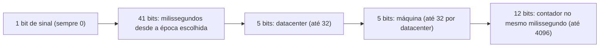
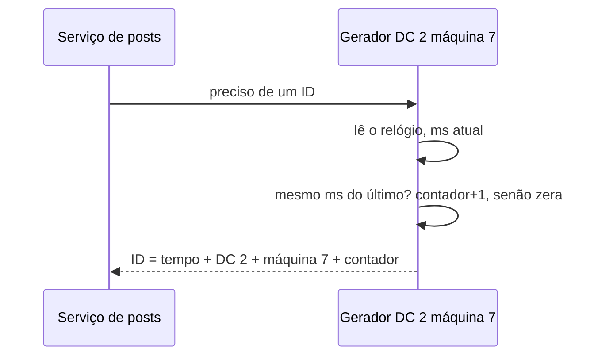

# Problema 4. Gerador de IDs únicos

> [!NOTE] Em uma frase
> Quando muitas máquinas precisam criar identificadores ao mesmo tempo sem conversar entre si, a saída é montar o ID a partir de pedaços que já são únicos por construção: o instante atual, quem está gerando e um contador local.

## Por que isso importa

Num sistema pequeno, ninguém pensa em ID: a tabela tem uma coluna `id` com auto-incremento (o banco soma 1 a cada linha nova) e pronto. O problema aparece quando o dado deixa de caber num banco só. Imagine uma rede social que divide os posts entre 50 bancos usando [particionamento](../../../glossario.md#particionamento-sharding), ou seja, cada banco guarda uma fatia dos dados. Se cada um usar seu próprio auto-incremento, o banco 3 e o banco 17 vão criar, os dois, um post de ID 1.000. Agora um link para "post 1.000" é ambíguo.

A tentação é criar um único serviço que distribui números em ordem. Funciona, mas todo post do mundo passa a depender dessa máquina: se ela cai, ninguém posta; se ela fica lenta, todo mundo fica lento. O volume 1, capítulo 7, usa esse dilema para ensinar uma ideia que reaparece em todo sistema distribuído: dá para obter unicidade global sem coordenação, se você escolher bem o que entra no número.

## O que você precisa saber antes

- [O método de 4 passos](../01-o-metodo-de-4-passos.md): a estrutura (escopo, alto nível, aprofundar, fechar) que esta página segue.
- [Estimativas de ordem de grandeza](../03-estimativas-de-ordem-de-grandeza.md): para conferir se 64 bits e 12 bits de contador bastam.
- [Particionamento](../../../glossario.md#particionamento-sharding) e [disponibilidade](../../../glossario.md#disponibilidade): os dois motivos pelos quais o auto-incremento de um banco só deixa de servir.

## As ideias centrais

### Requisitos e escopo

O primeiro passo é perguntar o que "ID" precisa garantir, porque cada requisito elimina soluções. O cenário do livro fecha assim:

- **Único**: dois objetos nunca recebem o mesmo ID.
- **Só números**, cabendo em **64 bits** (o tamanho de um `long`/`bigint`, que todo banco e linguagem trata bem e que indexa rápido).
- **Ordenado por tempo**: um ID criado à noite é maior que um criado de manhã. Isso permite ordenar por ID em vez de guardar e indexar uma coluna de data à parte.
- **Escala**: pelo menos 10.000 IDs por segundo.

Repare que "ordenado por tempo" é mais fraco do que "sequencial sem buracos". Ninguém pediu 1, 2, 3, 4; pediu só que, grosso modo, maior signifique mais recente. Essa folga é o que torna o problema solúvel sem coordenação.

O livro passa por quatro candidatos antes de escolher:

1. **Auto-incremento com vários mestres**: cada um dos *k* bancos soma *k* em vez de 1 (com 2 bancos, um gera ímpares e o outro pares). Funciona, mas adicionar ou remover um banco muda *k* e bagunça tudo, e os IDs de bancos diferentes não ficam ordenados por tempo entre si.
2. **UUID**: um número aleatório de 128 bits; a chance de colisão é tão pequena que se ignora. Zero coordenação, mas não cabe em 64 bits, tem letras na forma usual e não é ordenado por tempo (a versão 4, a mais comum, é aleatória).
3. **Ticket server**: um banco central só para entregar o próximo número, técnica que o Flickr popularizou. Simples e numérico, mas é o ponto único de falha do exemplo da introdução.
4. **Snowflake**: o formato que o Twitter publicou em 2010, que monta o ID com timestamp, identificador de máquina e contador. É a escolha do capítulo.

### Desenho de alto nível

O ID de 64 bits é dividido em campos fixos. Cada servidor gerador sabe seu próprio número de datacenter e de máquina (recebidos na configuração, na inicialização) e, a cada pedido, preenche o resto sozinho, sem falar com ninguém.

Por que cada campo resolve uma parte:

- **Timestamp na frente**: como os bits mais significativos são o tempo, comparar dois IDs como números equivale a comparar quando foram criados. É isso que entrega o "ordenado por tempo".
- **Datacenter e máquina no meio**: dois geradores diferentes nunca têm a mesma combinação, então não podem colidir nem gerando no mesmo milissegundo.
- **Contador no fim**: dentro de uma mesma máquina e do mesmo milissegundo, o contador diferencia os IDs. Ele volta a zero no milissegundo seguinte.

O gerador costuma ser uma biblioteca dentro do próprio serviço, não um serviço separado na rede: assim não há chamada remota nenhuma, e a [latência](../../../glossario.md#latência-e-throughput) de gerar um ID é a de algumas operações de bits.

### Onde aprofundar

**1. As contas dos bits fecham?** Aqui entra a estimativa de ordem de grandeza. 41 bits de milissegundos dão 2⁴¹ ms, cerca de 69 anos. Por isso o tempo não é contado desde 1970 (a época Unix), e sim desde uma "época" própria, por exemplo a data de lançamento do sistema; o Twitter usa uma data de 2010. Quem começa a contar em 1970 já gastou mais de 55 desses 69 anos. Os 12 bits de contador dão 4.096 IDs por milissegundo por máquina, ou seja, uns 4 milhões por segundo por máquina, muito acima dos 10.000 pedidos. Se uma máquina estourar o contador dentro de um milissegundo, ela simplesmente espera o próximo milissegundo.

**2. O relógio não é confiável.** O desenho inteiro supõe que o relógio de cada máquina só anda para frente. Na prática, servidores sincronizam o relógio pela rede com NTP (Network Time Protocol, o protocolo que ajusta o relógio local a partir de servidores de referência), e esse ajuste pode puxar o relógio alguns milissegundos para trás. Se o gerador emitir um ID, o relógio voltar e ele emitir outro no "mesmo" milissegundo com o contador zerado, pode repetir um ID. A defesa clássica: o gerador lembra o último timestamp usado e, se o relógio atual for menor, recusa gerar (ou espera) até o tempo alcançar. Outro efeito: relógios de máquinas diferentes nunca batem exatamente, então a ordem entre IDs de máquinas diferentes é aproximada. Dois IDs gerados com 2 ms de diferença em máquinas distintas podem sair invertidos. Para ordenar posts numa timeline, isso é irrelevante; para decidir quem comprou o último ingresso, não serve.

**3. Quem distribui os números de máquina?** Os 10 bits de datacenter + máquina só garantem unicidade se nenhum par de geradores compartilhar a mesma combinação. Com servidores fixos, basta configurar. Em ambientes onde instâncias sobem e morrem o tempo todo (contêineres, autoscaling), é preciso algum mecanismo de atribuição, como um serviço de coordenação (ZooKeeper, etcd) que empresta um número livre a cada instância. Esse ponto o livro trata de leve, e é onde implementações reais costumam errar.

### Trade-offs

| Opção | Ganha | Perde |
|---|---|---|
| Vários mestres com passo *k* | Usa o banco que já existe | Escalar muda *k*; sem ordem global por tempo |
| UUID | Zero coordenação, trivial | 128 bits, não numérico, sem ordem |
| Ticket server | Simples, sequencial de verdade | Ponto único de falha e gargalo |
| Snowflake | 64 bits, ordenado, sem coordenação por pedido | Depende do relógio; ordem só aproximada; IDs de máquina precisam ser geridos |

O ponto que vale guardar: o Snowflake troca uma dependência de rede (o servidor central) por uma dependência de relógio. Isso é quase sempre um bom negócio, porque o relógio está na própria máquina, mas não é de graça. O livro também comenta, no fechamento, que o tamanho de cada campo é ajustável: um sistema com poucas máquinas e muito tráfego por máquina pode tirar bits do identificador e dar ao contador.

## Onde isso aparece no mundo real

- **Twitter/X**: o Snowflake nasceu lá, quando o Twitter migrou do MySQL para o Cassandra e perdeu o auto-incremento. Os IDs de tweets que você vê na URL até hoje seguem esse formato, e por isso é possível extrair a hora aproximada de um tweet só pelo número.
- **Discord e Instagram**: o Discord usa IDs no estilo Snowflake para mensagens e usuários; o Instagram publicou uma variante que gera os IDs dentro do próprio PostgreSQL, com o número do shard no lugar do número de máquina.
- **UUID versão 7**: a especificação mais recente de UUID (RFC 9562, de 2024) define um formato com timestamp nos bits iniciais justamente para ganhar a ordenação por tempo que o UUID v4 não tem. É a mesma ideia do Snowflake em 128 bits.

## Erros comuns de quem está aprendendo

- **Achar que "ordenado por tempo" significa "estritamente sequencial".** Snowflake deixa buracos (um milissegundo sem pedidos não consome número nenhum) e só garante ordem aproximada entre máquinas. Se o requisito é sequência sem buracos, como numeração de nota fiscal, é outro problema, e ele exige coordenação.
- **Contar o tempo desde 1970.** Com 41 bits e época Unix, o sistema estoura por volta de 2039. Escolha uma época própria e próxima do lançamento.
- **Ignorar o relógio voltando.** Testes locais nunca mostram o problema; ele aparece em produção depois de um ajuste de NTP ou de uma migração de máquina virtual. O gerador precisa tratar timestamp menor que o último explicitamente.
- **Colocar o gerador atrás de um serviço remoto "para centralizar".** Isso traz de volta o ponto único de falha que o desenho existia para eliminar. A geração local é o objetivo.

## Verifique se entendeu

1. Por que o UUID versão 4, mesmo sem colisões práticas, não atende aos requisitos do livro? (Requisitos e escopo)
2. Que propriedade do ID vem do fato de o timestamp ocupar os bits mais altos? (Desenho de alto nível)
3. Quantos anos cabem em 41 bits de milissegundos, e por que isso obriga a escolher uma época própria? (Onde aprofundar, ponto 1)
4. Descreva a sequência de eventos em que um ajuste de relógio gera um ID duplicado, e como o gerador se protege. (Onde aprofundar, ponto 2)
5. Para que tipo de dado a ordem aproximada entre máquinas é aceitável, e para qual não é? (Trade-offs e Erros comuns)

## Para ir além

- [booknotes, capítulo de IDs únicos](https://github.com/preslavmihaylov/booknotes/tree/master/system-design/system-design-interview/chapter08): resumo dos quatro candidatos e do layout de bits, seguindo os 4 passos do livro.
- [system-design-notes, Unique-Id Generator](https://github.com/liquidslr/system-design-notes/tree/main/07.%20Unique-Id%20Generator): outra leitura do capítulo, em prosa e bullets, útil para conferir os números.
- [topofmind.dev, notas do volume 1](https://topofmind.dev/notes/system-design/system-design-interview-alex-xu/): as notas do capítulo 7 com diagramas e comentários críticos do autor.

---
Anterior: [Problema 3. Key-value store](03-key-value-store.md) · Próximo: [Problema 5. Encurtador de URL](05-encurtador-de-url.md) · Voltar ao livro: [Guia de leitura](../index.md)
