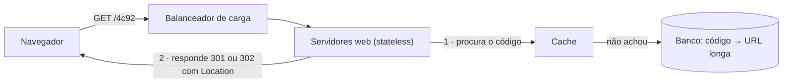
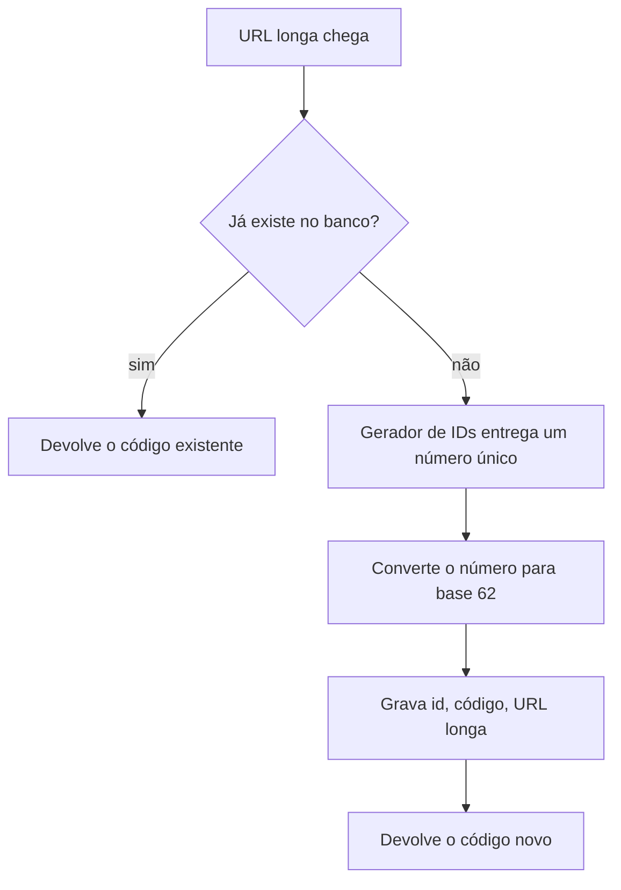

# Problema 5. Encurtador de URL

> [!NOTE] Em uma frase
> Um encurtador é uma tabela gigante de "código curto → link longo" que é escrita pouco e lida muito; o desenho inteiro gira em torno de gerar códigos curtos sem colisão e de responder leituras rápido.

## Por que isso importa

Você já clicou num link do tipo `bit.ly/3xYz9Ab`. Por trás dele há uma URL de 200 caracteres cheia de parâmetros de rastreamento, que não caberia numa mensagem de SMS nem ficaria bonita num slide. O serviço recebeu a URL longa, devolveu um código de 7 caracteres e, a cada clique, olha o código e manda o navegador para o endereço original.

Parece trivial, e é por isso que o problema é bom para treinar: o difícil não é a funcionalidade, é a escala. Bilhões de links guardados por anos, e cada link lido muitas vezes mais do que foi escrito. O volume 1, capítulo 8, usa o encurtador para mostrar três decisões que aparecem em muitos sistemas: como dimensionar armazenamento, como gerar uma chave curta e única, e qual código de redirecionamento HTTP usar.

## O que você precisa saber antes

- [O método de 4 passos](../01-o-metodo-de-4-passos.md): a estrutura que esta página segue.
- [Estimativas de ordem de grandeza](../03-estimativas-de-ordem-de-grandeza.md): as contas de requisições por segundo e de armazenamento abaixo usam a mesma técnica.
- [Problema 4. Gerador de IDs únicos](04-gerador-de-ids-unicos.md): uma das duas abordagens daqui depende de um gerador como aquele.
- [Cache](../../../glossario.md#cache): cópia de um dado num lugar mais rápido; aqui é o que segura a carga de leitura.

## As ideias centrais

### Requisitos e escopo

O livro fecha o escopo com perguntas ao entrevistador e chega a este cenário:

- **Funcional**: dado um link longo, devolver um curto; dado o curto, redirecionar para o longo. Links não são apagados nem editados.
- **Volume**: 100 milhões de links novos por dia. Isso dá cerca de 1.160 escritas por segundo (100 milhões ÷ 86.400 segundos).
- **Proporção leitura:escrita de 10:1**, ou seja, cerca de 11.600 redirecionamentos por segundo.
- **Retenção de 10 anos**: 100 milhões × 365 × 10 = 365 bilhões de registros. Com uns 100 bytes por URL, são cerca de 36,5 TB só de URLs longas.
- **Código o mais curto possível**, usando só dígitos e letras.

Com esses números já dá para tirar o tamanho do código. Usando `0-9`, `a-z` e `A-Z` há 62 símbolos possíveis por posição. Com 6 posições, 62⁶ ≈ 57 bilhões de combinações, pouco para 365 bilhões. Com 7 posições, 62⁷ ≈ 3,5 trilhões, o que sobra com folga. Resposta: 7 caracteres.

A API (a interface que os clientes chamam) fica com dois endpoints: um `POST` que recebe a URL longa e devolve a curta, e um `GET /{código}` que responde com redirecionamento.

### Desenho de alto nível

O caminho de leitura é o que importa: o navegador pede o código, um servidor [stateless](../../../glossario.md#stateless-e-stateful) (que não guarda nada entre requisições, então qualquer um atende) procura no cache e, se não achar, no banco. A resposta HTTP traz o cabeçalho `Location` com a URL longa, e o navegador vai para lá sozinho.

O caminho de escrita: o servidor recebe a URL longa, verifica se ela já foi encurtada antes (se sim, devolve o código existente), gera um código novo e grava o par no banco. O modelo de dados é uma tabela simples com colunas `id`, `codigo` e `url_longa`. Não há relações, então um banco relacional ou um key-value store servem; o que pesa é o volume.

### Onde aprofundar

**1. Como gerar o código: hash ou base 62?** São as duas abordagens que o livro compara.

*Hash com resolução de colisão.* Aplica-se uma função de hash (uma função que transforma qualquer texto num número de tamanho fixo, sempre igual para a mesma entrada) como CRC32, MD5 ou SHA-1 à URL longa e pegam-se os 7 primeiros caracteres. Como foram cortados, duas URLs diferentes podem gerar o mesmo prefixo. Então é preciso consultar o banco: se o código já existe para outra URL, acrescenta-se um texto fixo à URL e faz-se o hash de novo, até não colidir. Consultar o banco a cada tentativa é caro; um **filtro de Bloom** (estrutura compacta em memória que responde "com certeza não existe" ou "talvez exista") evita a maioria das consultas.

*Conversão de ID para base 62.* Pede-se um ID numérico único a um gerador (como o do problema anterior) e escreve-se esse número em base 62, do mesmo jeito que se escreve um número em binário ou hexadecimal, só que com 62 símbolos. Por exemplo, 125 = 2 × 62 + 1, que vira `21`; um milhão vira `4c92`. Como o ID é único, o código é único por construção: não há colisão e nem consulta prévia.

**2. 301 ou 302?** Os dois códigos HTTP redirecionam, mas com um efeito colateral diferente. O **301** (*moved permanently*) diz ao navegador que a mudança é permanente; o navegador guarda a resposta e, nos próximos cliques, vai direto à URL longa sem passar pelo encurtador. Isso alivia o servidor. O **302** (*found*, temporário) faz todo clique passar pelo encurtador. Isso custa mais carga, mas permite contar cliques, saber de onde vieram e trocar o destino depois. Se o produto vende estatísticas de clique, a escolha é 302.

**3. Segurar 11.600 leituras por segundo.** Leituras dominam e o mapeamento nunca muda depois de criado, o cenário ideal para cache: um código popular fica em memória e quase nunca chega ao banco. Como os dados não mudam, o problema clássico do cache, saber quando a cópia ficou velha, praticamente não existe aqui. O banco, com centenas de bilhões de linhas, acaba precisando de [particionamento](../../../glossario.md#particionamento-sharding) e de [replicação](../../../glossario.md#replicação) para leituras, assuntos da página [Escalar de zero a milhões](../02-escalar-de-zero-a-milhoes.md).

### Trade-offs

| Decisão | Opção A | Opção B |
|---|---|---|
| Geração do código | Hash: tamanho fixo, não depende de serviço extra, mas exige checar colisão | Base 62 de ID: sem colisão, mas tamanho cresce com o ID e depende de um gerador distribuído |
| Previsibilidade | Hash parece aleatório | Base 62 de ID sequencial é adivinhável: dá para enumerar links vizinhos |
| Redirecionamento | 301: menos carga, perde a análise | 302: toda visita passa pelo servidor, ganha a análise |

O ponto de previsibilidade merece atenção: se o código vem de um contador, quem recebe `4c92` pode tentar `4c93` e descobrir links que outra pessoa encurtou, às vezes com documentos privados. O livro aponta isso como desvantagem da base 62; em produção, costuma-se embaralhar o ID antes de converter.

## Onde isso aparece no mundo real

- **Bitly e TinyURL**: os produtos que dão nome à categoria. O Bitly vende painéis de análise de cliques, o que só funciona porque os cliques (ou ao menos o primeiro de cada navegador) passam pelo servidor do encurtador antes do redirecionamento: a mesma tensão entre 301 e 302 discutida acima.
- **Encurtadores internos (`go/links`)**: muitas empresas mantêm um encurtador interno onde `go/folha-de-ponto` leva à página certa. É o mesmo desenho com escala muito menor e com códigos escolhidos por pessoas em vez de gerados.
- **Pesquisas sobre links enumeráveis**: um estudo de 2016 da Cornell Tech (*Gone in Six Characters*) mostrou que varrer códigos curtos de serviços públicos expõe documentos compartilhados em nuvem e localizações de mapas, exatamente o risco de códigos previsíveis.

## Erros comuns de quem está aprendendo

- **Começar pelo hash sem fazer a conta do tamanho.** O tamanho do código sai da estimativa (365 bilhões de links, 62 símbolos), não de gosto. Fazer a conta primeiro justifica os 7 caracteres.
- **Esquecer a colisão ao truncar o hash.** MD5 tem 128 bits; os 7 primeiros caracteres não têm. Truncar um hash joga fora a garantia de unicidade, e o desenho precisa de um passo de verificação.
- **Escolher 301 "porque é mais rápido" sem olhar o produto.** Se a empresa precisa de dados de clique ou de poder mudar o destino, o 301 em cache no navegador atrapalha.
- **Achar que o banco é o gargalo.** Com 10 leituras por escrita e dados imutáveis, um cache bem dimensionado absorve a maior parte da carga; o banco importa mais pelo volume guardado do que pelas consultas.

## Verifique se entendeu

1. Por que 6 caracteres não bastam e 7 bastam? Refaça a conta. (Requisitos e escopo)
2. Descreva o caminho de um clique, do navegador até a URL longa, citando onde entra o cache. (Desenho de alto nível)
3. Qual das duas abordagens de geração precisa consultar o banco antes de gravar, e por quê? (Onde aprofundar, ponto 1)
4. Um cliente quer relatórios de cliques por país. Que código de redirecionamento você usa e o que muda na carga do servidor? (Onde aprofundar, ponto 2)
5. Que risco de privacidade a conversão de IDs sequenciais cria, e como mitigá-lo? (Trade-offs)

## Para ir além

- [booknotes, capítulo do encurtador](https://github.com/preslavmihaylov/booknotes/tree/master/system-design/system-design-interview/chapter09): resumo do capítulo com as contas, as duas abordagens e a discussão 301/302.
- [system-design-notes, URL Shortener](https://github.com/liquidslr/system-design-notes/tree/main/08.%20URL%20Shortener): outra leitura do capítulo, com os fluxos de encurtar e redirecionar.
- [system-design-primer](https://github.com/donnemartin/system-design-primer): o problema resolvido do Pastebin é parente próximo do encurtador e mostra o mesmo raciocínio de base 62 e cache.

---
Anterior: [Problema 4. Gerador de IDs únicos](04-gerador-de-ids-unicos.md) · Próximo: [Problema 6. Web crawler](06-web-crawler.md) · Voltar ao livro: [Guia de leitura](../index.md)
