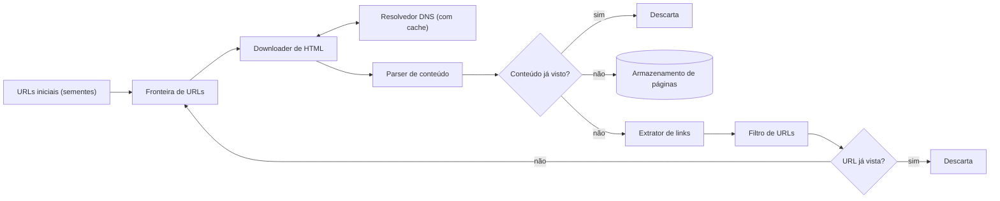
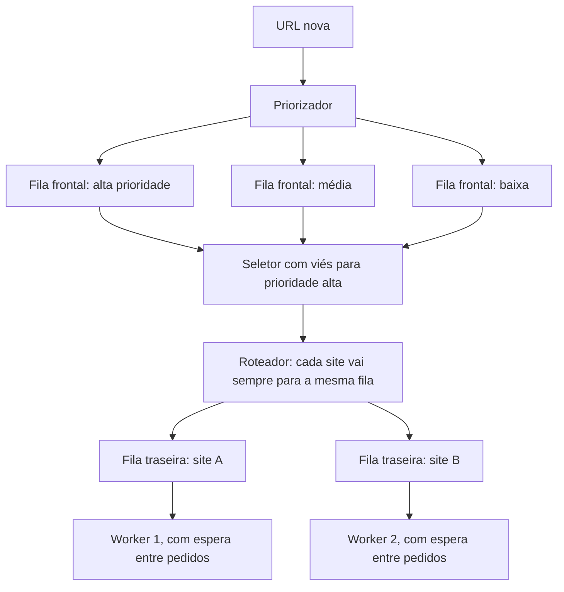

# Problema 6. Web crawler

> [!NOTE] Em uma frase
> Um crawler é um laço "pega um link, baixa a página, extrai os links novos, volta ao início"; o desenho difícil está na fila de links a visitar, que precisa decidir o que baixar primeiro sem martelar nenhum site.

## Por que isso importa

O Google só consegue responder a uma busca porque, antes, um programa visitou bilhões de páginas e guardou o conteúdo. Esse programa é um **web crawler** (ou *spider*): começa com alguns endereços, baixa cada página, encontra os links dentro dela e repete com esses links. Além de buscadores, crawlers alimentam arquivamento (o Internet Archive), monitoramento de marcas e preços, e a coleta de texto usada para treinar modelos de linguagem.

A versão de 20 linhas funciona num notebook. A versão que roda por meses contra a internet real quebra de jeitos que o código simples não prevê: sites que bloqueiam o robô por excesso de pedidos, a mesma notícia publicada em 50 endereços, calendários com links infinitos para "próximo mês". O volume 1, capítulo 9, usa o crawler para mostrar como um algoritmo trivial (uma busca em largura num grafo) vira um sistema distribuído quando a escala e o mundo real entram.

## O que você precisa saber antes

- [O método de 4 passos](../01-o-metodo-de-4-passos.md): a estrutura que esta página segue.
- [Estimativas de ordem de grandeza](../03-estimativas-de-ordem-de-grandeza.md): para as contas de páginas por segundo e petabytes.
- [Fila e mensageria](../../../glossario.md#fila-e-mensageria): componente que guarda trabalho entre quem produz e quem consome; o coração do crawler é uma coleção de filas.
- [Problema 2. Consistent hashing](02-consistent-hashing.md): usado para repartir os sites entre os servidores que baixam.

## As ideias centrais

### Requisitos e escopo

O livro fixa um crawler para buscador, e o escopo sai destas respostas:

- **Propósito**: indexação para busca. Só HTML; imagens e vídeos ficam de fora.
- **Volume**: 1 bilhão de páginas por mês, o que dá uns 400 downloads por segundo (1 bilhão ÷ 30 dias ÷ 86.400 s), com pico estimado no dobro, 800.
- **Armazenamento**: com páginas de cerca de 500 KB, são 500 TB por mês; guardando por 5 anos, uns 30 PB (petabytes, milhares de terabytes).
- **Páginas novas e editadas** devem ser consideradas; páginas com conteúdo duplicado, ignoradas.

E as características que separam o brinquedo do sistema real:

- **Escalabilidade**: trabalho paralelo em muitas máquinas.
- **Robustez**: HTML quebrado, servidores que não respondem, links maliciosos não podem derrubar o crawler.
- **Politeness** (educação): não mandar pedidos demais ao mesmo site num curto intervalo, para não parecer um ataque.
- **Extensibilidade**: incluir novos tipos de conteúdo sem refazer tudo.

### Desenho de alto nível

O ciclo, em ordem:

1. **Sementes**: um conjunto inicial de URLs, escolhido para cobrir bem a web (portais populares de cada país e assunto).
2. **Fronteira de URLs** (*URL frontier*): a estrutura que guarda os links ainda não baixados e decide qual vem a seguir.
3. **Downloader**: baixa a página. Antes, precisa traduzir o nome do site para endereço IP via DNS (o "catálogo telefônico" da internet), por isso um resolvedor com [cache](../../../glossario.md#cache) evita repetir essa consulta lenta.
4. **Parser**: valida o HTML e descarta o que estiver muito quebrado.
5. **Conteúdo já visto?**: o livro cita que perto de 30% das páginas da web são duplicatas. Compara-se um hash (uma "impressão digital" curta calculada a partir do conteúdo) em vez do texto inteiro, porque comparar bilhões de páginas caractere a caractere é inviável.
6. **Extrator e filtro de links**: tira os links da página e descarta tipos indesejados, extensões fora do escopo e sites na lista de bloqueio.
7. **URL já vista?**: impede colocar de novo na fronteira o que já foi visitado ou já está na fila. Um filtro de Bloom (estrutura compacta que responde "com certeza não vi" ou "talvez já tenha visto") ou uma tabela hash resolvem.

### Onde aprofundar

**1. A fronteira: prioridade e educação ao mesmo tempo.** A web é um grafo: páginas são nós, links são arestas. Percorrer em largura (BFS, *breadth-first search*, visitar todos os vizinhos antes de descer um nível) é o padrão, porque a busca em profundidade pode descer infinitamente num único site. Mas uma fila BFS simples tem dois defeitos. Primeiro, a maioria dos links de uma página aponta para o mesmo site, então o crawler dispara centenas de pedidos seguidos ao mesmo servidor: falta de educação que acaba em bloqueio. Segundo, trata todas as páginas como iguais, quando a home de um grande jornal vale mais do que um fórum abandonado.

A solução do livro divide a fronteira em duas camadas de filas:

As **filas frontais** cuidam da prioridade: um priorizador dá nota a cada URL (por popularidade, tráfego, frequência de atualização) e a coloca na fila correspondente; um seletor tira mais vezes das filas de prioridade alta. As **filas traseiras** cuidam da educação: uma tabela mapeia cada site para uma única fila, e cada fila tem um único worker que espera um intervalo entre um download e outro. Como um site nunca está em duas filas, nunca recebe dois pedidos ao mesmo tempo deste crawler.

**2. Frescor e escala.** Páginas mudam, então o crawler precisa voltar a elas. Revisitar tudo é caro; o livro sugere revisitar com base no histórico de atualização de cada página e priorizar as importantes. Quanto à escala: a fronteira tem centenas de milhões de URLs, que não cabem em memória, mas ler do disco a cada passo é lento. A saída é híbrida, com a maior parte no disco e *buffers* (áreas de memória temporária) para enfileirar e desenfileirar, gravados em lote. Os downloaders se espalham por várias máquinas, cada uma responsável por um conjunto de sites, e [consistent hashing](02-consistent-hashing.md) permite adicionar ou remover máquinas sem redistribuir todos os sites. Colocar servidores perto geograficamente dos sites também reduz o tempo de download.

**3. Robustez contra o mundo real.** Três defesas aparecem no capítulo:

- **robots.txt**: arquivo na raiz de cada site dizendo o que robôs podem visitar. O crawler deve baixá-lo, respeitá-lo e guardá-lo em cache para não pedir de novo a cada página.
- **Armadilhas de spider** (*spider traps*): páginas que geram links infinitos, como `site.com/a/a/a/a/...` ou um calendário com "próximo mês" para sempre. Limitar o tamanho da URL e a profundidade por site ajuda, mas nenhuma regra pega todas; parte da defesa é identificar manualmente e pôr o site no filtro.
- **Falhas parciais**: tempo limite curto no download (um servidor lento não pode prender o worker), salvar o estado da fronteira periodicamente para recomeçar de onde parou, e tratar exceções sem derrubar o processo inteiro.

### Trade-offs

| Decisão | Ganha | Perde |
|---|---|---|
| BFS em vez de DFS | Cobertura ampla, não se perde num site | Precisa de controle explícito de prioridade e educação |
| Uma fila por site com espera | Não sobrecarrega nem é bloqueado | Sites grandes demoram mais para ser cobertos |
| Deduplicação por hash | Comparação barata | Pega só cópias idênticas; páginas quase iguais escapam |
| Fronteira em disco com buffers | Cabe centenas de milhões de URLs | Mais complexidade e latência que uma fila em memória |
| Filtro de Bloom para URLs vistas | Pouquíssima memória | Falsos positivos: algumas URLs novas são descartadas como "vistas" |

O último ponto ilustra bem o tipo de escolha do capítulo: perder uma pequena fração de páginas por falso positivo é aceitável para um buscador, e em troca a memória cai em ordens de grandeza.

## Onde isso aparece no mundo real

- **Googlebot**: o crawler do Google ajusta a taxa de pedidos a cada site conforme o servidor responde (se ficar lento ou devolver erros, ele reduz), uma forma automática da educação descrita acima. O Google documenta publicamente como o Googlebot lê o robots.txt.
- **Common Crawl**: projeto sem fins lucrativos que publica, de graça, coletas mensais com bilhões de páginas. É uma das principais fontes de texto usadas para treinar modelos de linguagem, e seus arquivos mostram na prática a escala de petabytes estimada no capítulo.
- **Internet Archive**: o Heritrix, crawler de código aberto do Internet Archive, implementa fronteira com filas por site e respeito a robots.txt, as mesmas ideias do desenho do livro.

## Erros comuns de quem está aprendendo

- **Desenhar só o laço e esquecer a fronteira.** "Fila de URLs" não é detalhe; é onde estão a prioridade, a educação e a escala. Uma entrevista sobre crawler que não aprofunda a fronteira fica rasa.
- **Confundir "URL já vista" com "conteúdo já visto".** São duas checagens diferentes: endereços diferentes podem ter o mesmo conteúdo, e o mesmo endereço pode mudar de conteúdo. O desenho precisa das duas.
- **Achar que deduplicar por hash pega páginas parecidas.** Um hash comum muda inteiramente se um caractere mudar, então uma notícia com data diferente no rodapé passa como nova. Detectar quase-duplicatas exige outras técnicas, que o livro só menciona.
- **Ignorar DNS.** Resolver nomes é síncrono e pode levar dezenas a centenas de milissegundos; sem cache, vira o gargalo escondido do downloader.

## Verifique se entendeu

1. Refaça a estimativa: por que 1 bilhão de páginas por mês dá uns 400 downloads por segundo e uns 30 PB em 5 anos? (Requisitos e escopo)
2. Qual a diferença entre a checagem "conteúdo já visto" e "URL já vista", e onde cada uma fica no fluxo? (Desenho de alto nível)
3. Por que as filas traseiras têm um site por fila e um worker por fila? Que problema isso evita? (Onde aprofundar, ponto 1)
4. Dê dois exemplos de spider trap e uma defesa para cada. (Onde aprofundar, ponto 3)
5. Que custo o filtro de Bloom impõe ao crawler, e por que ele é aceitável para um buscador? (Trade-offs)

## Para ir além

- [booknotes, capítulo do web crawler](https://github.com/preslavmihaylov/booknotes/tree/master/system-design/system-design-interview/chapter10): resumo dos componentes, da fronteira com filas frontais e traseiras e das defesas de robustez.
- [system-design-notes, Web Crawler](https://github.com/liquidslr/system-design-notes/tree/main/09.%20Web%20Crawler): outra leitura do capítulo, útil para conferir as estimativas.
- [system-design-primer](https://github.com/donnemartin/system-design-primer): tem um web crawler resolvido em outro estilo, bom para comparar as escolhas com as do livro.

---
Anterior: [Problema 5. Encurtador de URL](05-encurtador-de-url.md) · Próximo: [Problema 7. Sistema de notificações](07-sistema-de-notificacoes.md) · Voltar ao livro: [Guia de leitura](../index.md)
