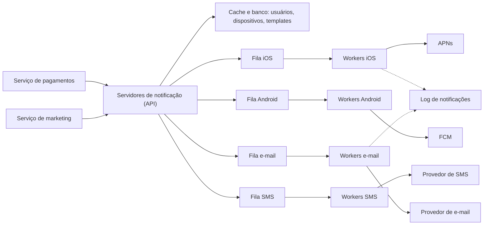

# Problema 7. Sistema de notificações

> [!NOTE] Em uma frase
> Um sistema de notificações é uma linha de montagem: quem quer avisar alguém entrega o pedido, filas separam o pedido do envio, e trabalhadores conversam com os provedores externos (Apple, Google, operadora de SMS, serviço de e-mail), tentando de novo quando algo falha.

## Por que isso importa

Pense no aplicativo do seu banco. Uma compra no cartão gera um push no celular em segundos; o extrato mensal chega por e-mail; o código de confirmação de login chega por SMS. Do lado de dentro, dezenas de serviços diferentes (cobrança, segurança, marketing) querem avisar o usuário, e cada um deles não deveria precisar saber como falar com a Apple, com a operadora ou com o provedor de e-mail. Se cada serviço fizer isso por conta própria, você tem dez implementações de retry, dez lugares guardando credenciais e nenhum controle de quantas mensagens um usuário recebe por dia.

O problema parece simples porque o envio em si é delegado: você não constrói uma operadora de SMS. A dificuldade está em volta: não perder um aviso importante quando um provedor cai, não mandar o mesmo aviso duas vezes, respeitar quem pediu para não receber e aguentar picos (uma campanha de marketing disparada para milhões de pessoas às 9h). É um ótimo problema para praticar [filas e mensageria](../../../glossario.md#fila-e-mensageria) em um contexto concreto. O livro trata dele no volume 1, capítulo 10.

## O que você precisa saber antes

- [O método de 4 passos](../01-o-metodo-de-4-passos.md): a estrutura que esta página segue (escopo, alto nível, aprofundamento, trade-offs).
- [Escalar de zero a milhões](../02-escalar-de-zero-a-milhoes.md): por que separar componentes e usar filas para desacoplar.
- [Estimativas de ordem de grandeza](../03-estimativas-de-ordem-de-grandeza.md): para transformar "milhões por dia" em mensagens por segundo.
- [Rate limiter](01-rate-limiter.md): a mesma ideia de limitar volume reaparece aqui, aplicada por usuário.

## As ideias centrais

### Requisitos e escopo

O primeiro passo é perguntar antes de desenhar. As respostas que o livro usa como ponto de partida:

- **Canais:** push para iOS e Android, SMS e e-mail.
- **Tempo:** "tempo real suave" (soft real-time). O usuário deve receber o quanto antes, mas um atraso pequeno sob carga alta é aceitável. Não é um sistema de alarme hospitalar.
- **Quem dispara:** serviços internos (por exemplo, "pagamento confirmado") e tarefas agendadas no servidor.
- **Volume:** cerca de 10 milhões de push, 1 milhão de SMS e 5 milhões de e-mails por dia.
- **Opt-out:** o usuário pode desligar notificações, e o sistema tem que respeitar.

Faça a conta: 16 milhões de mensagens por dia dão em média uns 185 por segundo, mas a média engana. Campanhas concentram o volume em poucos minutos, e o pico pode ser dezenas de vezes maior. É isso que justifica filas.

Dois conceitos de fora que o desenho usa:

- **Provedor de push:** cada plataforma tem o seu serviço oficial. Na Apple é o APNs (Apple Push Notification service); no Android, o FCM (Firebase Cloud Messaging). Você não fala com o celular diretamente; manda para o provedor, junto com o **device token**, um identificador único que o aparelho recebe ao instalar o app.
- **Provedores de SMS e e-mail:** empresas como Twilio (SMS) e SendGrid (e-mail) oferecem APIs pagas. Seu sistema chama a API; eles entregam.

Para enviar, o sistema precisa ter guardado os contatos: quando o usuário instala o app ou se cadastra, o servidor salva e-mail, telefone e os device tokens (um usuário pode ter vários aparelhos, então é uma tabela de dispositivos ligada ao usuário).

### Desenho de alto nível

A primeira versão óbvia é um único "servidor de notificações" que recebe pedidos e chama os provedores. Ela tem três defeitos: é um ponto único de falha (se cai, ninguém recebe nada), é difícil de escalar (banco, cache e envio no mesmo processo) e fica lento, porque cada chamada a um provedor externo pode demorar e trava o resto.

A versão melhorada separa responsabilidades e coloca uma fila por canal:

O caminho de uma mensagem:

1. Um serviço chama a API do servidor de notificações dizendo "avise o usuário 42 que o pagamento foi aprovado".
2. O servidor de notificações valida o pedido (autenticação de quem chamou, formato), busca os dados do usuário (tokens, e-mail, preferências) no [cache](../../../glossario.md#cache) ou no banco, monta a mensagem a partir de um template e coloca na fila do canal certo.
3. Workers (processos que só consomem a fila) pegam a mensagem e chamam o provedor externo.
4. O provedor entrega ao aparelho ou à caixa de e-mail.

Por que uma fila por canal? Porque os canais falham de forma independente. Se o provedor de SMS ficar fora do ar uma hora, a fila de SMS cresce, mas o push e o e-mail continuam saindo normalmente. Com uma fila única, uma mensagem de SMS travada atrasaria todo o resto.

Os servidores de notificação são [stateless](../../../glossario.md#stateless-e-stateful): não guardam nada entre pedidos, então dá para colocar mais instâncias atrás de um balanceador quando o volume sobe.

### Onde aprofundar

**1. Não perder mensagens.** Uma notificação pode se perder em vários pontos: o worker morre depois de tirar da fila e antes de enviar; o provedor responde erro. A defesa é dupla. Primeiro, persistir: o sistema grava cada notificação em um banco (o "log de notificações") com o status (pendente, enviada, falhou). Segundo, retry: se o envio falha, o worker devolve a mensagem para a fila e tenta de novo, com espera crescente entre tentativas. Depois de N falhas, a mensagem vai para um lugar separado e alguém é alertado.

**2. Não mandar duplicado.** Aqui o livro é honesto: entregar exatamente uma vez é, na prática, impossível em sistema distribuído. Se o worker envia e cai antes de marcar "enviado", ao reiniciar ele vai mandar de novo. O que dá para fazer é reduzir duplicatas: cada notificação recebe um ID de evento; antes de enviar, o worker checa se aquele ID já foi processado e, se sim, descarta. É a ideia de [idempotência](../../../glossario.md#idempotência) aplicada ao envio. Repare que a checagem e o envio não são atômicos, então ainda sobra uma janela pequena; o objetivo é tornar a duplicata rara, não impossível.

**3. Respeitar o usuário.** Três peças:

- **Preferências:** uma tabela por usuário e canal ("usuário 42, SMS, desligado"). O servidor checa antes de enfileirar.
- **Limite de frequência:** sem limite, um bug ou uma campanha agressiva pode mandar 30 pushes em uma hora, e o usuário desinstala o app. Um [rate limiter](01-rate-limiter.md) por usuário resolve.
- **Templates:** mensagens parecidas ("Seu pedido {id} saiu para entrega") ficam em templates parametrizados, o que padroniza formato e evita montar texto à mão em cada serviço.

Completam o desenho: credenciais de acesso para que só serviços autorizados possam disparar notificações; monitorar o tamanho das filas (fila crescendo = workers insuficientes ou provedor com problema); e rastrear eventos depois do envio (entregue, aberta, clicada), que alimentam métricas de engajamento.

### Trade-offs

| Decisão | Ganho | Custo |
|---|---|---|
| Fila entre API e envio | Absorve picos; isola falhas de provedores | Mais um componente para operar; atraso extra |
| Uma fila por canal | Falha de SMS não atrasa push | Mais filas e grupos de workers |
| Retry com log persistido | Mensagem não se perde | Aumenta a chance de duplicata |
| Dedupe por ID de evento | Menos duplicatas | Uma consulta a mais por envio; não elimina 100% |
| "Tempo real suave" | Permite filas e lotes | Não serve para avisos com prazo de segundos garantidos |

O ponto central: confiabilidade (não perder) e unicidade (não duplicar) puxam em direções opostas. Quase sempre se escolhe "pelo menos uma vez" com dedupe, porque perder um aviso de segurança é pior do que receber dois.

## Onde isso aparece no mundo real

- **Apps de banco e delivery:** o push de "pedido saiu para entrega" passa por um desenho parecido, com APNs e FCM no fim da linha. Quando a Apple ou o Google têm instabilidade, notificações de muitos apps atrasam ao mesmo tempo, o que mostra que o provedor externo é uma dependência que você não controla.
- **E-mail transacional:** empresas usam serviços como SendGrid ou Amazon SES e mantêm a própria fila na frente, justamente para reenviar quando o provedor limita a taxa de envio.
- **Códigos de verificação por SMS:** aqui o "tempo real suave" fica mais apertado; um código que chega em dez minutos já expirou. Por isso muitos sistemas dão prioridade a esse tipo de mensagem em uma fila própria.

## Erros comuns de quem está aprendendo

- **Achar que dá para garantir "exatamente uma vez".** Não dá. O desenho realista é "pelo menos uma vez" com dedupe pelo ID do evento, e aceitar uma duplicata rara.
- **Chamar o provedor direto da API.** Funciona no teste e quebra no primeiro pico ou na primeira lentidão do provedor: a API fica presa esperando. A fila existe para cortar essa espera.
- **Esquecer o opt-out e o limite por usuário.** Não é só detalhe de produto: em muitos países mandar SMS ou e-mail de marketing para quem recusou tem consequência legal.
- **Uma fila única para tudo.** Um canal com problema vira fila parada para todos.

## Verifique se entendeu

1. Por que a primeira versão, com um único servidor de notificações, não serve? (Desenho de alto nível)
2. O que acontece com push e e-mail se o provedor de SMS ficar fora do ar por uma hora no desenho com filas por canal? (Desenho de alto nível)
3. Por que retry e dedupe são necessários juntos, e por que mesmo assim duplicatas podem acontecer? (Onde aprofundar, pontos 1 e 2)
4. Com 16 milhões de mensagens por dia, qual a média por segundo, e por que você não deve dimensionar só pela média? (Requisitos e escopo)
5. Onde no fluxo fica a checagem de preferências do usuário, e por que ali? (Onde aprofundar, ponto 3)

## Para ir além

- [booknotes, capítulo de notificações](https://github.com/preslavmihaylov/booknotes/tree/master/system-design/system-design-interview/chapter11): resumo passo a passo com o desenho inicial, o melhorado e a seção de confiabilidade (log, retry, dedupe).
- [liquidslr/system-design-notes, Notification System](https://github.com/liquidslr/system-design-notes/tree/main/10.%20Notification%20System): notas em prosa com os componentes e o fluxo de envio.
- [system-design-primer](https://github.com/donnemartin/system-design-primer): a seção sobre filas e comunicação assíncrona aprofunda o porquê de colocar uma fila entre quem pede e quem executa.

---
Anterior: [Web crawler](06-web-crawler.md) · Próximo: [News feed](08-news-feed.md) · Voltar ao livro: [Guia de leitura](../index.md)
