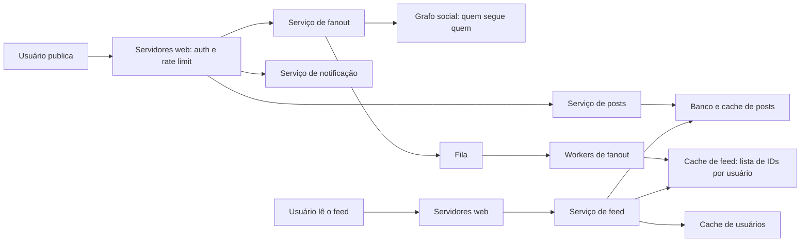

# Problema 8. News feed

> [!NOTE] Em uma frase
> Um feed é uma lista pré-calculada: quando alguém publica, o sistema copia a referência do post para a lista de cada amigo (ou deixa para montar na hora da leitura, no caso de celebridades), e a leitura só precisa buscar essa lista e completar os detalhes no cache.

## Por que isso importa

Você abre o Instagram ou o LinkedIn e a primeira tela aparece quase instantaneamente, com posts de dezenas de pessoas diferentes. Se o servidor tivesse que, naquele momento, buscar quem você segue, pegar os posts recentes de cada um, juntar e ordenar, a tela levaria segundos, e milhões de pessoas fazendo isso ao mesmo tempo derrubariam o banco. O feed parece uma consulta; na prática, é um problema de onde e quando fazer o trabalho pesado.

Esse problema ensina uma das ideias mais reutilizáveis de system design: **fanout**, que é espalhar uma informação de um produtor para muitos destinatários. Você pode espalhar na escrita (cada post é copiado para N listas) ou na leitura (cada leitor junta os posts de N fontes). A escolha muda tudo: custo, [latência](../../../glossario.md#latência-e-throughput) e o que acontece quando alguém com 50 milhões de seguidores publica. O livro trata do tema no volume 1, capítulo 11.

## O que você precisa saber antes

- [O método de 4 passos](../01-o-metodo-de-4-passos.md): a estrutura desta página.
- [Escalar de zero a milhões](../02-escalar-de-zero-a-milhoes.md): cache, réplicas de banco e filas, que aparecem todos aqui.
- [Sistema de notificações](07-sistema-de-notificacoes.md): o mesmo padrão de fila + workers, agora usado para distribuir posts.

## As ideias centrais

### Requisitos e escopo

Perguntas que delimitam o problema, com as respostas do livro:

- **Plataforma:** web e mobile.
- **Funcionalidades:** publicar um post e ver o feed com posts dos amigos.
- **Ordem:** cronológica reversa (mais recente primeiro). Ranqueamento por relevância fica fora, para simplificar.
- **Escala:** 10 milhões de usuários ativos por dia; cada usuário pode ter até 5.000 amigos.
- **Conteúdo:** texto, imagens e vídeos (a mídia em si fica em um armazenamento de arquivos e uma CDN; o feed só carrega referências).

Duas APIs bastam:

- `POST /v1/me/feed` com o conteúdo do post e o token de autenticação.
- `GET /v1/me/feed` com o token; devolve o feed do usuário.

O sistema se divide em dois fluxos: **publicação** (o que acontece quando alguém posta) e **construção do feed** (o que acontece quando alguém abre o app).

### Desenho de alto nível

**Publicação.** O post passa pelos servidores web, que autenticam e aplicam [rate limiting](01-rate-limiter.md) (para conter spam). Três coisas acontecem em paralelo: o serviço de posts grava o conteúdo no banco e no [cache](../../../glossario.md#cache); o serviço de fanout distribui o post para os amigos; o serviço de notificação avisa quem quer ser avisado.

O fanout funciona assim: busca no grafo social a lista de amigos do autor; filtra quem silenciou o autor ou configurou para não ver; coloca na fila uma tarefa por lote de amigos; os workers gravam, no cache de feed de cada amigo, o par (ID do post, ID do autor).

**Leitura.** O serviço de feed pega a lista de IDs do cache de feed do usuário, depois completa cada item ("hidrata") com os dados do post e do autor (nome, foto) vindos dos caches de posts e de usuários, e devolve o JSON pronto.

Por que o cache de feed guarda só IDs e não o post inteiro? Memória. Um post aparece no feed de milhares de pessoas; copiar o texto e a foto em cada lista multiplicaria o uso de memória por milhares. Com IDs, o conteúdo existe uma vez e cada lista tem só ponteiros. O livro também sugere limitar o tamanho da lista (por exemplo, os últimos poucos centenas de posts), porque quase ninguém rola o feed até posts de meses atrás; quem rolar cai no caminho lento, buscando do banco.

### Onde aprofundar

**1. Fanout na escrita versus na leitura.** É a decisão central.

- **Na escrita (push):** quando alguém publica, o post já é empurrado para o feed de todos os amigos. A leitura fica trivial e rápida, porque a lista está pronta. O problema: um usuário com milhões de seguidores gera milhões de escritas por post (o "problema da celebridade" ou hotkey), e o sistema gasta trabalho em contas inativas que nunca vão ler.
- **Na leitura (pull):** nada é copiado na publicação; quando alguém abre o feed, o sistema busca os posts recentes de cada pessoa seguida e junta. Não há desperdício com inativos, e celebridade não é problema. Mas a leitura fica lenta, justamente na operação mais frequente.

**A solução do livro é híbrida:** push para a maioria dos usuários, pull para contas com muitos seguidores. Ao abrir o feed, o sistema pega a lista pronta (push) e mistura na hora os posts recentes das poucas celebridades que a pessoa segue (pull). Para escolher quem é "celebridade", uma regra simples por número de seguidores basta. Uma ferramenta citada para distribuir a carga do fanout de forma uniforme é o [consistent hashing](02-consistent-hashing.md), que espalha usuários entre servidores de cache.

**2. Camadas de cache.** O livro organiza o cache em cinco camadas, cada uma com um tipo de dado e um padrão de acesso:

| Camada | O que guarda |
|---|---|
| Feed | Lista de IDs de posts por usuário |
| Conteúdo | Dados dos posts; posts populares em uma área "quente" |
| Grafo social | Quem segue quem |
| Ações | Se o usuário curtiu, respondeu, compartilhou |
| Contadores | Número de curtidas, respostas, seguidores |

Separar permite dimensionar e invalidar cada uma de forma independente: contadores mudam o tempo todo; o grafo social muda raramente.

**3. Escalar o armazenamento.** Com o volume crescendo, entram as técnicas da página de [escala](../02-escalar-de-zero-a-milhoes.md): [replicação](../../../glossario.md#replicação) com réplicas de leitura (o feed é muito mais lido do que escrito), [particionamento](../../../glossario.md#particionamento-sharding) do banco de posts e manter os servidores web [stateless](../../../glossario.md#stateless-e-stateful). O grafo social costuma morar em um banco de grafos ou em tabelas de relacionamento muito bem indexadas.

### Trade-offs

| Escolha | Ganho | Custo |
|---|---|---|
| Fanout na escrita | Leitura rápida e simples | Escrita cara; celebridades geram tempestade de escritas; trabalho desperdiçado com inativos |
| Fanout na leitura | Sem desperdício; celebridade sem custo extra | Leitura lenta; carga no momento mais sensível |
| Híbrido | Pega o melhor de cada | Dois caminhos para manter; regra de corte para ajustar |
| Só IDs no cache de feed | Memória muito menor | Passo extra de hidratação na leitura |
| Lista de feed limitada | Cache cabe na memória | Rolar muito para trás é lento |

Outro trade-off implícito é de [consistência](../../../glossario.md#consistência-forte-e-eventual): com fanout assíncrono por fila, o post aparece no feed dos amigos alguns segundos depois, não instantaneamente. Para um feed social isso é aceitável; para um extrato bancário não seria.

## Onde isso aparece no mundo real

- **Twitter (atual X):** a equipe de engenharia já descreveu publicamente o uso de fanout na escrita para timelines, com tratamento especial para contas com muitos seguidores, que é exatamente o híbrido do livro.
- **Feeds com ranqueamento:** Instagram e LinkedIn não mostram mais em ordem cronológica pura; um modelo escolhe a ordem. O desenho de candidatos pré-calculados + montagem na leitura continua o mesmo; o ranqueamento entra como uma etapa a mais na hora da leitura.
- **Qualquer "atividade recente":** o painel de atividade do GitHub ou o histórico de um app de projetos são feeds menores e usam o mesmo raciocínio.

## Erros comuns de quem está aprendendo

- **Escolher só push ou só pull.** Os dois extremos falham em algum caso realista. A resposta madura é o híbrido, com a justificativa de por quê.
- **Guardar o post inteiro no cache de feed.** Multiplica a memória pelo número de seguidores. Guarde IDs e hidrate.
- **Esquecer os inativos.** Fanout na escrita para quem não abre o app há meses é trabalho jogado fora; alguns sistemas pulam essas contas e montam o feed delas sob demanda se voltarem.
- **Achar que o post precisa aparecer na hora para todos.** Alguns segundos de atraso são aceitáveis e é isso que permite usar filas.

## Verifique se entendeu

1. O que é fanout, e qual a diferença prática entre fazê-lo na escrita e na leitura? (Onde aprofundar, ponto 1)
2. Por que uma celebridade quebra o fanout na escrita, e como o modelo híbrido contorna isso? (Onde aprofundar, ponto 1)
3. Por que o cache de feed guarda IDs em vez de posts completos, e qual o custo dessa escolha? (Desenho de alto nível)
4. Por que separar o cache em camadas, em vez de um cache único? (Onde aprofundar, ponto 2)
5. Por que o fluxo de publicação pode ser assíncrono sem prejudicar o usuário? (Trade-offs)

## Para ir além

- [booknotes, capítulo de news feed](https://github.com/preslavmihaylov/booknotes/tree/master/system-design/system-design-interview/chapter12): resumo dos dois fluxos, do fanout e das camadas de cache.
- [topofmind.dev, notas do livro](https://topofmind.dev/notes/system-design/system-design-interview-alex-xu/): as notas do capítulo 11 são das mais completas do site, com diagramas e críticas do autor ao desenho.
- [liquidslr/system-design-notes, News Feed System](https://github.com/liquidslr/system-design-notes/tree/main/11.%20News%20Feed%20System): notas em prosa do capítulo.
- [system-design-primer](https://github.com/donnemartin/system-design-primer): o problema resolvido da timeline do Twitter compara push e pull com números.

---
Anterior: [Sistema de notificações](07-sistema-de-notificacoes.md) · Próximo: [Chat](09-chat.md) · Voltar ao livro: [Guia de leitura](../index.md)
