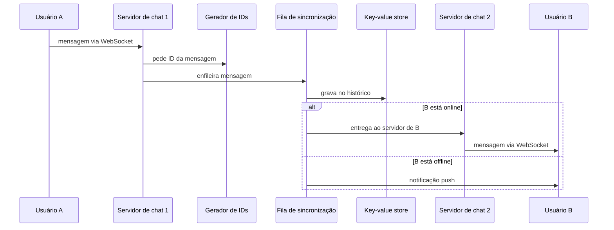

# Problema 9. Chat

> [!NOTE] Em uma frase
> Um chat precisa que o servidor consiga falar com o cliente a qualquer momento, então cada usuário online mantém uma conexão aberta com um servidor de chat; o resto do desenho é sobre achar o servidor certo, guardar as mensagens em ordem e saber quem está online.

## Por que isso importa

Quase toda aplicação web funciona no modelo "o cliente pergunta, o servidor responde". Você clica, o navegador faz uma requisição HTTP, o servidor devolve a página. Um chat quebra esse modelo: quando seu amigo manda uma mensagem, é o servidor que precisa avisar o seu celular, sem que você tenha perguntado nada. Resolver isso de forma eficiente para milhões de pessoas conectadas ao mesmo tempo é o coração do problema.

É também o primeiro problema do livro em que uma parte do sistema é deliberadamente [stateful](../../../glossario.md#stateless-e-stateful): o servidor de chat sabe quais usuários estão conectados nele. Isso muda como você escala, como balanceia carga e o que acontece quando uma máquina cai. Além disso, o chat junta vários problemas anteriores: [IDs únicos](04-gerador-de-ids-unicos.md), [key-value store](03-key-value-store.md) e [notificações](07-sistema-de-notificacoes.md). O livro trata dele no volume 1, capítulo 12.

## O que você precisa saber antes

- [O método de 4 passos](../01-o-metodo-de-4-passos.md): a estrutura desta página.
- [Escalar de zero a milhões](../02-escalar-de-zero-a-milhoes.md): balanceador de carga e a diferença entre camadas stateless e stateful.
- [Gerador de IDs únicos](04-gerador-de-ids-unicos.md): IDs ordenáveis no tempo, usados aqui para ordenar mensagens.
- [Key-value store](03-key-value-store.md): o tipo de banco escolhido para o histórico.

## As ideias centrais

### Requisitos e escopo

O livro fixa um escopo parecido com o do Facebook Messenger:

- Conversa um a um e em grupo, com grupos de no máximo 100 pessoas.
- Apenas texto, mensagens de até 100.000 caracteres.
- 50 milhões de usuários ativos por dia.
- Indicador de online/offline.
- Um usuário pode estar logado em vários aparelhos ao mesmo tempo, e todos devem ver as mesmas conversas.
- Notificação push quando o destinatário está offline.
- Histórico guardado para sempre.

Antes do desenho, a pergunta técnica: **como o servidor manda algo ao cliente?** Três opções:

- **Polling:** o cliente pergunta "tem mensagem nova?" a cada poucos segundos. Simples, mas a maioria das respostas é "não", e isso desperdiça conexões e bateria.
- **Long polling:** o cliente pergunta e o servidor segura a resposta aberta até ter algo ou até um tempo limite. Melhor, mas a mensagem pode chegar a um servidor que não é o que está segurando a conexão do destinatário, e o servidor não tem como saber se o cliente se desconectou.
- **WebSocket:** um protocolo que começa como uma requisição HTTP comum e, com um "upgrade", vira uma conexão persistente e bidirecional: os dois lados podem mandar dados a qualquer momento. Como usa as portas 80 e 443, passa pela maioria dos firewalls. É a escolha do livro, tanto para enviar quanto para receber.

### Desenho de alto nível

O sistema se divide em três partes:

- **Serviços stateless:** cadastro, login, perfil. São APIs HTTP comuns atrás de um balanceador de carga. Inclui o **service discovery**, que escolhe para qual servidor de chat cada cliente deve se conectar (o livro cita o Apache ZooKeeper, uma ferramenta que mantém um registro coordenado dos servidores disponíveis).
- **Serviço stateful:** os servidores de chat, cada um com milhares de conexões WebSocket abertas.
- **Integrações:** o serviço de notificações push.

Por que um **key-value store** para o histórico? O volume é enorme (o livro cita o Facebook Messenger e o WhatsApp processando dezenas de bilhões de mensagens por dia), o acesso é quase todo às mensagens recentes, e a operação dominante é "busque as mensagens desta conversa a partir do ponto X". Um banco relacional teria dificuldade com o volume e com a cauda longa de dados antigos; key-value stores escalam horizontalmente com [particionamento](../../../glossario.md#particionamento-sharding). O livro menciona que o Facebook Messenger usa HBase e o Discord usa Cassandra.

O modelo de dados:

- **Conversa um a um:** chave primária `message_id`, com `from_user_id`, `to_user_id`, conteúdo e data.
- **Grupo:** chave composta `(channel_id, message_id)`. O `channel_id` funciona como chave de partição, porque toda consulta é "mensagens deste grupo".

### Onde aprofundar

**1. O ID da mensagem.** Duas mensagens enviadas no mesmo milissegundo precisam ter uma ordem definida, então a data não basta. O ID precisa ser único e ordenável: um ID maior significa uma mensagem mais nova. Duas saídas: um gerador global ordenável no tempo, como o Snowflake visto no [problema 4](04-gerador-de-ids-unicos.md), ou um **contador local por conversa**. O livro defende o contador local: a ordem só precisa fazer sentido dentro de uma conversa, e um contador por canal é mais simples do que coordenar um gerador global.

**2. Sincronizar vários aparelhos.** Cada aparelho guarda a variável `cur_max_message_id`, o maior ID de mensagem que ele já recebeu. Ao conectar, ele pede ao servidor "tudo desta conversa com ID maior que o meu máximo". Como os IDs são ordenáveis, isso é uma consulta por faixa simples e cada aparelho alcança os outros sozinho, sem que o servidor precise rastrear o que cada um viu.

**3. Grupos e presença.**

Em grupos pequenos, o livro usa o modelo de **caixa de entrada por usuário**: cada mensagem do grupo é copiada para a fila de sincronização de cada membro. Com 100 membros, são 100 cópias por mensagem, o que é aceitável e deixa a leitura trivial (cada usuário só olha a própria caixa). Para grupos com milhares de membros essa cópia fica cara demais; o livro observa que o WeChat usa essa abordagem e limita grupos a 500 pessoas.

O **indicador de online** usa **heartbeat**: cada cliente manda um sinal periódico ao serviço de presença (por exemplo, a cada 5 segundos). Se nenhum sinal chegar por um intervalo maior (o livro usa 30 segundos), o usuário é marcado offline. Por que não marcar offline assim que a conexão cai? Porque redes móveis caem e voltam o tempo todo (o elevador, o túnel); sem a tolerância, o status piscaria sem parar. Para avisar os amigos de mudanças de status, usa-se publish-subscribe: cada par de amigos tem um canal em que mudanças são publicadas. Isso funciona para grupos pequenos; em grupos grandes, mostrar presença ao vivo para todos fica caro, e a saída é buscar o status só quando alguém abre o grupo.

### Trade-offs

| Decisão | Ganho | Custo |
|---|---|---|
| WebSocket | Mensagem chega na hora, em qualquer direção | Servidor stateful; conexões a gerenciar e reconectar |
| Servidor de chat stateful | Entrega direta e rápida | Escalar e substituir máquinas fica mais difícil; queda de um servidor desconecta milhares |
| Key-value store | Escala horizontal, leitura rápida das recentes | Consultas complexas (busca por texto) precisam de outro sistema |
| Contador de ID por conversa | Simples, ordem correta onde importa | Não ordena mensagens entre conversas diferentes |
| Caixa de entrada por usuário | Leitura trivial | Escrita multiplica pelo tamanho do grupo |
| Heartbeat com tolerância | Status estável em redes instáveis | Status atrasa alguns segundos |

O livro também lista extensões para a fase final: mídia (fotos e vídeos exigem compressão, armazenamento em nuvem e miniaturas), criptografia ponta a ponta (como no WhatsApp, em que só os participantes leem), cache de mensagens no cliente, e o tratamento de erros quando um servidor de chat cai (o service discovery redireciona os clientes para outro servidor, e eles reconectam).

## Onde isso aparece no mundo real

- **WhatsApp:** ficou famoso por servir um número enorme de conexões persistentes por servidor, mostrando quanto uma camada stateful bem feita aguenta.
- **Discord:** a equipe de engenharia publicou artigos sobre guardar bilhões de mensagens em Cassandra, com o canal como chave de partição, exatamente o modelo de dados desta página.
- **Slack:** também usa WebSocket para mensagens em tempo real; os indicadores de "digitando" e de presença seguem a lógica de heartbeat.

## Erros comuns de quem está aprendendo

- **Usar polling "porque é mais simples".** Para chat, o custo de milhões de clientes perguntando a cada segundo é enorme. WebSocket é o padrão.
- **Ordenar mensagens pela data.** Relógios de máquinas diferentes discordam, e duas mensagens podem ter a mesma data. Use um ID ordenável.
- **Tratar o servidor de chat como stateless.** Ele sabe quem está conectado nele; por isso existe service discovery e por isso uma queda precisa de reconexão.
- **Copiar mensagens para todos em grupos enormes.** A caixa de entrada por usuário é boa para grupos pequenos; para canais com milhares de pessoas a leitura por canal é melhor.

## Verifique se entendeu

1. Por que o modelo HTTP "pergunta e resposta" não basta para chat, e o que o WebSocket muda? (Requisitos e escopo)
2. O que é stateful no desenho e qual a consequência disso para escalar e para falhas? (Desenho de alto nível, Trade-offs)
3. Como um aparelho que ficou desligado descobre quais mensagens perdeu? (Onde aprofundar, ponto 2)
4. Por que a presença usa um intervalo de tolerância em vez de marcar offline assim que a conexão cai? (Onde aprofundar, ponto 3)
5. Por que um contador por conversa é suficiente para o ID das mensagens? (Onde aprofundar, ponto 1)

## Para ir além

- [booknotes, capítulo de chat](https://github.com/preslavmihaylov/booknotes/tree/master/system-design/system-design-interview/chapter13): resumo com a comparação polling/long polling/WebSocket, o modelo de dados e o fluxo de mensagens.
- [topofmind.dev, notas do livro](https://topofmind.dev/notes/system-design/system-design-interview-alex-xu/): as notas do capítulo 12 trazem os diagramas e comentários do autor sobre o desenho.
- [liquidslr/system-design-notes, Chat System](https://github.com/liquidslr/system-design-notes/tree/main/12.%20Chat%20System): notas em prosa do capítulo.

---
Anterior: [News feed](08-news-feed.md) · Próximo: [Autocomplete de busca](10-autocomplete-de-busca.md) · Voltar ao livro: [Guia de leitura](../index.md)
