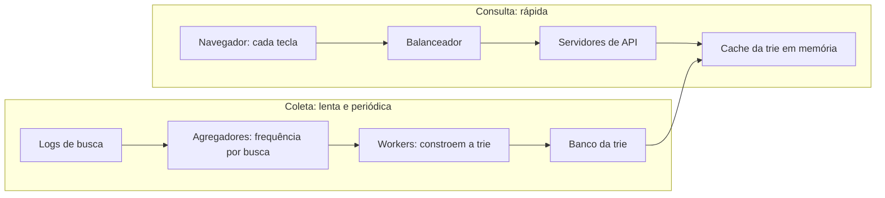

# Problema 10. Autocomplete de busca

> [!NOTE] Em uma frase
> O autocomplete responde rápido porque não calcula nada na hora: uma estrutura de árvore por prefixo (trie) já guarda, em cada prefixo, as cinco buscas mais populares, e essa árvore é reconstruída periodicamente a partir dos logs de busca.

## Por que isso importa

Digite "como faz" no Google e, antes de terminar a palavra seguinte, aparecem sugestões. Cada letra que você digita é uma requisição nova ao servidor, e a lista precisa voltar antes da próxima tecla, senão a sugestão chega atrasada e atrapalha. Multiplique isso por milhões de pessoas digitando ao mesmo tempo e você tem um sistema com volume de requisições muito alto e um orçamento de [latência](../../../glossario.md#latência-e-throughput) muito curto.

O problema ensina uma lição que vale para muitos sistemas: **separe o caminho de escrita do caminho de leitura quando eles têm exigências diferentes**. A leitura precisa ser instantânea; a atualização dos dados pode ser lenta e periódica. Quem tenta fazer as duas coisas no mesmo lugar acaba com um sistema lento para ler e difícil de atualizar. O livro trata dele no volume 1, capítulo 13.

## O que você precisa saber antes

- [O método de 4 passos](../01-o-metodo-de-4-passos.md): a estrutura desta página.
- [Estimativas de ordem de grandeza](../03-estimativas-de-ordem-de-grandeza.md): usadas para chegar ao número de requisições por segundo.
- [Escalar de zero a milhões](../02-escalar-de-zero-a-milhoes.md): cache e particionamento, que fecham o desenho.

## As ideias centrais

### Requisitos e escopo

O escopo que o livro fixa:

- **Só prefixo:** "din" sugere "dinheiro", não "comprar com dinheiro".
- **5 sugestões**, ordenadas por popularidade, isto é, quantas vezes cada busca foi feita no histórico.
- **Resposta em até 100 ms**, senão a interface engasga.
- **Inglês, letras minúsculas, sem verificação ortográfica** (para simplificar).
- **Escala:** 10 milhões de usuários ativos por dia.

A estimativa, passo a passo: cada usuário faz em média 10 buscas por dia; cada busca tem em média 20 caracteres; como cada caractere digitado dispara uma requisição, são 200 requisições por usuário por dia. 10 milhões × 200 = 2 bilhões por dia, divididos por 86.400 segundos, dão cerca de 24.000 requisições por segundo. No pico, o livro usa o dobro: 48.000. Para armazenamento: se 20% das buscas diárias forem novas, a 20 bytes cada, entram por volta de 0,4 GB de dados novos por dia. Ou seja, o desafio é latência e volume de leitura, não espaço.

### Desenho de alto nível

O sistema tem dois lados:

- **Coleta de dados:** transforma os logs de busca em uma tabela de frequências ("dinheiro": 12.000 buscas).
- **Consulta:** dado um prefixo, devolve as 5 buscas mais frequentes que começam com ele.

A primeira versão faria a consulta direto em um banco relacional (`WHERE query LIKE 'din%' ORDER BY frequency DESC LIMIT 5`). Funciona com poucos dados, mas vira gargalo com bilhões de linhas e milhares de consultas por segundo. A estrutura certa é a **trie** (árvore de prefixos): uma árvore em que cada nó representa um caractere, e o caminho da raiz até um nó soletra um prefixo. Do nó "d" sai o "i", dele o "n", e abaixo de "din" estão todas as buscas que começam com "din".

Achar o top 5 numa trie simples custa três passos: descer até o nó do prefixo, percorrer toda a subárvore abaixo para coletar as buscas completas e ordenar por frequência. O segundo passo é o caro: abaixo de "a" há milhões de buscas. Duas otimizações resolvem:

1. **Limitar o tamanho do prefixo:** ninguém digita 200 caracteres no campo de busca. Com um limite (por exemplo, 50), descer até o nó custa tempo constante.
2. **Guardar o top 5 em cada nó:** cada nó já carrega a lista das 5 buscas mais populares abaixo dele. A consulta vira: descer até o nó e ler a lista. Gasta mais memória (cada nó repete referências), em troca de leitura em tempo praticamente constante.

**Coleta.** Atualizar a trie a cada busca seria caro e inútil: as 5 buscas mais populares para "din" não mudam a cada segundo. Então os logs brutos são agregados periodicamente (o livro sugere semanalmente para um caso tipo Google; algo como o Twitter, com assuntos do momento, pede atualização mais frequente). Workers constroem uma trie nova a partir dos dados agregados e gravam no banco da trie. O livro dá duas opções de armazenamento: serializar a trie inteira e guardar como documento (um snapshot semanal) ou representá-la em um key-value store, com o prefixo como chave e os dados do nó como valor.

**Consulta.** O navegador manda a requisição a cada tecla; os servidores de API leem do [cache](../../../glossario.md#cache) da trie em memória (com fallback para o banco se faltar). Mais três truques: requisições assíncronas no navegador (AJAX, que atualiza a lista sem recarregar a página); cache no próprio navegador, já que as sugestões para "din" não mudam em minutos (o livro cita que o Google guarda o resultado no navegador por uma hora); e amostragem dos logs, gravando só 1 a cada N buscas, porque a frequência relativa continua confiável e o volume cai muito.

### Onde aprofundar

**1. Operações sobre a trie.** Criar: feito pelos workers a partir dos dados agregados. Atualizar: o mais simples é substituir a trie inteira pela nova da semana. Atualizar nó a nó é possível, mas uma mudança de frequência numa busca obriga a recalcular o top 5 de todos os nós ancestrais, até a raiz. Remover: sugestões ofensivas, perigosas ou ilegais não podem aparecer. Em vez de mexer na trie, coloca-se uma camada de filtro entre a API e o cache que descarta resultados proibidos; a remoção definitiva acontece na próxima reconstrução.

**2. Particionar quando não cabe numa máquina.** A ideia ingênua é dividir pela primeira letra: buscas que começam com "a" num servidor, "b" em outro. O problema é que as letras não são igualmente usadas; muito mais buscas começam com "c" ou "s" do que com "x". Isso cria partições quentes, um risco clássico do [particionamento](../../../glossario.md#particionamento-sharding). A solução do livro é um **gerenciador de mapa de shards**: com base no histórico, ele decide a divisão para equilibrar a carga (por exemplo, "s" sozinho num shard, "u" a "z" juntos em outro), e os servidores de API consultam esse mapa para saber onde buscar.

**3. Extensões que o entrevistador pode pedir.** Vários idiomas: guardar caracteres Unicode nos nós. Sugestões por país: tries diferentes por país, servidas de perto do usuário com CDN. Buscas em alta em tempo real (um acontecimento repentino): o desenho semanal não pega isso. A saída envolve [processamento em streaming](../../../glossario.md#batch-vs-streaming) dos logs e dar mais peso a buscas recentes do que às antigas.

### Trade-offs

| Decisão | Ganho | Custo |
|---|---|---|
| Top 5 guardado em cada nó | Consulta em tempo quase constante | Muito mais memória |
| Reconstrução periódica | Leitura sem disputa com escrita; simples | Sugestões ficam até uma semana desatualizadas |
| Substituir a trie inteira | Simples e previsível | Reconstruir tudo custa tempo de máquina |
| Cache no navegador | Corta boa parte das requisições | Usuário vê sugestões velhas até expirar |
| Amostragem de logs | Volume de dados muito menor | Buscas raras podem não ser registradas |
| Shards por histórico | Carga equilibrada | Mapa extra para manter e consultar |

A troca central da página: abrir mão de frescor (dados de até uma semana) para ganhar velocidade de leitura. Para sugestões de busca, essa troca é ótima; quem precisa de frescor (assuntos em alta) paga por um caminho separado de streaming.

## Onde isso aparece no mundo real

- **Google, Bing e lojas online:** a sugestão por prefixo com dados pré-calculados é o padrão, com filtros para remover sugestões ofensivas, que já foram tema de polêmicas públicas.
- **IDEs e editores de código:** o autocomplete de nomes de função também usa estruturas de prefixo, só que sobre o índice do projeto em vez de logs de busca.
- **Elasticsearch e similares:** oferecem "completion suggesters", estruturas em memória otimizadas para prefixo, que aplicam a mesma ideia do top-k pré-calculado sem você precisar construir uma trie à mão.

## Erros comuns de quem está aprendendo

- **Tentar atualizar a trie a cada busca.** É caro e não muda nada visível. Agregue e reconstrua periodicamente.
- **Percorrer a subárvore na hora da consulta.** Com prefixos curtos como "a", isso é ler milhões de nós. Guarde o top-k nos nós.
- **Particionar só pela primeira letra.** A distribuição das letras é desigual; isso gera partições quentes.
- **Esquecer o filtro de conteúdo.** Sugestão é texto que o seu produto exibe; tem que existir uma forma rápida de tirar algo do ar sem esperar a reconstrução.

## Verifique se entendeu

1. Refaça a conta: de onde vêm as 24.000 requisições por segundo? (Requisitos e escopo)
2. Quais são os três passos para achar o top 5 numa trie simples, e qual deles as otimizações eliminam? (Desenho de alto nível)
3. Por que a coleta de dados é separada da consulta e roda periodicamente? (Desenho de alto nível, Trade-offs)
4. Por que atualizar uma única busca na trie pode exigir mexer em muitos nós? (Onde aprofundar, ponto 1)
5. Qual o problema de particionar pela primeira letra, e como o mapa de shards resolve? (Onde aprofundar, ponto 2)

## Para ir além

- [booknotes, capítulo de autocomplete](https://github.com/preslavmihaylov/booknotes/tree/master/system-design/system-design-interview/chapter14): resumo com a estimativa, as otimizações da trie e o particionamento.
- [liquidslr/system-design-notes, Search Autocomplete](https://github.com/liquidslr/system-design-notes/tree/main/13.%20Search%20Autocomplete): notas em prosa do capítulo, com os fluxos de coleta e consulta.
- [system-design-primer](https://github.com/donnemartin/system-design-primer): as seções de cache e de particionamento aprofundam as duas técnicas que fecham este desenho.

---
Anterior: [Chat](09-chat.md) · Voltar ao livro: [Guia de leitura](../index.md)
