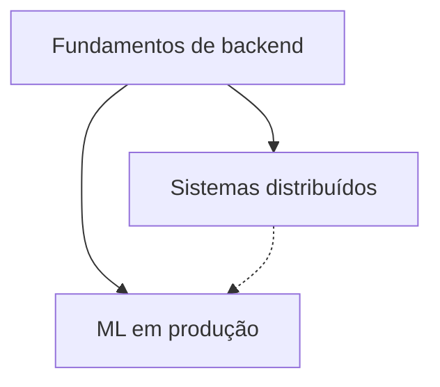

# Trilhas de estudo

> [!WARNING] Em construção
> As trilhas serão fechadas na fase de integração, quando todas as páginas de capítulo existirem para serem linkadas. Abaixo, o desenho.

Uma trilha é uma sequência de páginas que atravessa livros. Cada passo diz o que ler e o que você precisa ter entendido antes de seguir.

## 1. Fundamentos de backend
Clean Architecture → DDD (Partes I–III) → Fundamentals of Software Architecture (Parte I) → DDIA capítulos 1–4. Objetivo: saber organizar um sistema e entender o que o banco de dados faz por você.

## 2. Sistemas distribuídos
DDIA capítulos 5–12 → Fundamentals of Software Architecture (Parte II) → System Design Interview. Objetivo: projetar sistemas que escalam e sobrevivem a falhas.

## 3. ML em produção
Deep Learning (Parte I e capítulos 6–8) → Designing Machine Learning Systems. Objetivo: entender o que há dentro de um modelo e o que é preciso para mantê-lo funcionando em produção.
